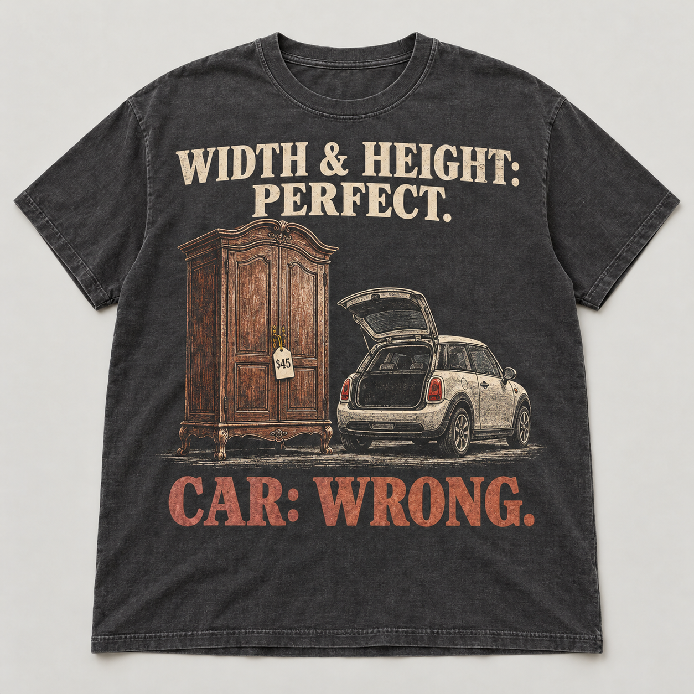
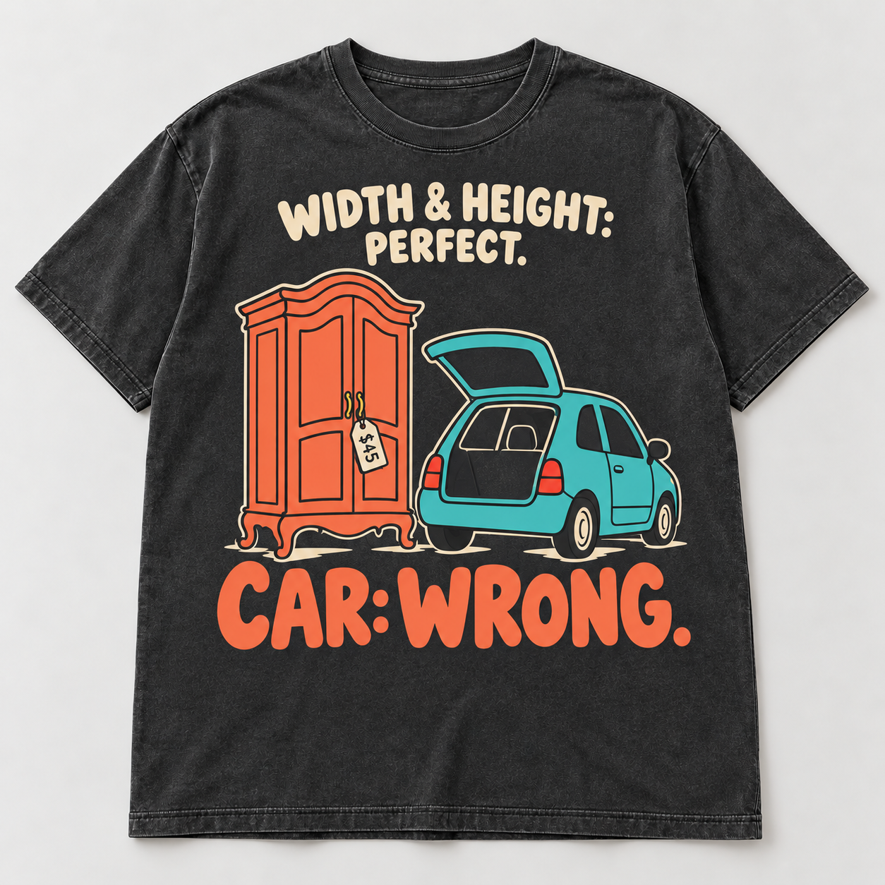

# CAR: WRONG — two contrasting family applications

Creative Director · October 20, 2026 · Original review mockups, pending Founder feedback.

This round tests whether the [220-reference discovery](../../discovery-01/README.md) produces usable design guidance. The same concept is executed through two contrasting provisional families. These are original text-guided generations; no seller artwork was supplied to the generator.

| Version | Family | Review status |
|---|---|---|
| **A — Heritage** | [DLF-003 Heritage illustrated emblem](../../discovery-01/families/DLF-003.md) | First execution retained for comparison |
| **B — Playful, revised** | [DLF-004 Playful lettering and illustration interlock](../../discovery-01/families/DLF-004.md) | Revised after Creative Director self-review; initial attempt preserved |

## A — Heritage

## B — Playful, revised

[Side-by-side and thumbnail check](assets/comparison.jpg) · [Frozen assessment](assessment.md) · [Initial playful attempt](assets/B-initial.png).

## Fixed brief and controlled choices

- Audience: R012 antique/vintage treasure hunters.
- Material: R012-E007 transport constraints. The documented source episode concerns a thrift-shop hat rack and a truck; **the cabinet, hatchback, $45 tag and their staging here are invented visual adaptation**, not new audience evidence.
- Creative concept: HEIGHT: PERFECT. WIDTH: PERFECT. CAR: WRONG. Mechanism: TRM-002. This round uses the Founder-approved combined setup, **WIDTH & HEIGHT: PERFECT.**, followed by **CAR: WRONG.** Width and height receive equal treatment within the same phrase.
- Both versions use a charcoal, relaxed crew-neck front, a prominent antique cabinet outside an undersized car with an open rear hatch, and the same copy and price-tag cue. No unrelated ornament or explanatory paragraph is added.
- Family-specific differences: engraved detail / serif lettering / cream-rust versus simplified flat illustration / rounded lettering / cream-coral-turquoise. These are deliberate joint treatments, not a clean causal test of a single variable.

The curved cabinet silhouette, paneled doors, carved feet and hanging tag supply vintage-shopping context. The open trunk and relative scale supply the transport problem. The tag is a supporting cue; its tiny price need not be read for the joke. The copy supplies setup and verdict. No essential job is assigned only to a tiny decorative icon.

## What was corrected before review

The [first playful execution](assets/B-initial.png) retained intricate engraved automobile/cabinet detail and made PERFECT highly prominent. It changed palette and type more successfully than illustration language. The revision simplified the objects, reduced the setup's weight and gave the payoff stronger hierarchy. Both the initial file and the exact revision prompt are preserved.

The revised result still uses a relatively orderly setup/image/payoff arrangement. It demonstrates the family's friendly stroke, palette and scale relationships more strongly than its most interwoven letter/object arrangements. This is partial transfer evidence, not proof that all essential/flexible boundaries are settled.

## Garment and scale limits

The generator produced larger prints than the original approximate 65%-of-torso-width brief. Visual estimates from the outputs are roughly **75–80% of visible torso width** for A and revised B; the initial B is broader still. These are coarse screen estimates at print level, not physical inches. A's illustration is more finely detailed and its rust payoff less bright; B's flatter colored forms survive reduction more clearly. The same washed-looking blank helps comparison, but its actual availability, fabric and print behavior are unverified.

The [comparison sheet](assets/comparison.jpg) includes approximately 230-pixel whole-shirt thumbnails. This checks digital reduction, not actual 3-foot/10-foot viewing or unprompted customer comprehension. All outputs are raster garment mockups; they are not separated artwork, print-ready files or production samples. Worn-body fit and waistband interaction have not been tested.

## Reproduction and provenance

- [Initial prompts](prompts.json), saved before generation.
- [Revision prompt](revision-B-prompt.txt), used with the initial B image as the sole edit reference.
- [Asset manifest](asset-manifest.json): exact original generated PNGs, dimensions and SHA-256 hashes. The comparison sheet is a labeled research derivative, not a new design.
- Tool: built-in imagegen. Original generation files were copied intact into this package. No seller's distinctive artwork was edited or traced.

No new Founder feedback has been received on these outputs when the assessment was frozen. Feedback belongs in a dated appended section or separate review, preserving original judgments and assets. A positive internal review does not establish customer willingness to pay or successful transfer to a different identity group.
