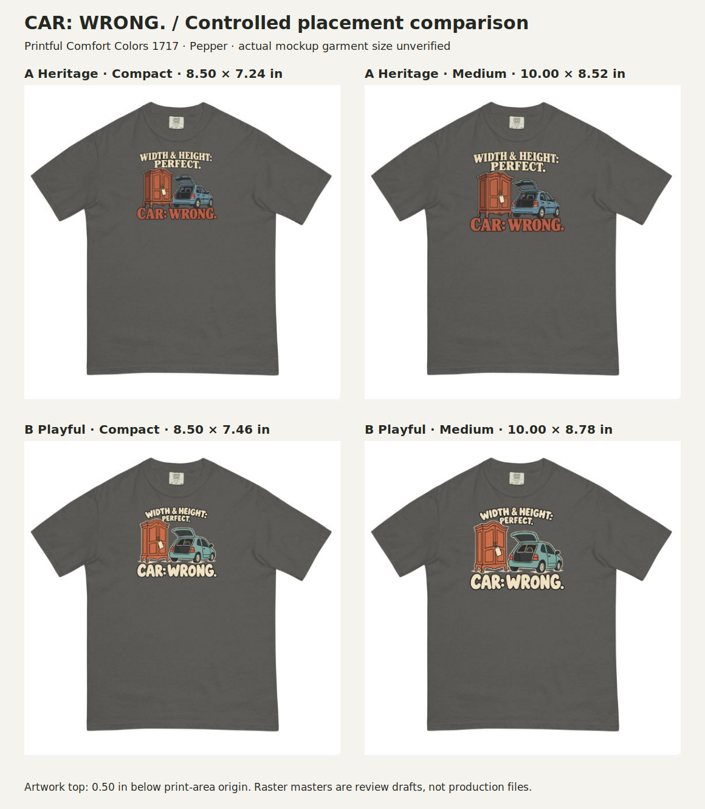
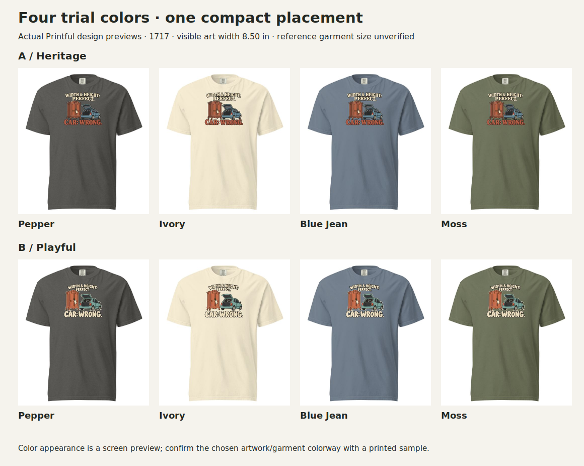

# CAR: WRONG — round 03: measured garment placement

Creative Director working revision · October 21, 2026 · Review drafts, not production files.

This round implements Founder feedback on [round 02](../CAR-WRONG-02/README.md): reduce the footprint; combine Heritage typography with simpler, generic-car graphics; mute Playful colors; and control placement separately from image generation. Both designs remain on Comfort Colors 1717 because neither has a meaningful conflict with its relaxed, garment-dyed character.

**Recommended for Founder review:** compact 8.5″ footprint; A Heritage on **Ivory or Pepper**; B Playful on **Pepper or Moss**. Medium remains available to compare recognition and scale. These are proposed colorways, not four retail options.

The boards arrange unaltered regions of the saved provider screenshots. Printful's flat and draped previews use different presentation geometry; compare footprints within the first board and colors within the second. The provider has not identified the actual photographed reference size.

## What changed

- **A / DLF-003 Heritage:** slab/serif lettering, a tagged antique cabinet, and a generic small hatchback with its hatch open. No Mini Cooper styling. The rendering is simpler than round 02, although its remaining fine details and gradients still need production cleanup.
- **B / DLF-004 Playful:** rounded lettering, simplified objects and muted clay/teal/cream colors. Width and height share the same setup line and visual weight.
- Transparent artwork is laid out independently in a **12 × 16 inch** front-print canvas. Compact and medium refer to the visible design, not transparent padding.

The cabinet/hatchback scene is an invented visual adaptation of transport-constraint material R012-E007; it is not a new audience-evidence claim. Concept: TRM-002, “WIDTH & HEIGHT: PERFECT. / CAR: WRONG.”

## Measured placements

| Design | Trial | Visible width | Visible height | Left from print-area origin | Top from print-area origin |
|---|---|---:|---:|---:|---:|
| A Heritage | Compact | 8.50″ | 7.24″ | 1.75″ | 0.50″ |
| A Heritage | Medium | 10.00″ | 8.52″ | 1.00″ | 0.50″ |
| B Playful | Compact | 8.50″ | 7.46″ | 1.75″ | 0.50″ |
| B Playful | Medium | 10.00″ | 8.78″ | 1.00″ | 0.50″ |

These dimensions are design decisions for this application, not universal recipe requirements. The top anchor is the **provider print-area origin**, not the neckline. A garment-relative neckline offset has not been independently verified.

[Exact specs](layout-specs.json) record visible bounds and native effective resolution. [Layout builder](build_layouts.py) embeds unchanged artwork in an SVG layout and renders a transparent PNG. A viewBox excludes near-invisible peripheral generation noise using an alpha ≥16 bounding box; this does not remove interior semitransparency or create extra image detail.

## Provider verification and size limits

On October 21, the live [Printful 1717 DTG guidelines](https://www.printful.com/custom/brands/comfort-colors/unisex-garment-dyed-heavyweight-shirt-comfort-colors-1717) listed the same **12 × 16 inch** front area for all sizes. The editor retained a 12 × 16 inch canvas after separately selecting S, L and 2XL with A-medium. This verifies retained editor dimensions; it does not prove that three different garment photographs were rendered.

[Printful's scaling explanation](https://help.printful.com/hc/en-us/articles/50264397552657-How-is-my-design-scaled-for-different-garment-sizes) says most garments retain print dimensions, with exceptions where smaller sizes have a reduced print area. Some exceptions scale even already-small artwork. No reduced-size area was listed for 1717 in this check. The generic product-page footnote about scaling is less specific, so verify the final order/template behavior before production.

**Mockup reference size remains unverified.** Use the provider preview as the provider preview; do not relabel it L, or claim an S/L/2XL visual fit test merely because those sizes were selected. Our previous arbitrary L reference is superseded by the Founder's instruction to match the actual provider template/mockup when verified.

The supplier measurements shown in Printful's size guide permit this separate dimensional check:

| Garment size | Flat width | Length from high-point shoulder | 8.5″ art / flat width | 10″ art / flat width |
|---|---:|---:|---:|---:|
| S | 18.25″ | 26.625″ | 46.6% | 54.8% |
| L | 22.00″ | 29.375″ | 38.6% | 45.5% |
| 2XL | 26.00″ | 31.625″ | 32.7% | 38.5% |

These are calculations from nominal flat-garment dimensions, not body measurements or simulated drape. The guide allows measurement variation up to 2 inches. Neither placement exceeds the listed print area; the medium needs particular visual review on S, while compact appears proportionally quieter on 2XL.

## Production status

The generated masters are about 1,200 pixels wide within their visible bounds. Their effective native resolution ranges from **117–144 ppi** across these trials. The layout PNGs are 1,800 × 2,400, and Printful labels those canvases “Good / 150 DPI,” but that label does **not** recover missing native detail. These are review mockups only.

Before production: rebuild/clean the approved artwork at adequate native resolution (preferably editable vector shapes and lettering), remove stray/translucent edge artifacts, simplify fine lines and unintended gradients, verify the final provider size behavior/reference geometry, and inspect a printed sample. No product was published and no order was placed in this round.

## Files

- `assets/`: unaltered generated transparent artwork drafts.
- `layouts/`: compact/medium transparent print-canvas PNGs and reproducible SVG layouts.
- `evidence/`: provider screenshots and verification notes.
- `generation-prompts.json`: generation instructions; family/reference provenance remains in round 02.
- `assessment.md`: Creative Director's judgment, recorded before new Founder feedback.

Founder feedback received October 21: both placements too close to the collar; Heritage payoff too fat for the desired classic character; try a monotone object illustration; Playful visual treatment looks right. [Round04](../CAR-WRONG-04/README.md) preserves the feedback, the later preference for an arched Heritage setup, revised placement and new assessment. This historical package and its initial assessment remain unchanged as evidence of the prior execution. No family is promoted to purchase-validated status.
