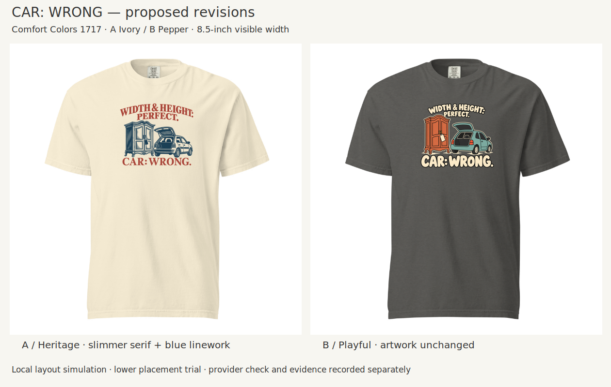
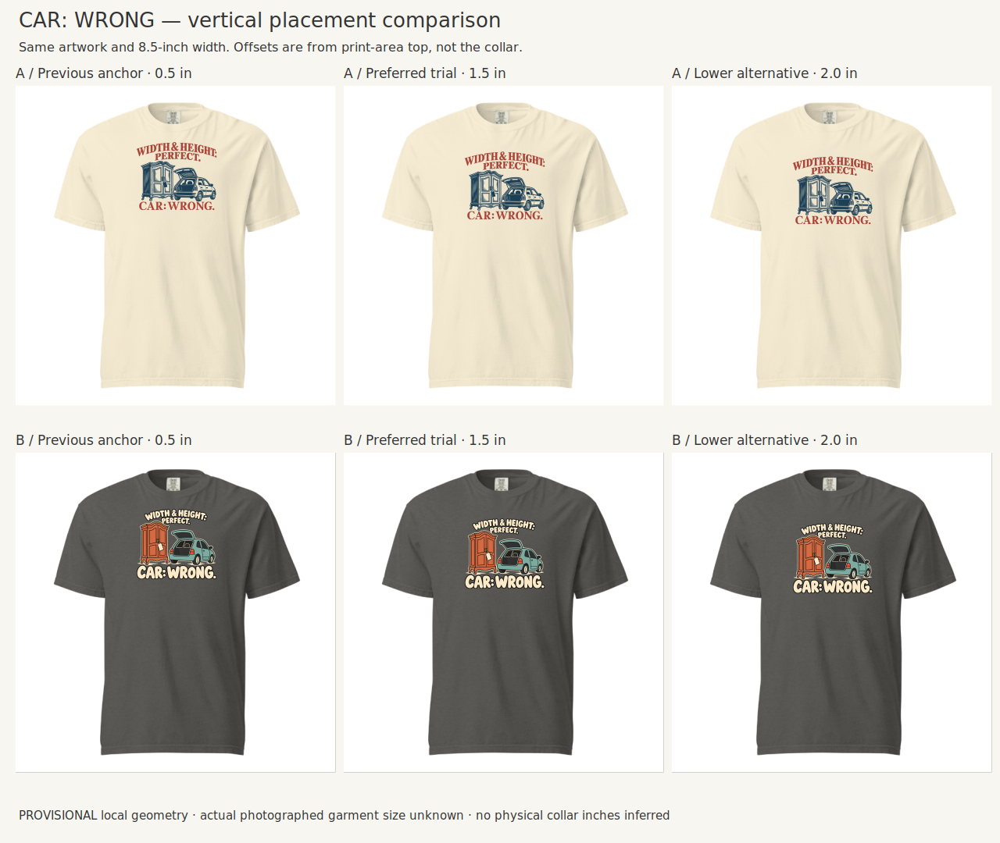
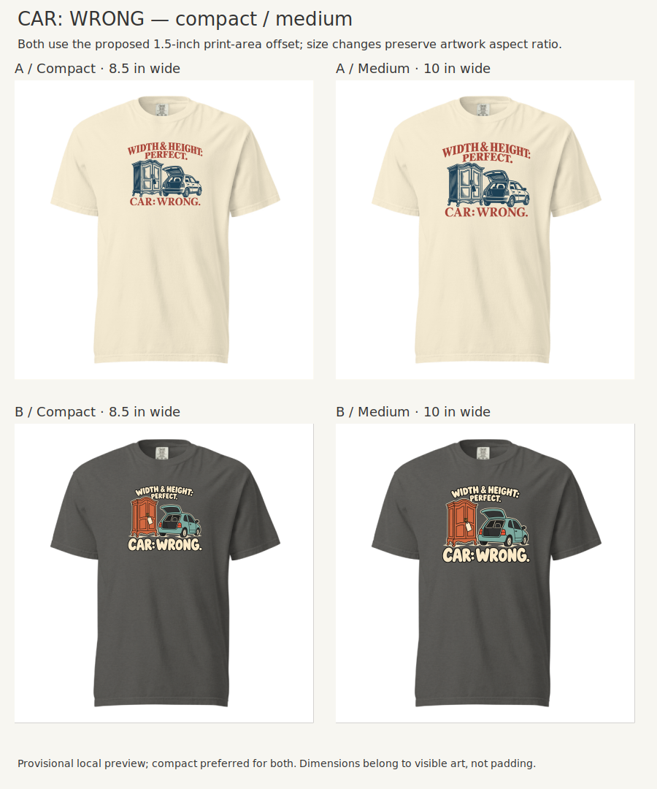
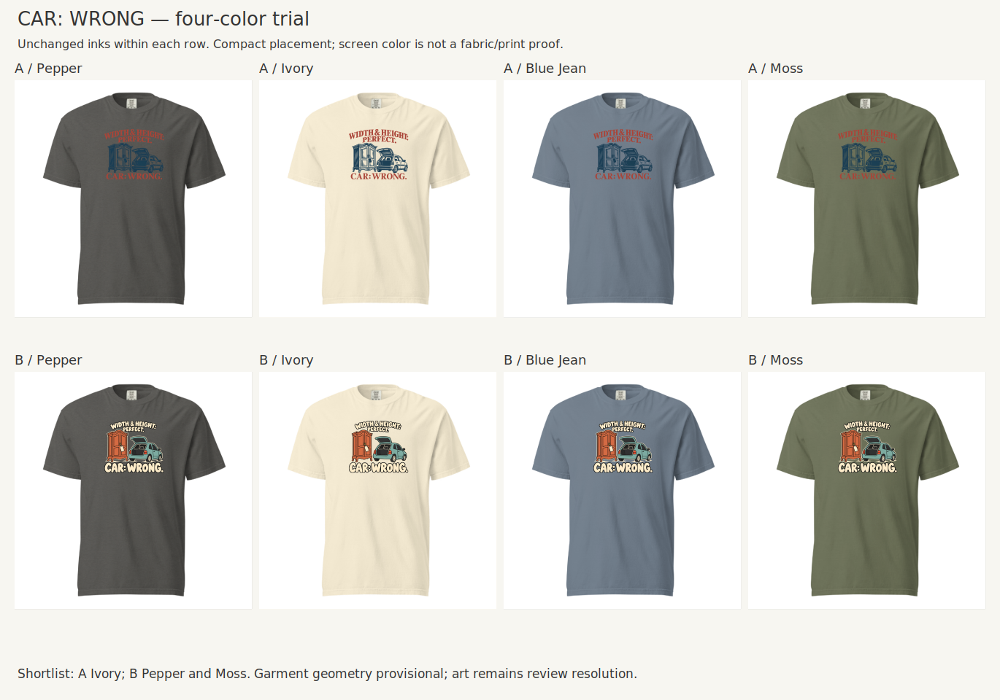

# CAR: WRONG — round04: collar clearance and Heritage emblem

Creative Director · October 21, 2026 · Review drafts; Founder review pending on the final pair below.

## Founder feedback and response

On round03, Founder found both designs too close to the collar, found Heritage’s “CAR: WRONG.” too fat to retain a classic feel, suggested a one-color object illustration using the supplied raccoon shirt as a style reference, and said Playful looks right. During this revision, Founder preferred the **first arched setup** over the straight-stack alternatives because it better delivered the Heritage emblem recipe. Preserve that preference together with the earlier lighter-type request.

The final Heritage trial restores the arch, retains a decorative antique cabinet and anonymous open-hatch car, uses slate-blue object illustration and terracotta-rose serif lettering, and opens the payoff’s serif forms. Playful’s artwork is byte-for-byte unchanged from round03. Both are lowered by one inch in print-canvas coordinates, at the same 8.5-inch visible width.

The pair above consists of uniformly scaled crops of the actual provider mockups. Full screenshots retain the provider context in [verification evidence](evidence/verification.md).

The second board is a **local layout simulation**, using cached Printful blank preview layers and their observed color backgrounds. The artwork transform is estimated from the provider’s round03 design preview. It is not a calibrated physical garment model. Actual provider screenshots are retained in [verification evidence](evidence/verification.md).

## Selected execution

| Design | Family | Blank and proposed colors | Visible footprint | Left / top from print-area origin |
|---|---|---|---|---|
| A Heritage | DLF-003 | Comfort Colors 1717, **Ivory only** | 8.50 × 7.21 inches | 1.75 / 1.50 inches |
| B Playful | DLF-004 | Comfort Colors 1717, **Pepper; Moss alternative** | 8.50 × 7.46 inches | 1.75 / 1.50 inches |

The top coordinate is **not a neckline measurement**. The previous top was 0.50 inches from the same print-area origin. Preserve the 12 × 16-inch transparent canvas and full aspect ratio. [Exact specifications](layout-specs.json) record dimensions, visible bounds and native effective resolution. Neither style conflicts with 1717’s garment-dyed finish; there is no reason to switch to 64000 for this application.

Material: R012-E007 transport constraint. Concept: TRM-002, “WIDTH & HEIGHT: PERFECT. / CAR: WRONG.” The cabinet/car scene is a creative adaptation, not a new audience-evidence claim.

## Controlled comparisons

Same artwork, width, garment and color; compare 0.5, 1.5 and 2.0-inch print-area offsets. The 1.5-inch trial gives the collar more breathing room while preserving a chest-centered composition. The lower alternative remains plausible; it is not objectively disqualified. The left Heritage example uses the **new artwork at the old anchor**, not the original round03 artwork.

The 8.5-inch footprint is preferred for both. The 10-inch Heritage trial is 8.48 inches tall; Playful is 8.78 inches tall. Medium gives detail more room but occupies more of the smaller sizes. Compact retains the essential mismatch, though tiny trim and the sale-tag interior are not reliably legible and must not carry the joke alone.

Ivory is the clear choice for this Heritage ink palette; Pepper, Blue Jean and Moss lose object/type separation. Do not offer a dark option merely to reach two colors. Playful retains Pepper and Moss: its cream type and muted object fills separate well. Its unchanged cream-filled type loses emphasis on Ivory.

## S/L/2XL and geometry

Reuse round03’s documented Printful 1717 size guide and retained 12 × 16-inch editor canvas; do not restart the same template investigation. Nominal flat widths are S 18.25, L 22 and 2XL 26 inches. An 8.5-inch print is respectively **46.6%, 38.6% and 32.7%** of those widths. It fits inside the listed print area at the new top offset; the selected bottom edges are 8.71 and 8.96 inches from its origin, well within 16 inches.

These are dimension checks, not verified worn previews for three sizes. The photographed reference size and physical collar-to-print-area geometry remain unknown. A selected L order control is not evidence that the photo is L. No automatic size scaling is invented. Final fulfillment behavior and sample placement still require confirmation before production.

## Judgment, learning and status

[Assessment](assessment.md) records the Creative Director’s judgment after the known Founder steering and before feedback on this final pair. [Placement study](../../studies/Front-Placement-01/README.md) and the [canonical workflow](../../Garment-and-Placement-Workflow.md) add an explicit collar-clearance and vertical-balance check.

The useful Heritage lesson is relational: the arch frames the object group, the restrained serif payoff anchors it, and a limited illustration palette unifies it. Switching to a straight stack or extremely sparse outline can change the family’s character even if the copy and objects stay the same. This feedback does not make arches mandatory or equate all bold type with poor heritage design.

Production cleanup remains necessary: simplify the remaining narrow hatch marks, remove stray/translucent pixels, retain generous negative gaps, and rebuild editable type/art as needed. A’s selected native width is about 153 ppi; B’s is about 137 ppi. Rendered 150-DPI canvases do not improve native detail or guarantee printable linework. These are review assets, not approved production files. No product publication or order is part of this round.

## Reproduction

- `assets/`: selected transparent masters and comparison boards.
- `layouts/`: the two selected 12 × 16-inch PNGs; other trials are reproducible with `build_review.py`.
- `blanks/`: cached provider preview layers; use each with its recorded color background, not as interchangeable opaque images.
- `build_review.py` and `layout-specs.json`: measured placement and local comparisons. Pillow reads bounds only; SVG/CairoSVG handles layout without changing source illustration pixels.
- `generation-prompts.json`: iteration instructions and dispositions. The first arched candidate is preserved as `assets/A-first-arched-study.png` because it explains the Founder’s selection.
- `evidence/`: provider verification screenshots and limits.

The source style reference is [DLS-ETSY-022](../../sourcing/expanded-scan/records/DLS-ETSY-022.md). Its blue illustration/rose lettering informed palette and rendering; its distinctive raccoon and wording were not copied.
