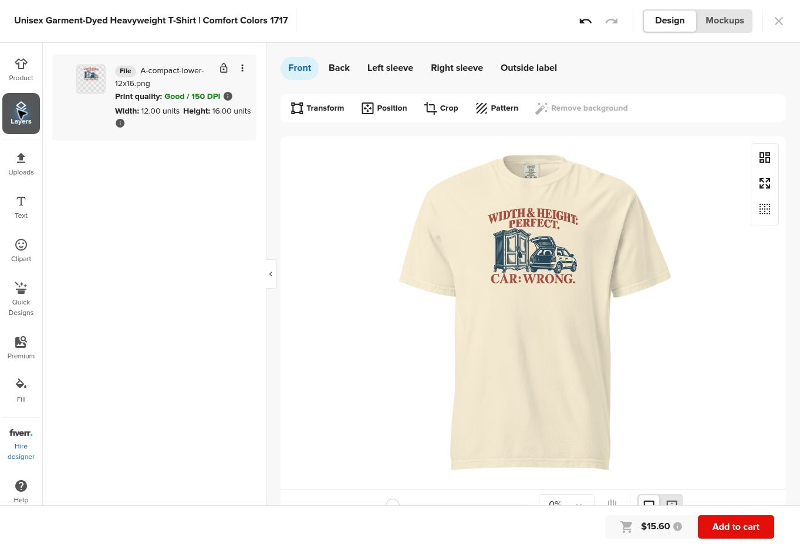
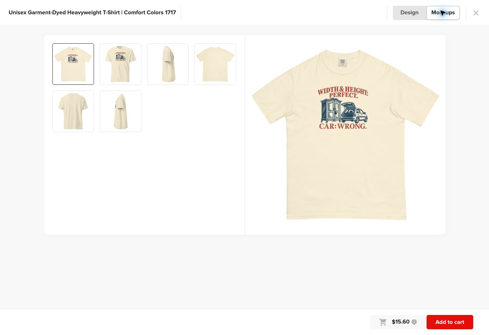
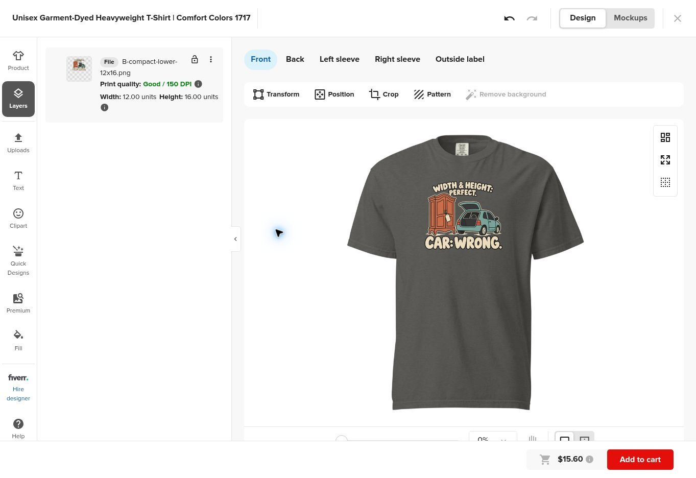
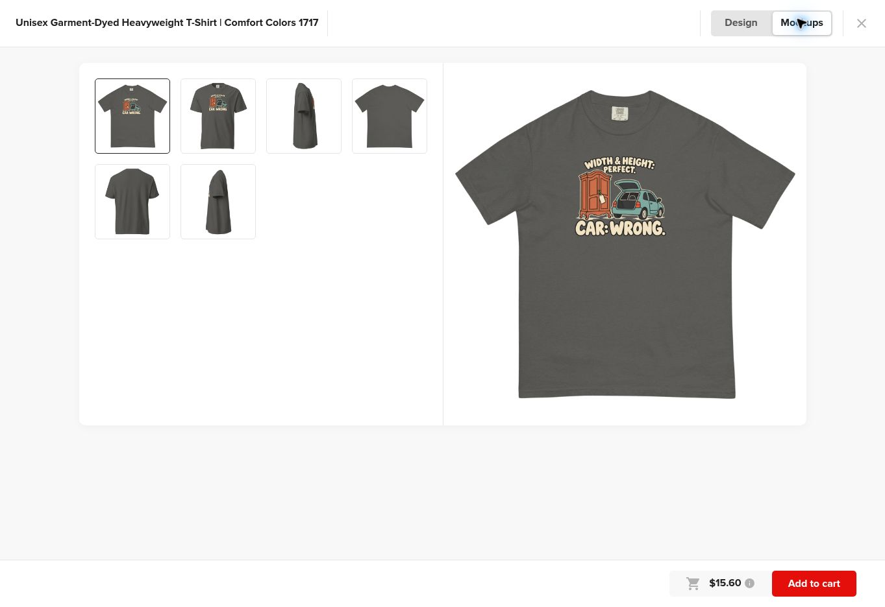
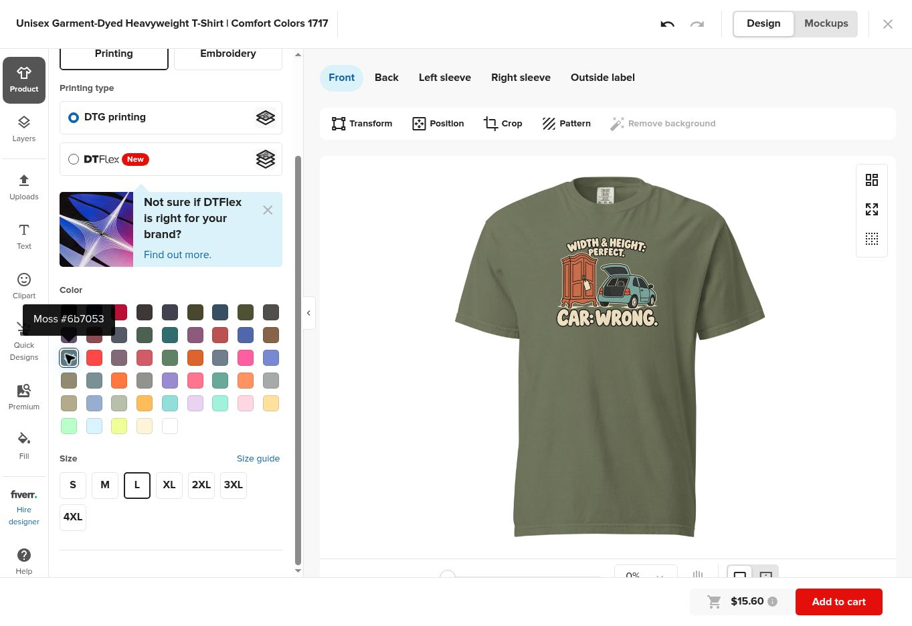
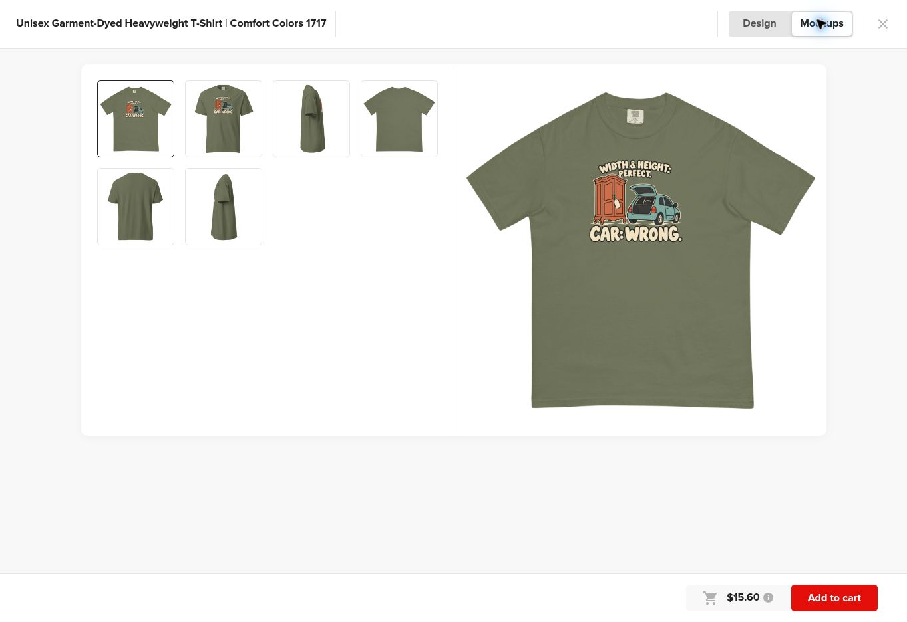

# Provider verification — round04

October 21, 2026. Printful public Comfort Colors 1717 Design Maker, DTG, front placement. No product was published or ordered.

Two shortlisted transparent 1800 × 2400 PNGs were uploaded:

- A-compact-lower-12x16.png — file ID 1091307745.
- B-compact-lower-12x16.png — file ID 1091307742.

The files contain the complete visible art at 8.5 inches wide, centered horizontally, with its top 1.5 inches below the print-canvas origin. This is a one-inch downward shift from round03. The canvas is still 12 × 16 inches. Transparent padding is intentional and must be retained; the layer’s 12 × 16 dimensions describe the canvas, not the ink footprint.

## Evidence

Both selected layers retained **12.00 × 16.00** canvas dimensions in the editor. A was checked on Ivory; B on Pepper and Moss. Their visible widths and top positions are defined by the preserved transparent files, whose canvas dimensions remained unchanged on upload.

The new flat Pepper mockup shows roughly 34 image pixels from the lower outer collar rib to the highest ink, over roughly 333 pixels of torso width: about 10%, versus about 6% in round03. This is an approximate image measurement, not a physical collar distance. The purpose of the comparison is to verify that the placement actually moved and now leaves more space. Both flat and draped presentations should be reviewed; they do not share a verified physical geometry.

The final source files and all three proposed colorway previews were visually inspected. No clipping was observed in the selected visible composition. This is preview verification, not a printed-fidelity pass.

## Reused evidence and limits

Round03 already recorded S/L/2XL retaining the 12 × 16-inch editor canvas, provider size-chart dimensions and the discrepancy between generic scaling language and the listed all-size print area. Those checks are reused because the blank, print method and canvas have not changed. No new garment-size or fulfillment claim is made. The reference photograph’s size remains unknown.

Cached blank layers were obtained from the visible blank-preview image, with the displayed color background where applicable: Pepper #514f4c, Ivory #fff4d9, Blue Jean #707e8d, Moss #6b7053. Their color/opacity handling differs, so each is kept separately. Local placement uses a visual transform estimated from the round03 draped editor preview: at 602 × 602 image pixels, center x≈303, print origin y≈97, scale≈17.8 pixels per artwork inch. This is a preview-matching convenience, **not physical garment calibration**.

The editor’s Good / 150 DPI badge describes the exported canvas. Native source detail, narrow hatching, edge translucency, actual color and physical placement require independent production cleanup and sample review. A has about 153 native ppi at the selected footprint; B about 137. The limited-color intention is not a verified two-spot-color separation.
