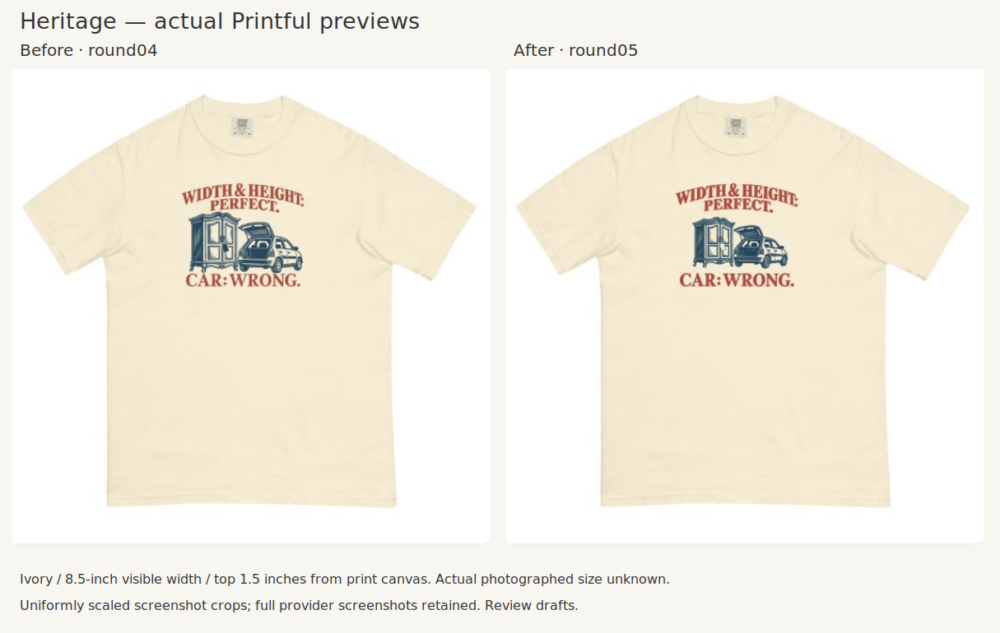
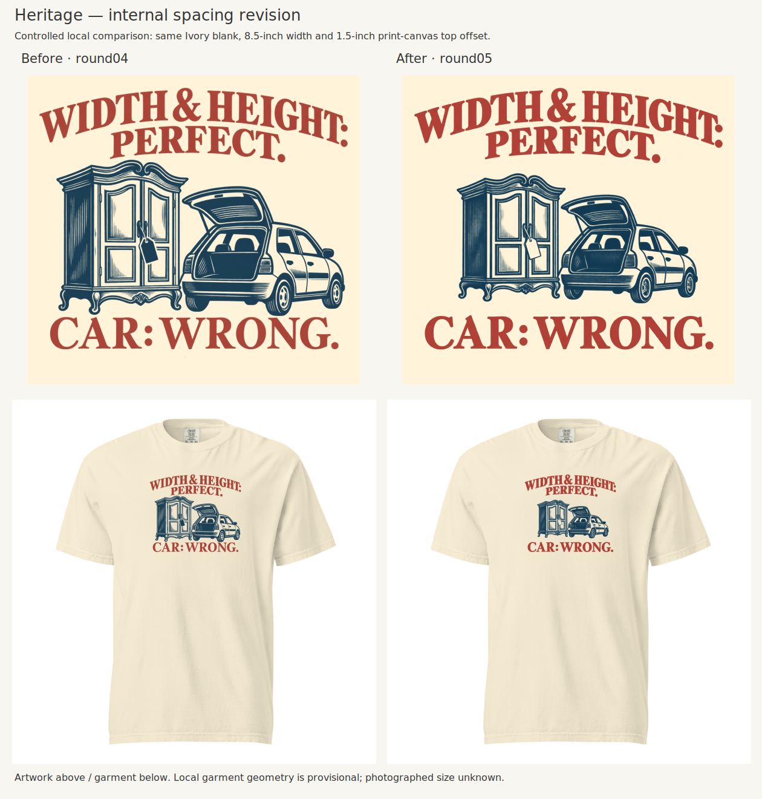
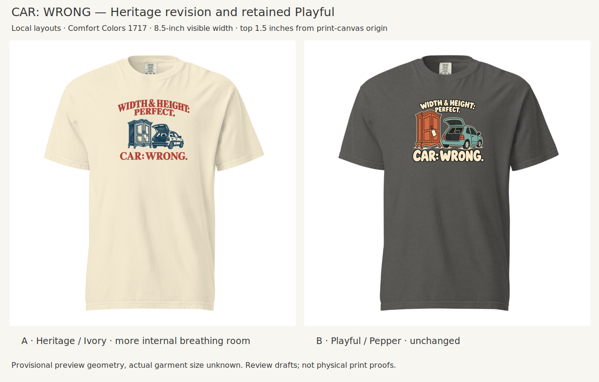

# CAR: WRONG — round05: Heritage breathing room

Creative Director · October 21, 2026 (America/Chicago) · Artwork revision for Founder review; not production-approved.

## What changed

Founder approved the [review principles and spacing diagnosis](../../reviews/2026-10-21-CAR-WRONG-Spacing.md) and requested documentation before this revision. The Playbook, methodology and controlled-placement workflow now preserve a family-sensitive critique of visual relationships, two-scale inspection, relevant reference comparison and paired visual learning.

Heritage's object group is smaller within the composition, opening the gaps below PERFECT and above CAR: WRONG. The arch, classic serif direction, slate-blue objects, muted rose lettering, Ivory blank and 8.5-inch overall width are retained. The first generated edit made the payoff too heavy; the Creative Director rejected it and selected the second edit. This is an image-generated revision, not a pixel-identical repositioning: minor letterform and linework differences remain.

The provider comparison uses uniformly scaled crops of retained screenshots. [Full verification evidence](evidence/verification.md) preserves context and limits. The revised canvas was applied and visually checked successfully after one page refresh resolved the upload-panel loading issue.

The comparison holds the blank, color, print width, top anchor and local garment transform constant. It is a local layout simulation, not a new pair of provider mockups. The Ivory panel behind the enlarged artwork represents garment color; the actual master has transparency.

Playful's source artwork remains unchanged from [round04](../CAR-WRONG-04/README.md), on Pepper with Moss retained as its alternative. Its accepted density is preserved rather than applying Heritage's spacing change indiscriminately.

## Selected specification

| Item | Round05 Heritage |
|---|---|
| Audience / material / concept | R012 antique/vintage treasure hunters; transport constraint; WIDTH & HEIGHT: PERFECT. / CAR: WRONG. |
| Family | DLF-003 Heritage illustrated emblem |
| Blank / color | Comfort Colors 1717 / Ivory |
| Visible composition | 8.50 × 7.2113 inches; round04 was 8.50 × 7.2074 inches |
| Position | Left 1.75 inches, top 1.50 inches from the 12 × 16-inch print-canvas origin |
| Collar relationship | Existing lower-placement convention retained; physical neckline inches unverified |
| Reference garment size | Actual photographed size unknown; local geometry provisional |
| Native effective resolution | Approximately 153.6 pixels per visible inch; export is 1800 × 2400 pixels |
| Review status | Selected by Creative Director for Founder review; detailed production cleanup and sample evaluation outstanding |

The near-identical total height is deliberate: more internal air without enlarging the garment footprint. The exact artwork dimensions do not establish physical fulfillment scale. Reuse round04's four-color decision and prior S/L/2XL evidence because the blank, color and overall dimensions remain essentially the same. At nominal flat widths S 18.25, L 22 and 2XL 26 inches, an 8.5-inch print remains approximately 46.6%, 38.6% and 32.7% of width. These are size-chart calculations, not verified size-specific mockups or a guarantee of provider scaling. The smaller illustration's fine detail remains a production consideration.

## Review files

- [Selected transparent master, v2](assets/A-heritage-spacing-v2.png)
- [Rejected first edit, v1](assets/A-heritage-spacing-v1.png) — retained to show the type-weight issue caught during self-review
- [Measured upload canvas](layouts/A-heritage-spaced-12x16.png) and [layout specification](layout-specs.json)
- [Frozen Creative Director assessment](assessment.md)
- [Provider verification and evidence](evidence/verification.md)
- [Exact built-in image-generation prompts](generation-prompts.json)
- [Reproducible measured-layout script](build_review.py)

Run `python build_review.py` from a complete checkout with Pillow and CairoSVG installed. It uses the retained round04 blank/masters and selected round05 v2 by default. The SVG layout preserves source artwork; it does not redraw the illustration or typography. Generated SVG intermediates are reproducible and are not duplicated in the repository.

## What Founder should review

Does the new separation feel composed while keeping the object group prominent and the whole emblem connected? The [assessment](assessment.md) records the Creative Director's answer before feedback. This package does not reopen Playful's accepted treatment or turn this spacing choice into a universal family rule.

## Limits

This is an aesthetic revision. Fine hatching, transparency edges and native detail still need production cleanup. A provider preview or DPI badge does not establish printed fidelity. Physical garment geometry and a sample remain outstanding. No product was published and no order placed.
