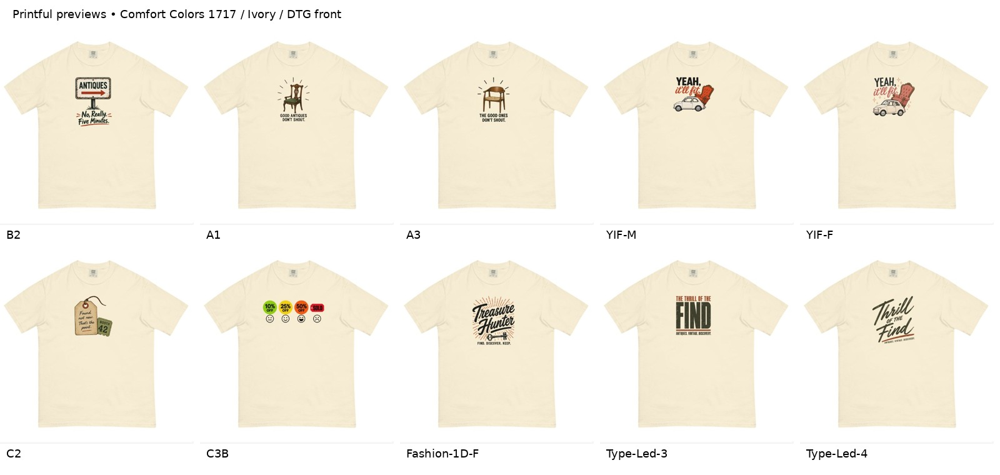

# MVV-PRINTFUL-01 — unbranded production review

October 21, 2026 · Status: garment/color/layout review complete; derivative artwork review and production release pending.

This is the exact ten-design MVV assortment from [MVV-001-LP-Assortment-Manifest](../../../../mvv/worth-the-detour/MVV-001-LP-Assortment-Manifest.md). Original locked images remain unchanged. The new transparent artwork is reconstructed from those flattened sources and must be reviewed as a derivative.

## Decisions and checks

- Comfort Colors 1717, Ivory, front DTG for all ten; approved color direction retained.
- No Worth the Detour name, WD initials or business logo on any printed placement. Fashion-1D-F loses WD and its lines; Type-Led-3/4 replace the brand sentence with **ANTIQUES. VINTAGE. DISCOVERY.** and omit the compass star. Optional A1/A3 neck marks are excluded.
- Each selected footprint was compared with an 85%-width alternative. The selected layouts fit the current 12 × 16-inch area with native resolution at least 150 PPI.
- All ten uploaded files displayed **Good / 150 DPI**, and actual Printful previews were inspected. [Layer evidence](evidence/layer-checks.json), [provider setup and sources](evidence/provider-setup.md), [size guide](evidence/size-chart.txt).
- S/L/2XL are checked through nominal width ratios and current provider guidance. They are not three photographed sample sizes. See the fixed-inch working inference and limitations in the provider evidence.

## Measured layouts

Visible bounds use alpha ≥16; left/top are inches from the print-area origin, **not from the neckline**. Files are sRGB 1800 × 2400 transparent PNG canvases at 150 DPI. Native PPI is measured before layout resampling.

| Design | Visible W × H (in) | Left / top (in) | Native PPI | Width % S / L / 2XL | Review |
|---|---:|---:|---:|---|---|
| B2 | 6.25 × 8.41 | 2.875 / 1.50 | 155.20 | 34.2 / 28.4 / 24.0 | [Source comparison](assets/B2-comparison.jpg) · [Footprints](assets/B2-footprints.jpg) · [Printful](evidence/B2-provider.jpg) |
| A1 | 5.50 × 7.54 | 3.250 / 1.50 | 169.09 | 30.1 / 25.0 / 21.2 | [Source comparison](assets/A1-comparison.jpg) · [Footprints](assets/A1-footprints.jpg) · [Printful](evidence/A1-provider.jpg) |
| A3 | 5.50 × 7.62 | 3.250 / 1.50 | 170.36 | 30.1 / 25.0 / 21.2 | [Source comparison](assets/A3-comparison.jpg) · [Footprints](assets/A3-footprints.jpg) · [Printful](evidence/A3-provider.jpg) |
| YIF-M | 7.00 × 5.88 | 2.500 / 1.50 | 178.00 | 38.4 / 31.8 / 26.9 | [Source comparison](assets/YIF-M-comparison.jpg) · [Footprints](assets/YIF-M-footprints.jpg) · [Printful](evidence/YIF-M-provider.jpg) |
| YIF-F | 7.25 × 6.70 | 2.375 / 1.50 | 162.48 | 39.7 / 33.0 / 27.9 | [Source comparison](assets/YIF-F-comparison.jpg) · [Footprints](assets/YIF-F-footprints.jpg) · [Printful](evidence/YIF-F-provider.jpg) |
| C2 | 6.50 × 6.95 | 2.750 / 1.50 | 168.00 | 35.6 / 29.5 / 25.0 | [Source comparison](assets/C2-comparison.jpg) · [Footprints](assets/C2-footprints.jpg) · [Printful](evidence/C2-provider.jpg) |
| C3B | 10.50 × 3.81 | 0.750 / 2.25 | 166.29 | 57.5 / 47.7 / 40.4 | [Source comparison](assets/C3B-comparison.jpg) · [Footprints](assets/C3B-footprints.jpg) · [Printful](evidence/C3B-provider.jpg) |
| Fashion-1D-F | 7.25 × 8.34 | 2.375 / 1.50 | 155.17 | 39.7 / 33.0 / 27.9 | [Source comparison](assets/Fashion-1D-F-comparison.jpg) · [Footprints](assets/Fashion-1D-F-footprints.jpg) · [Printful](evidence/Fashion-1D-F-provider.jpg) |
| Type-Led-3 | 6.00 × 6.76 | 3.000 / 1.50 | 171.33 | 32.9 / 27.3 / 23.1 | [Source comparison](assets/Type-Led-3-comparison.jpg) · [Footprints](assets/Type-Led-3-footprints.jpg) · [Printful](evidence/Type-Led-3-provider.jpg) |
| Type-Led-4 | 7.25 × 8.17 | 2.375 / 1.50 | 151.86 | 39.7 / 33.0 / 27.9 | [Source comparison](assets/Type-Led-4-comparison.jpg) · [Footprints](assets/Type-Led-4-footprints.jpg) · [Printful](evidence/Type-Led-4-provider.jpg) |

## Review and production limits

Review the three branding replacements, reconstruction fidelity across all ten, and the measured footprints. The source comparisons show the archived board alongside the proposed garment view. Font files were not available; generated lettering is not a verified font match. Local shirt views are provisional geometry; provider screenshots supply the additional provider check.

The independent [assessment](assessment.md) is preserved with [SHA-256](assessment.sha256) before feedback. Record founder feedback in [founder-feedback.md](founder-feedback.md), without rewriting the frozen assessment.

**These files are not yet production-certified.** The generated masters contain partially transparent edge/distress pixels. No alpha repair was applied. Printful's resolution pass does not certify opacity or small-detail retention. Resolve opacity treatment and sample the print before final production release. No order, store publication, lock replacement or merge is part of this review package.

## Reproduction and provenance

`prompts.json` retains the generation prompts; `assets/*-v1.png` are the returned transparent masters. `build_review.py` measures the visible bounds and creates padded layouts and local views; `build_comparisons.py` and `build_footprints.py` create the review boards. These scripts crop, resample and composite; they do not repaint artwork or repair alpha. `layout-specs.json` records geometry and SHA-256 hashes. Full provider screenshots are in `evidence/`.

The working branch was based on main commit 9538690a7c2cead93858e216a291c8bec1d02f47. This application does not change the earlier approved T-E-A, T-E-B or N-A designs.
