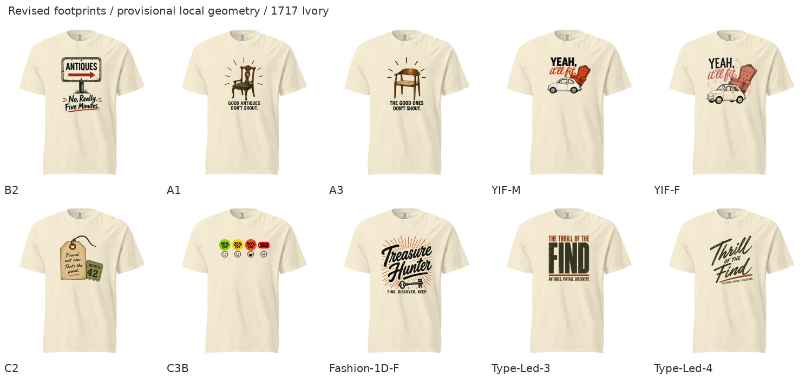

# MVV-PRINTFUL-02 — larger, slightly lower placements

October 23, 2026 · Revision of all ten designs in PR142 · Local layout review complete; fresh Printful preview check pending.

## What changed

- Lower every composition by **0.5 inches** from round01.
- Enlarge seven standard designs to a composition-specific **medium** footprint (8–9 inches wide).
- Give **YIF-F and Fashion-1D-F large footprints** (10.5 inches wide).
- Retain **C3B at 10.5 inches wide**, with only the downward shift.
- Reuse the exact unbranded round01 artwork, Ivory color and Comfort Colors 1717 blank. No art regeneration or new copy changes.

The before/after boards hold the local shirt presentation constant. The prior round01 actual Printful mockup and this provisional local mockup have different garment presentations; do not compare their pixel sizes directly.

## Dimensions and review links

Top positions are from the **print-area origin**, not the neckline. Aspect ratios are preserved. All files use a 12 × 16-inch transparent sRGB canvas.

| Design | Previous width | Revised W × H (in) | Top (in) | Footprint | Comparison |
|---|---:|---:|---:|---|---|
| B2 | 6.25 | 8.5 × 11.44 | 2 | medium | [Before / after](assets/B2-before-after.jpg) |
| A1 | 5.5 | 8 × 10.97 | 2 | medium | [Before / after](assets/A1-before-after.jpg) |
| A3 | 5.5 | 8 × 11.09 | 2 | medium | [Before / after](assets/A3-before-after.jpg) |
| YIF-M | 7 | 9 × 7.56 | 2 | medium | [Before / after](assets/YIF-M-before-after.jpg) |
| YIF-F | 7.25 | 10.5 × 9.70 | 2 | large | [Before / after](assets/YIF-F-before-after.jpg) |
| C2 | 6.5 | 9 × 9.63 | 2 | medium | [Before / after](assets/C2-before-after.jpg) |
| C3B | 10.5 | 10.5 × 3.81 | 2.75 | retained wide strip | [Before / after](assets/C3B-before-after.jpg) |
| Fashion-1D-F | 7.25 | 10.5 × 12.08 | 2 | large | [Before / after](assets/Fashion-1D-F-before-after.jpg) |
| Type-Led-3 | 6 | 8.5 × 9.57 | 2 | medium | [Before / after](assets/Type-Led-3-before-after.jpg) |
| Type-Led-4 | 7.25 | 9 × 10.14 | 2 | medium | [Before / after](assets/Type-Led-4-before-after.jpg) |

## Assessment and remaining checks

The [independent assessment](assessment.md) is frozen with [SHA-256](assessment.sha256). It records why the previous pass was too conservative and the tradeoffs in this revision. [Founder feedback](founder-feedback.md) remains separate. The existing [placement-reference study](../../studies/Front-Placement-01/README.md) and its actual images were reinspected.

**Fresh Printful previews are pending:** Founder approved the upload conditions on October 23. The subsequent browser connection and recovery calls both timed out before any terms acceptance or upload could be performed. Approval is recorded in founder-feedback.md; the remaining blocker is browser access. The round01 provider screenshots verify round01 only. The new layouts have been checked locally for boundaries, aspect ratio, visible size and position, and nominal S/L/2XL width proportions. They have not yet been applied in Printful.

**Production resolution:** nine enlargements have about 107–138 native PPI. The canvas is exported at 150 PPI for the placement preview, but resampling adds no detail. Higher-detail masters are needed before a production-quality pass; C3B retains 166 native PPI. Existing alpha and sample-print issues also remain. Preserve the larger visual targets when preparing production masters.

## Reproducibility

Run `python build_revision.py` from any working directory. It reads unchanged round01 masters and recorded visible bounds, applies the measured transform, writes layouts and local comparisons, and records hashes and S/L/2XL calculations in `layout-specs.json`. No artwork repainting or alpha cleanup is performed. Reusable local geometry remains provisional; actual generic mockup size is unknown.
