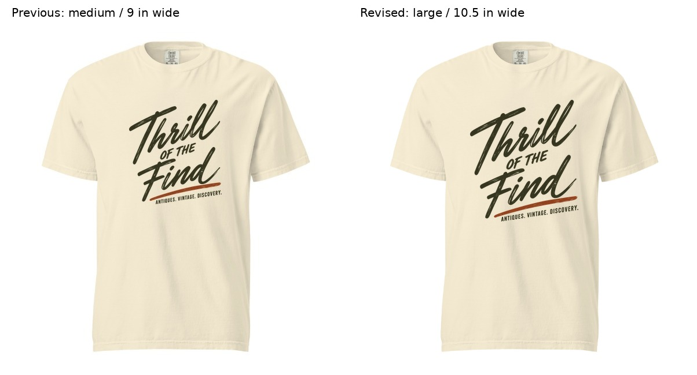
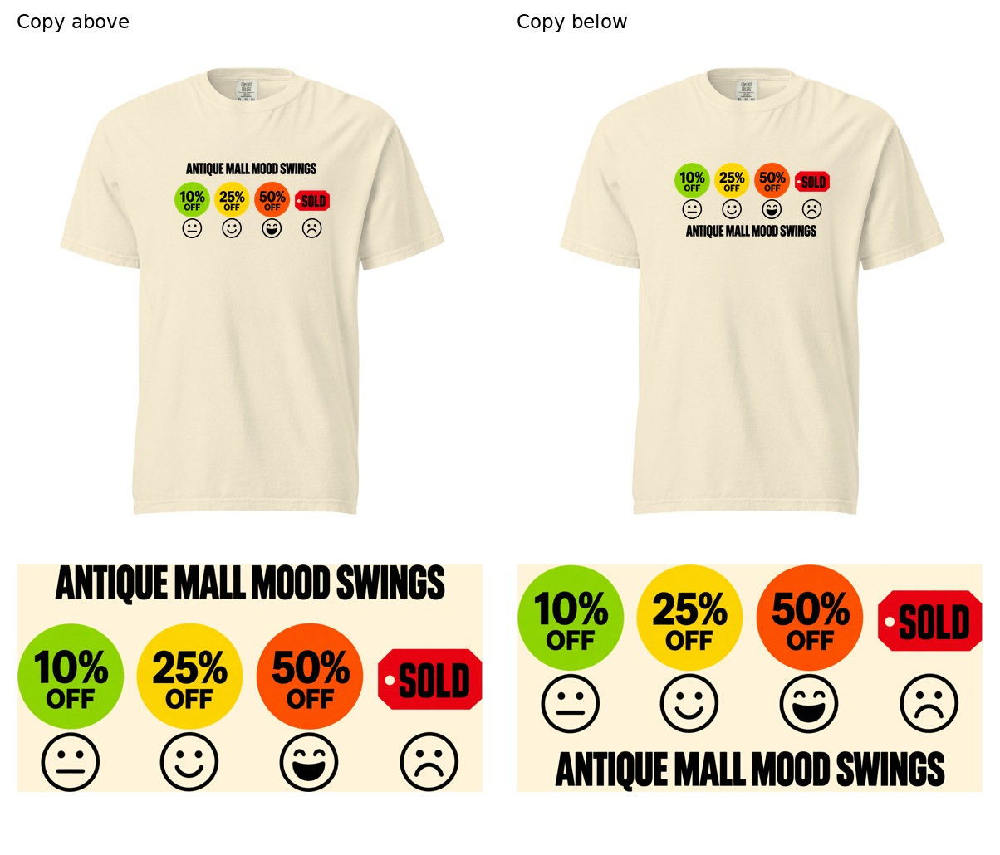

# MVV round03 — two focused revisions

October 23, 2026. Founder approved round02 for B2, A1, A3, YIF-M, YIF-F, C2, Fashion-1D-F and Type-Led-3. This is creative/layout approval, not production certification. Type-Led-4 and C3B remain revision targets. No merge authorization was given.

## Type-Led-4: large footprint

Founder clarified that this is also a female-oriented execution and requested large sizing. The unchanged artwork is now 10.5 × 11.84 inches, with top at 2 inches from the print-area origin. This retains round02's downward shift. Same Comfort Colors 1717, Ivory, front DTG.

Independent assessment before feedback on this revision: the larger script has stronger presence and matches the requested statement scale. The angled support line stays subordinate. The bottom edge sits farther down the torso, but remains comfortably above the hem in the provisional local view. No clipping in the 12 × 16-inch canvas. The unchanged source now provides about 105 native PPI; exported 150 PPI is resampling only. Higher-detail production artwork and existing opacity/sample checks remain unresolved. Fresh provider preview is pending.

Reproduce with `python build_type4.py`; exact geometry and hash are in Type-Led-4-spec.json.

## C3B: copy shortlist, before typography or placement work

The graphic shows increasing delight at 10%, 25% and 50% off, followed by disappointment at SOLD. The caption should identify the antique-mall setting while letting the faces deliver the punchline.

| Candidate | Judgment |
|---|---|
| **Antique Mall Mood Swings** | Recommended. Four words name the setting and connect directly to the changing faces. Funny without explaining the ending. |
| **Antique Mall Rollercoaster** | Strong runner-up. Three words capture the emotional rise and sudden fall. Slightly more metaphorical. |
| **My Antique Mall Experience** | Personal and clear, though less punchy. |
| **Antique Mall Emotional Support** | Playful, but less accurately describes the sequence and could imply the mall provides comfort. |
| **Just Another Day at the Antique Mall** | Conversational and relatable, but longer than needed. |

Founder subsequently delegated the choice between the top two captions and requested above/below trials. Selected **Antique Mall Mood Swings**, above the graphic. See [preserved independent assessment](C3B-assessment.md), [exact geometry](C3B-specs.json), and the comparison below.

## Upload set and authorization

Use round02 files for the eight approved designs, this round’s large Type-Led-4, and `layouts/MVV3-C3B-above-12x16.png`. Printful upload terms were accepted using the founder’s existing explicit authorization. Upload and applied-layout verification status is tracked separately; upload success is not production certification. No merge or storefront publication is authorized in this round.

## Provider evidence — October 23

All ten current files were uploaded and individually identified by filename and Printful file ID in [the upload inventory](evidence/uploaded-files.txt). This is the guest Design Maker file library, not saved account product templates or storefront publication. C3B’s selected above layout was applied at the full 12 × 16-inch canvas and rendered on Comfort Colors 1717 / Ivory / front DTG: [provider screenshot](evidence/C3B-provider.png), [layer dimensions](evidence/C3B-layer.txt). Its headline remains legible and subordinate to the colored emotion sequence, with breathing room below the collar. The other nine revised layouts still require fresh applied-provider previews; upload verification alone does not close that check.

The 150 DPI provider badge measures the exported canvas. Nine enlarged source artworks retain roughly 105–138 native PPI; higher-detail masters, opacity checks and physical samples remain unresolved. Do not label the batch production-certified.

## Subsequent approval and production follow-through

Founder approved all ten revisions and requested merging PR142; it is merged. The nine resolution repairs and subsequent provider verification are recorded in open draft PR149, not yet merged. The outdated approval/provider tasks above describe the original checkpoint. [October 24 closeout](../../../R012-Creative-Session-Closeout-2026-10-24.md) identifies current files, actual sample selection and remaining physical checks.
