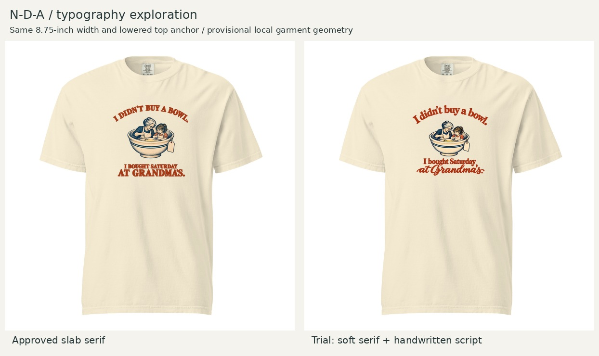

# N-D-A — softer typography exploration

October 23, 2026. Founder asks to explore typography more suited to the female-oriented grandma/granddaughter design. This is a trial, not a replacement of the approved N-D-A. The girl in the illustration informs the intended audience but does not establish that only women will like it.

## Pre-feedback assessment

Soft mixed-case serif lettering plus a flowing vintage script payoff feels warmer and more personal than the approved chunky slab serif. The handwritten “at Grandma’s” emphasizes the remembered relationship. Recommend exploring this direction, while recognizing that the original has stronger distant legibility. This is a creative judgment, not evidence of women's purchasing preference.

The built-in image edit also reduced the central illustration slightly and changed its details; it is not a pixel-identical font substitution. The final trial opens more room than the first draft, but the lower gap is still tighter than the upper central gap. Treat this as a font-direction review; preserve the approved balanced master until the selected typography is integrated with its spacing. No new assortment slot, production approval or sample order.

## Execution and next step

Built-in imagegen, transparent background. First prompt: replace western slab serif with warm mixed-case old-style serif for the arched “I didn’t buy a bowl.” and “I bought Saturday”, plus larger moderately thick vintage script “at Grandma’s.” Preserve rust palette, bowl/people/tag narrative, balanced negative space, no new decorations. First draft crowded the lower copy. Refinement prompt: reduce central illustration to 85%, retain typography, open generous balanced space above and below. Selected trial is serif-script-trial.png. Exact tool prompts remain in the conversation; these are faithful summaries, not verbatim records.

Local shirt comparison uses the existing provisional blank geometry, fixed 8.75-inch width and top 2 inches from print-canvas origin; height follows the trial's aspect ratio. No claim of calibrated collar distance, identical height or production readiness. Script strokes and native resolution need preflight before printing. Run build_review.py with Pillow to reproduce the comparison.

Next: Founder preference on this lettering direction; then restore the approved illustration proportions and finish optical spacing before locking any replacement.
