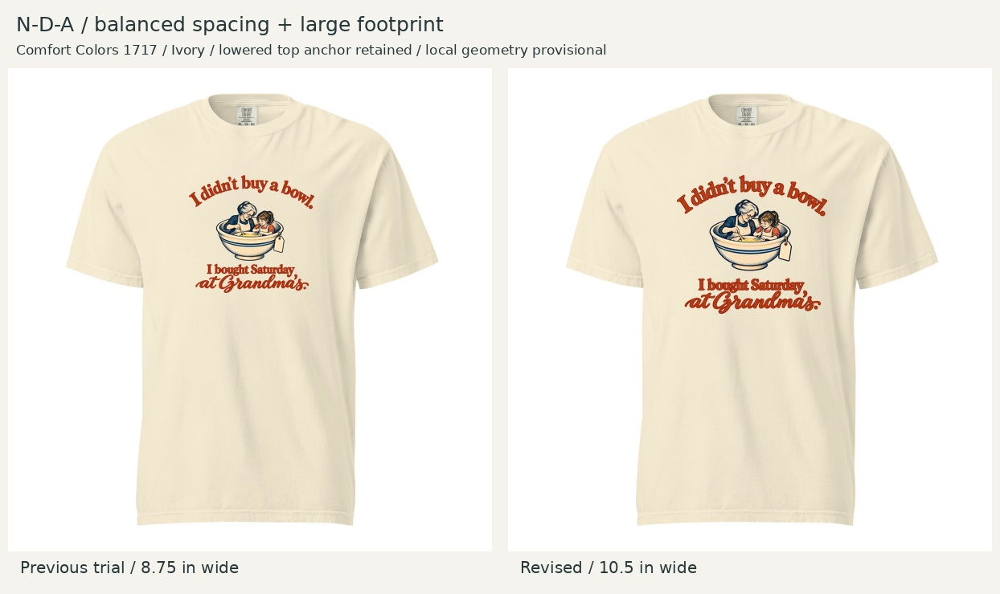

# N-D-A — balanced spacing, large footprint

October 23, 2026 · Revision for Founder review, not yet locked.

## Founder feedback and response

Founder identified the remaining uneven bowl-to-copy spacing and authorized a large footprint for this female-oriented execution. Preserve the earlier assessment and trial as history. The revised illustration sits higher between the text blocks, with balanced optical breathing room. Full composition increases from 8.75 to **10.5 inches wide**, preserving the 2-inch top anchor from the print-area origin. Comfort Colors 1717 / Ivory / DTG front and softer serif/script direction retained.

[Same-size spacing comparison](spacing-comparison.jpg) separates the internal-spacing change from enlargement. [Artwork detail](artwork-detail.jpg) shows actual type/illustration relationships on an Ivory viewing ground. The PNG master has transparency.

## Pre-feedback Creative Director assessment

Recommend this revision. The gap below the bowl no longer pinches the first payoff line; the upper arch and lower block now give the scene balanced optical space. Curved upper lettering means full bounding-box gaps are misleading; judge the clear space near the grandmother's hair and beneath the bowl. The 20% increase in overall width restores the scene's presence and improves the script's shirt-scale readability. It preserves the warm, personal character of the serif/script pairing.

The top anchor retains collar breathing room in the provisional local view, and the bottom remains above the lower torso. Tradeoff: the larger composition is more prominent, less understated, and demands more native detail. Image generation changed small illustration details; this is not a pixel-identical translation. No new objects, wording, brand marks or colorway were added. The girl's role supports the intended audience brief without implying that only women can wear the design.

## Geometry and verification

- Visible composition: **10.5 × 9.7286 inches**; left 0.75 / top 2.0 / bottom 11.7286 on a 12 × 16-inch canvas.
- Nominal print-width / flat garment-width: S 57.5%, L 47.7%, 2XL 40.4%. Calculations, not verified size-specific fit or scaling.
- Reused provisional geometry: 17.8 image px/in, center x303, print origin y97; photographed shirt size unknown. Print-origin coordinates are not measured collar distances.
- Saved transparent upload candidate: [NDA-large-balanced-12x16.png](NDA-large-balanced-12x16.png), 1800 × 2400 at 150 PPI. [Specs and hashes](specs.json) · [master](balanced-master.png) · [reproducible layout script](build_review.py).
- Reviewed full artwork, shirt comparison and same-size spacing board. Canvas bounds checked; no clipping. Native effective detail is approximately **116.7 PPI** at this width. Export PPI is not recovered detail. Production restoration, transparency/linework preflight and final Printful preview remain pending before sample ordering.

[Exact built-in imagegen prompt](generation-prompt.txt). Imagegen performed the artwork edit; Pillow only creates proportional measured layouts and review boards. Original approved master and the first typography assessment remain intact. This candidate would replace N-D-A, not add a sixth non-MVV design. No merge or purchase performed.
