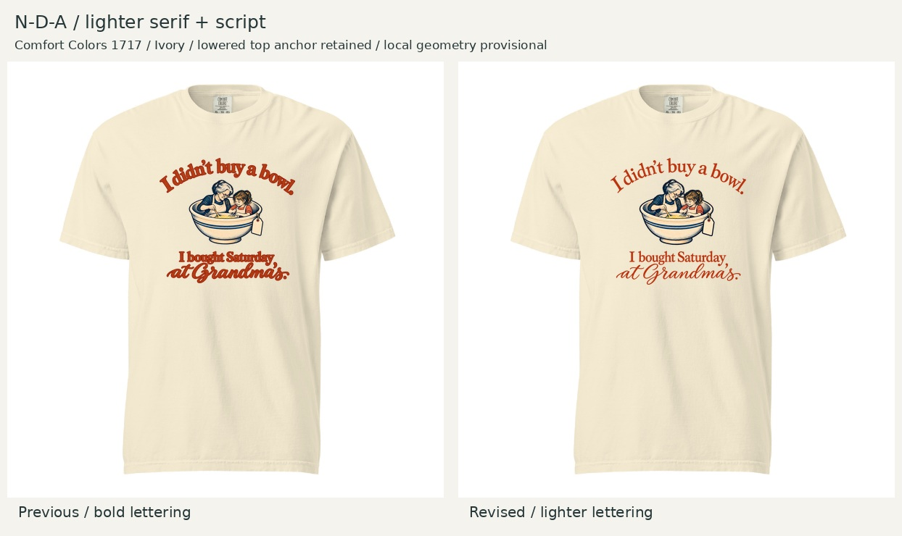

# N-D-A — lighter serif and script

October 23, 2026 · Current candidate for Founder review; not locked.

Founder accepts round02 spacing and large footprint, but finds its lettering too bold after enlargement and requests thinner fonts. This revision changes the chunky serif and brush script to lighter regular-weight serif and flowing script. Same wording, rust palette, Comfort Colors 1717 / Ivory and 10.5-inch width; lowered top remains 2 inches from print-canvas origin.

## Pre-feedback assessment

Recommend this version over round02 for the intended softer, more feminine direction. The lighter strokes and more open letter counters reduce the heavy headline effect while retaining a warm heirloom character. At shirt scale the bowl scene receives more attention; the script reads as a personal memory rather than a bold display slogan. Both serif lines and script remain readable in the local preview. The accepted optical spacing remains balanced.

Tradeoff: lower distant contrast and finer script strokes need particular attention in production preflight. This is a taste judgment, not evidence of women’s preferences or sales. Generated artwork retains the scene, approximate illustration proportions and layout but is not pixel-identical to round02. No claim of a specific licensed font identity or exact 45% stroke reduction; that figure in the prompt was a direction, not a measured result.

## Geometry, files and validation

- Composition 10.5 × 9.8184 inches; left 0.75, top 2, bottom 11.8184 on 12 × 16 canvas. Slight height change follows the new lettering contours; no stretching.
- [Artwork detail](artwork-detail.jpg) · [transparent master](balanced-master.png) · [upload candidate](NDA-large-balanced-12x16.png) · [specifications/hashes](specs.json) · [exact prompt](generation-prompt.txt) · [reproducible layout script](build_review.py).
- Built-in imagegen edited lettering; Pillow performs measured proportional placement and preview composition. Saved artwork and shirt views inspected. Bounds remain inside canvas; PNG alpha retained. Both comparison shirts use 10.5-inch width and identical top anchor.
- Reused local garment geometry remains provisional; photographed size unknown. Physical neckline distance is unverified. Native effective detail about 115.9 PPI at this size; the 150-PPI export does not increase source detail. Production restoration, fine-stroke/transparency inspection and Printful verification remain pending before printing.

Prior masters and assessments remain unchanged. If approved, this supersedes round02 for N-D-A without adding an assortment slot. No merge, purchase or publication performed.

## Subsequent Founder approval — October 23

Founder approved light-03 and instructed merging PR151; PR151 is merged. Light-03 is the current locked N-D-A aesthetic/layout, replacing earlier N-D-A versions without another assortment slot. The pre-feedback assessment above remains unchanged. Production-resolution/fine-stroke work and the latest Printful verification remain pending. N-D-A is not in the current sample order. See [current handoff](../../../../R012-Creative-Session-Closeout-2026-10-24.md).
