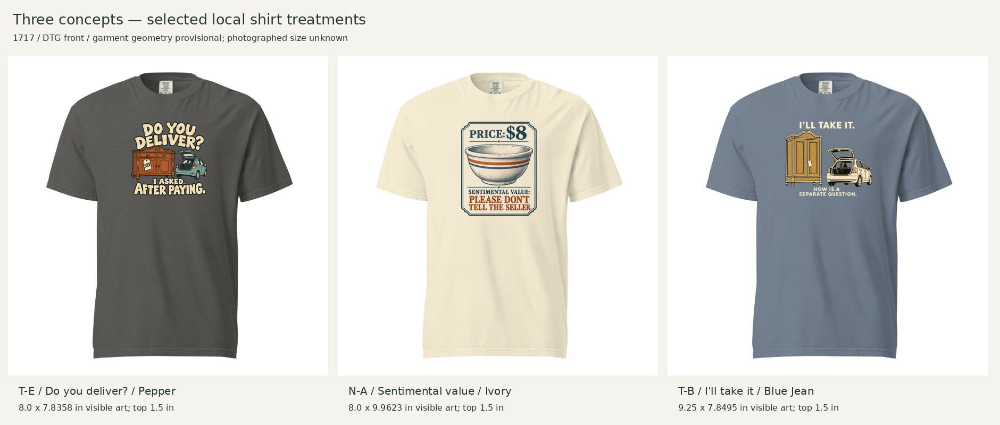
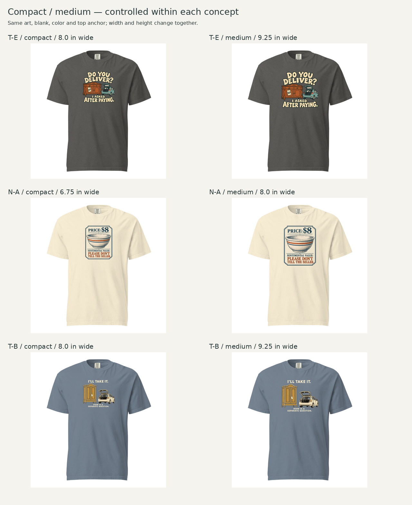
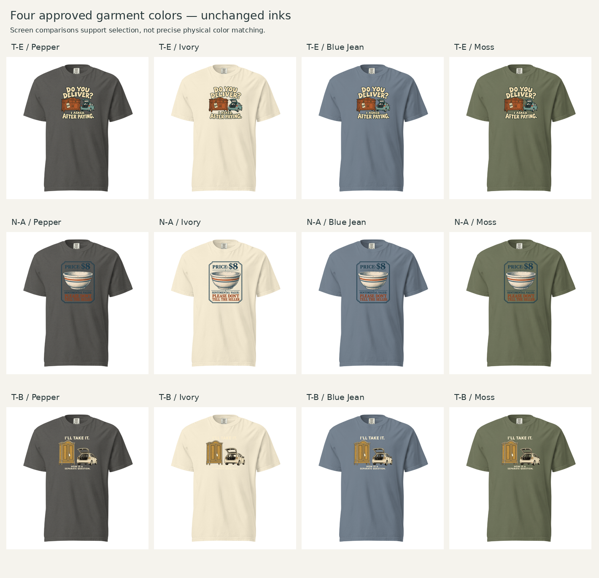
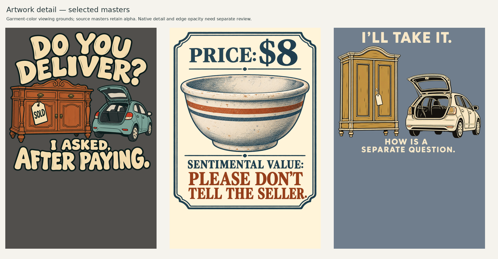

# Next three creative concepts — T-E, N-A and T-B

Creative Director · October 21, 2026 (America/Chicago) · New designs for Founder review; not production-approved. The prior approved package is published and merged in [PR139](https://github.com/kyleliaw-candoit/t-shirt/pull/139), merge `4d08a97fa6be895c270ce0dfc43d8f984c4246a7`.

## Current review decisions

[Founder feedback and follow-up](founder-feedback.md): **T-E Playful approved; T-B retired.** N-A received positive visual feedback; Founder clarified that thrift-shopping and sentimental collecting are welcome, provided the bowl reads as old. CD judges the current worn bowl sufficient and retains it. The [new T-E quiet typography execution](TE-quiet-02/README.md) is ready for review beside approved Playful. Historical selection and assessment below remain intact.

## Selection and scope

User authorized the next three strong existing concepts, reducing to two if necessary, using current principles/workflow and permitting an original visual direction outside the eight families when those do not fit. Three existing concepts clear the working creative-quality comparison; no weak third is added for quota. One execution per concept is developed. The [one-or-two assortment rule](../../../../company/Creative-Director-Scroll-Stop-and-Assortment-Principle.md#one-or-two-executions-per-creative-concept) is a cap, not a requirement to make two of each.

| Concept / wording | Existing Founder feedback | Selected visual treatment |
|---|---|---|
| **T-E:** DO YOU DELIVER? / I ASKED, AFTER PAYING. | 5/5 humor; clear setup and surprising timing reveal | DLF-004 Playful lettering and illustration interlock; Pepper |
| **N-A:** PRICE: $8 / SENTIMENTAL VALUE: / PLEASE DON'T TELL THE SELLER. | 4.5/5 reported concept score; good execution | DLF-006 Framed illustrated artifact, valuation-card subtype; Ivory |
| **T-B:** I'LL TAKE IT. / HOW IS A SEPARATE QUESTION. | 4/5 humor; easy to understand | DLF-002 Quiet vignette and dry caption, two-object boundary adaptation; Blue Jean |

Sources: [original cards](../../../R012-Process-Comparison-Review-2026-10-19.md), [transport feedback](../../../R012-Process-Comparison-Founder-Transport-Ratings-2026-10-19.md), [nostalgia feedback](../../../R012-Process-Comparison-Founder-Nostalgia-Ratings-2026-10-19.md), [process key](../../../R012-Process-Comparison-Key-2026-10-19.md), [comparison results](../../../R012-Process-Comparison-Results-2026-10-19.md). Scores are prior copy-plus-specified-visual judgments, not new artwork scores or purchase evidence. N-A's reported score is not relabeled as a pure humor measure.

T-D/CAR and N-D/Grandma are already developed. Remaining original regret and collection concepts did not reach the prior 4/5 benchmark; R-A/R-F possible improved scores concern proposed revisions, not completed high-scoring originals. N-F remains a solid 4/5 emotional candidate, held for later because the just-completed Grandma round already explores sincere attachment. T-B supplies a quieter humorous voice rather than another warm bowl record. Two new transport concepts share material; they have different turns but must still earn distinct assortment roles alongside CAR.

## Handoff, material and concept analysis

Handoff is **clear with nonblocking recognition and aesthetic uncertainty**. Reuse the approved [R012 positioning/line](../../../../brands/R012-Antiques-Treasure-Hunters-Brand-Hypothesis-Brief.md#current-decision--october-3-2026), full [material ranking](../../../R012-Material-Recognizability-Ranking-2026-10-19.md) and [material bank](../../../../Researches/R012-audience-evidence/Material-Bank.md). Do not restart the completed scan, ranking or three-method concept comparison. No brand name is added or live account renamed.

- **T-E / E007:** delight/commitment comes before transport planning. The new viewer must see a purchased bulky antique and a too-small open hatch. Free drafting after explicit material analysis produced this concept; do not retrofit a TRACE label. SOLD and the exact timing sentence supply the joke.
- **N-A / E005:** new ownership can carry old familiarity; the price buys the object without capturing personal meaning. The two-field valuation applies [TRM-002](../../../trace/mechanisms/TRM-002-Formal-Record-Informal-Experience.md): an ordinary financial record exposes private emotional stakes. It is not a normal price tag with decorative vintage art. No extra memory vignette is needed because SENTIMENTAL VALUE states that dimension explicitly.
- **T-B / E007:** enthusiasm settles the decision to acquire while leaving the means of transport unsettled. Free drafting after analysis produced this separate self-aware declaration. It needs the visible transport relation; the caption alone could be generic shopping language.

E007 reports a thrift-shop hat rack and help from a husband's truck. Cabinets, sideboard, car configurations, SOLD tag and dialogue here are invented staging, not source facts or spouse-conflict claims. E005 supports replacement objects evoking one's own memories, not original ownership by a relative. $8 and bowl styling are invented. Recognition estimates remain provisional and source-dependent. Avoid branded motifs, logos and licensed subjects.

## Family selection and actual visual references

All selected family cards, whole-shirt references and details were inspected. Existing families fit these semantic jobs, so no outside-family direction was necessary.

- [DLF-004](../../discovery-01/families/DLF-004.md): DLS-ETSY-025 / DLS-SNORG-002 and the accepted CAR Playful application inform cohesive type/object stroke character, repeated palette and open interlocking silhouette. They do not establish universal audience preference.
- [DLF-006](../../discovery-01/families/DLF-006.md): DLS-ETSY-016 / DLS-ZZ-029 and Grandma B inform integrated title, illustration and boundary. N-A turns those relationships into an object valuation artifact rather than copying a source's distinctive artwork or using a gothic mood.
- [DLF-002](../../discovery-01/families/DLF-002.md): DLS-RB-039 / DLS-HISTOREE-013 inform isolated object/aside and open cloth. A simple cabinet/car pair extends the single-figure pattern; record the boundary instead of claiming all multiple-object scenes fit. V2 quiets the first generated attempt's oversized heading.

## Garment and controlled comparisons

All three use **Comfort Colors 1717 / DTG front**. Its washed, relaxed character supports this brand and no concrete treatment conflict earns a 64000 switch. Photographed reference size is unknown. Reuse the provisional round04 transform and cached blanks, including the required color underlay for translucent blank shading; these are local simulations, not physically calibrated garments.

Compare each concept with its own art, garment color and top anchor held constant. Choices are made from the rendered shirt rather than a universal compact preference: T-E keeps a compact cluster; N-A and T-B use medium to preserve long replies and essential visual information. Maximum canvas size is not the target.

| Selected execution | Visible width × height, inches | Left / top from print-canvas origin | Native effective ppi |
|---|---|---|---:|
| T-E compact / Pepper | 8 × 7.8358 | 2 / 1.5 | 152.2 |
| N-A medium / Ivory | 8 × 9.9623 | 2 / 1.5 | 125.9 |
| T-B medium / Blue Jean | 9.25 × 7.8495 | 1.375 / 1.5 | 122.8 |

All use a 12 × 16-inch upload canvas. Transparent padding is excluded from visible dimensions. Dimensions/position refer to the print canvas, **not a measured neckline offset**. In the local 602px geometry the estimated collar-rib low point is around y=70 and selected highest ink y=124, leaving roughly 54 image pixels of cloth. This is not physical collar clearance. N-A's bottom is lowest, but stays above the lower torso in the local view. Actual drape and photographed size remain unverified.

Pepper gives T-E cream/colored objects clear separation; Ivory alone preserves N-A's slate/rust fields; Blue Jean supports T-B's softer cream/ochre treatment. Moss/Pepper are plausible secondary alternatives for some designs, but no second colorway earns advancement now. No master was recolored to manufacture a better comparison. Screen colors are approximations.

Nominal S/L/2XL width scenarios reuse the earlier 18.25 / 22 / 26-inch flat measurements:

| Selected print | S | L | 2XL |
|---|---:|---:|---:|
| T-E and N-A, 8 inches | 43.8% | 36.4% | 30.8% |
| T-B, 9.25 inches | 50.7% | 42.0% | 35.6% |

These ratios assume fixed artwork width only as a sensitivity scenario. Current provider guidelines state that graphics may scale by product size; exact fulfillment transforms remain unresolved. Neither this table nor selecting editor sizes establishes photographed size-specific fit.

## Assets, assessment and provider status

- [Frozen pre-Founder assessment](assessment.md): actual critique, reasons for selection, strengths and weaknesses. Preserve it before appending feedback.
- Masters: [T-E](assets/TE-playful-v1.png), [N-A](assets/NA-valuation-v1.png), [T-B selected v2](assets/TB-vignette-v2.png), [retained T-B first attempt](assets/TB-vignette-v1.png).
- [Design configuration](designs.json), [layout specifications and master fingerprints](layout-specs.json), [measured build script](build_review.py), [exact built-in image-generation prompts](generation-prompts.json).
- Selected canvases: [T-E compact](layouts/TE-compact-12x16.png), [N-A medium](layouts/NA-medium-12x16.png), [T-B medium](layouts/TB-medium-12x16.png). Medium/compact alternatives are retained beside them.
- [Provider verification](evidence/verification.md) records actual observed status separately from this creative judgment.

Run `python build_review.py` with Pillow from a complete checkout. It performs measured resampling/layout only; it does not repaint or clean generated art. A 150-DPI export does not recover missing native detail. Particularly N-A/T-B need higher-native-detail production derivatives, edge-opacity checks and eventual samples. N-A also carries border-distortion risk. Provider preview acceptance cannot establish printed fidelity.

## What to review

Judge the shirts before reading the assessment if you want a less anchored first impression. For each: does the wording/image make sense without the research, would you wear it, and is there a specific issue to correct? For N-A, check whether $8 reads as the bowl's mock valuation rather than the shirt's offer price. For T-B, check whether the quieter caption is readable enough. Consider whether both transport jokes add useful choices alongside CAR rather than merely repeating it.

This was the initial review package; the current decisions and second T-E execution are linked above. No new-design merge, store publication, ad spend, sample purchase or market test is included in their creation. Originality/phrase screening remains downstream before production as specified in the original concept record. Retain exact accepted visuals if advanced; do not regenerate merely to change garment footprint.
