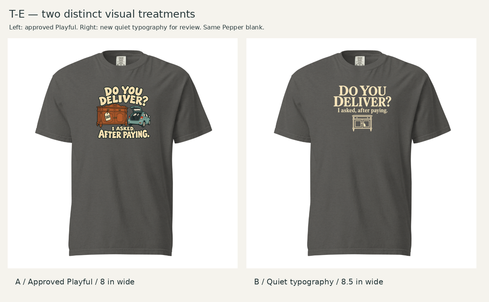
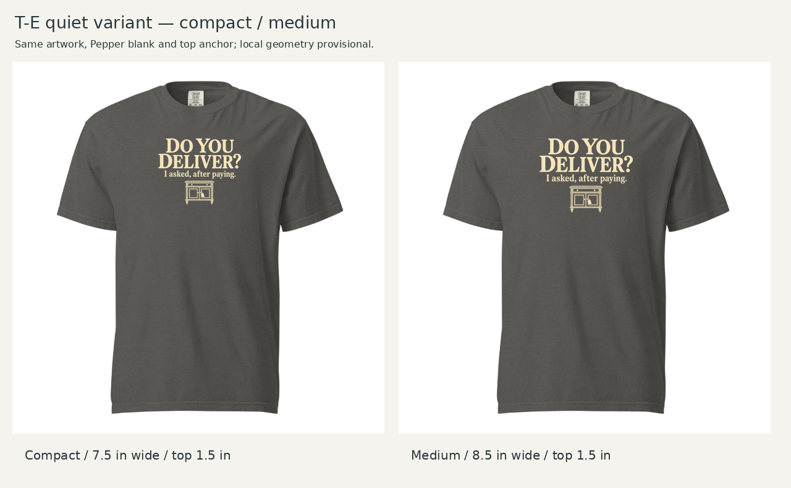
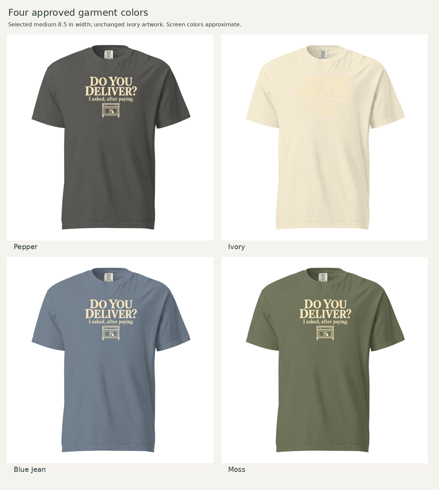

# T-E — quiet typography, second execution

October 21, 2026 (America/Chicago) · Awaiting Founder review. Built-in image generation; transparent artwork plus measured local layout. Original [Playful design](../assets/TE-shirt.png) is Founder-approved; this second treatment is proposed.

Founder requested a typography-led Quiet Vignette approach with a small treasure-hunting cue. The exact concept is preserved: **DO YOU DELIVER? / I asked, after paying.** One small tagged old cabinet supplies context; the timing joke carries itself without a car. This is a boundary adaptation of DLF-002, with more weight on the words than the source family's central figure-led pattern. Three existing family references were inspected on the [actual family card](../../../discovery-01/assets/DLF-002-card.jpg).

## Selected treatment and comparisons

1717 / DTG front / Pepper / warm ivory artwork. Medium wins for the payoff and cabinet's readability; quietness does not require the smallest print.

| Footprint | Visible width × height | Left / top on 12 × 16 canvas | Native effective ppi |
|---|---|---|---:|
| Compact | 7.5 × 5.9807 in | 2.25 / 1.5 in | 144.8 |
| **Medium — selected** | **8.5 × 6.7781 in** | **1.75 / 1.5 in** | **127.8** |

Pepper is selected for strong neutral contrast. Blue Jean and Moss also work, but do not earn an additional colorway here. Ivory loses the light copy. These comparisons preserve the same ink; no automatic recoloring is hidden in the trial.

Local geometry reuses the provisional round04 transform. Reference garment size and physical collar-to-art distance are unknown. Estimated image-space collar gap is about 54 pixels on a 602px blank; top 1.5 inches is measured from the print-canvas origin. Nominal S/L/2XL width ratios are 46.6/38.6/32.7%, assuming fixed width for sensitivity only. Exact provider size scaling remains unresolved.

## Review and reproducibility

- [Frozen assessment](assessment.md): preserved before Founder response to this variant.
- [Artwork detail](assets/artwork-detail.png), [transparent master](assets/TE-quiet-v1.png), [selected shirt](assets/selected-shirt.png).
- [Exact built-in generation prompt](generation-prompt.json), [layout specifications](layout-specs.json), [build script](build_review.py).
- [Selected upload canvas](layouts/TE-quiet-medium-12x16.png) and [compact alternative](layouts/TE-quiet-compact-12x16.png).
- [Provider verification](evidence/verification.md).

Run `python build_review.py` from a complete repo checkout with Pillow and DejaVu Sans. This script only crops transparent padding, resamples proportionally and composites on cached blanks; it does not repaint the artwork. The initial transparent-image display looked glowing, but the actual alpha-composited master on the garment ground is clean at review scale. Edge opacity still requires production inspection.

**Review question:** does this quieter, words-first treatment earn the second T-E slot beside approved Playful? Check the payoff's readability and whether the cabinet supplies enough antique/secondhand context at shirt scale. No new T-B development is planned; see [Founder feedback](../founder-feedback.md) for the round's decisions and N-A discussion.

This is a review master. Its native resolution, fine cabinet moldings and opacity require cleanup before a physical sample. Provider acceptance is not production release or market validation.
