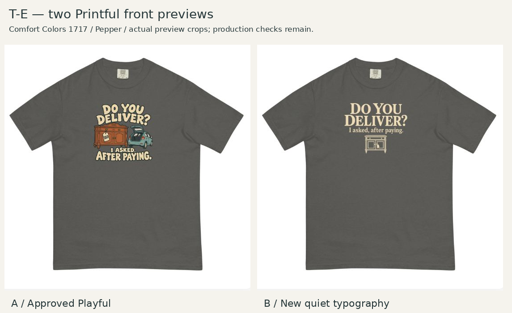

# Provider verification — T-E quiet second execution

October 21, 2026 (America/Chicago). Observations after the frozen creative assessment.

Selected **Comfort Colors 1717 / DTG printing / Front / Pepper** in the guest Design Maker. Uploaded `TE-quiet-medium-12x16.png`, file ID **1091580141**, 1800 × 2400 pixels, exported at 150 DPI. The applied layer retained **12.00 × 16.00** inches with Good / 150 DPI displayed. No fit-to-area or provider aesthetic resizing was applied.

Visible art is 8.5 × 6.7781 inches, left 1.75/top 1.5 inches within that padded canvas. Editor controls and the generated front mockup were inspected: correct wording and color, no clipping, comfortable apparent collar gap and compact chest grouping. The small cabinet remains a supporting cue. Placement agrees with the local preview sufficiently for creative review; exact physical geometry remains uncalibrated.

Full-context evidence: [controls](provider-controls.jpg), [generated mockup](provider-mockup.jpg). The pair is a uniform crop of the original approved Playful provider screenshot and this new screenshot. It is not a newly generated garment image.

Native artwork resolution remains about 127.8 effective ppi. The export label does not fix that limitation. Thin cabinet moldings, edge opacity, higher-native-detail typography/illustration and physical samples remain production work. Photographed size, exact size-dependent scaling and physical neckline distance are not established.

The settled Product panel showed DTG selected, Pepper selected, and enabled S/L/2XL controls. This confirms selectable variants in this guest preview context, not inventory across regions or fulfillment readiness.

No order, store listing or sample purchase was created.
