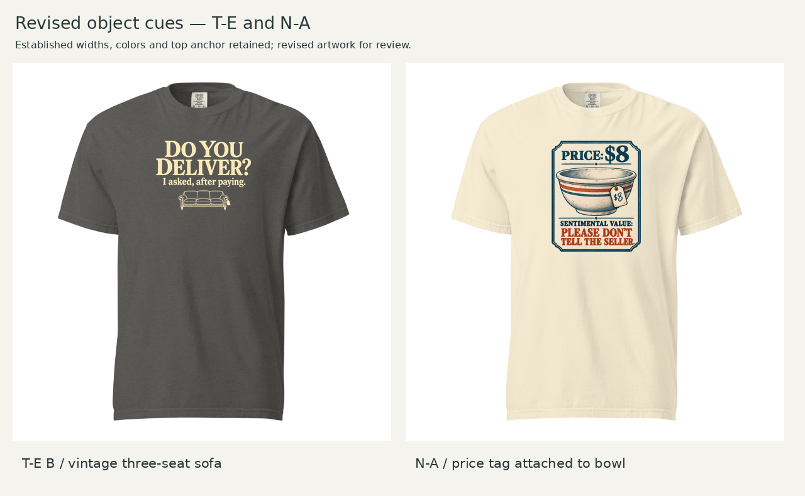

# T-E B sofa and N-A attached-tag revisions

October 21, 2026 (America/Chicago) · Historical review, superseded by [cue-revisions-04](../cue-revisions-04/README.md) after Founder feedback: restore the first sofa's ornate style, use SALE on the bowl tag and lower the main price. This package and its frozen assessment remain intact for comparison.

T-E A is approved and unchanged. Founder tentatively approved B, praising typography, proportions and layout, and asked for a stronger bulky-object cue. Replace its moderately sized cabinet with a three-seat vintage sofa. For N-A, attach an $8 price tag to the old bowl to clarify that it is for sale rather than dirty after a meal. T-B remains retired.

See the [before/after comparison](assets/before-after.png) and [frozen pre-feedback CD assessment](assessment.md). The selected sofa remains a subordinate illustration in a typography-led DLF-002 adaptation; N-A retains DLF-006's framed valuation-artifact treatment. These are replacements within the existing one-or-two execution cap, not two new products.

## Selected specifications

Both use Comfort Colors 1717 / DTG front, a transparent 12 × 16-inch canvas exported at 1800 × 2400 pixels, and top 1.5 inches from its origin.

| Revision | Color | Visible width × height | Left | Native effective ppi |
|---|---|---|---:|---:|
| T-E B sofa v3 | Pepper | 8.5 × 6.2358 in | 1.75 in | 165.2 |
| N-A tagged v2 | Ivory | 8 × 9.9703 in | 2 in | 126.4 |

Reuse the prior [T-E footprint/color comparison](../TE-quiet-02/README.md) and [N-A footprint/color comparison](../README.md#garment-and-controlled-comparisons) under the scoped-revision workflow. The new shirt comparison directly checks object proportions. The sofa's broader, shallower shape changes overall height; type, alignment and hierarchy are visually retained, not claimed pixel-identical. No ink recoloring or second garment color is introduced.

Provisional local placement and reference-size limitations carry forward. S/L/2XL nominal width ratios remain 46.6/38.6/32.7% for T-E and 43.8/36.4/30.8% for N-A under a fixed-width assumption. They do not establish physical collar clearance or provider size-specific print transforms. See [layout specifications](layout-specs.json) and [provider evidence](evidence/verification.md).

## Reproducible assets

- Selected transparent masters: [T-E sofa v3](assets/TE-sofa-v3.png), [N-A tagged v2](assets/NA-tagged-v2.png).
- Detail views on garment-color grounds: [T-E](assets/TE-sofa-v3-detail.png), [N-A](assets/NA-tagged-v2-detail.png).
- Upload canvases: [T-E](layouts/TE-revised-12x16.png), [N-A](layouts/NA-revised-12x16.png).
- [Exact generation/edit prompts](generation-prompts.json), [measured build script](build_review.py), [geometry and master fingerprints](layout-specs.json).
- Rejected intermediate masters: [first sofa, too prominent](assets/TE-sofa-first.png), [v2, unwanted glow](assets/TE-sofa-v2.png). These are process evidence, not additional candidates.
- [Founder feedback](../founder-feedback.md) preserves the direction that led to these changes; earlier assessments remain byte-identical.

Run `python build_review.py` with Pillow and DejaVu Sans from a complete checkout. It crops transparent padding, resamples proportionally and composites on existing blanks; it does not redraw or edit pixels to repair the art. Image generation made all artwork changes. New provider screenshots are external observations, not regenerated by that script.

**Status:** CD recommends both revised candidates; Founder approval is pending for the new images. Provider preview verification is separate from production release. N-A needs higher native detail; both need edge/line inspection and eventual physical samples. No live storefront change, purchase or market result is claimed.
