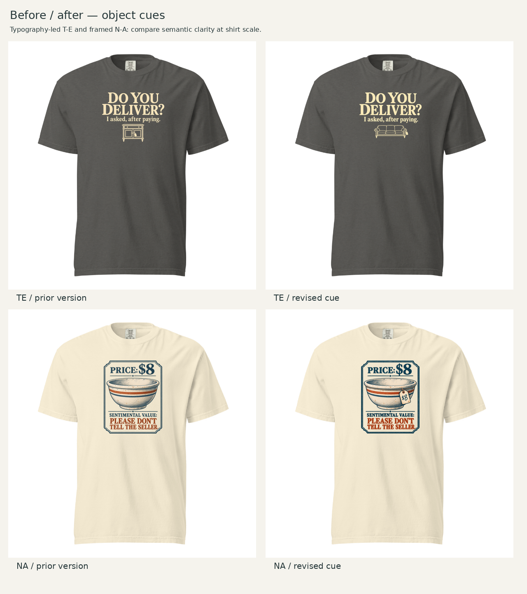

# Frozen CD assessment — stronger object cues

October 21, 2026 (America/Chicago). Recorded before Founder feedback on these revised images. The original round and cabinet-variant assessments remain unchanged. Subsequent reactions belong in the append-only Founder feedback record.

## Judgment

Advance **T-E B with the three-seat vintage sofa** and **N-A with an attached $8 tag** for review. Both changes address a specific ambiguity without changing the concept or adding another assortment slot. T-E A remains the exact approved Playful design. B has tentative Founder approval for its prior typography/layout; the new sofa image has not yet been approved. N-A's revised image also awaits review.

## T-E B — sofa

The cabinet conveyed secondhand furniture but did not make its difficult transport reliably legible: its isolated drawing could describe a modest bedside cabinet. A three-seat sofa has a stronger familiar scale. Rolled arms, a shaped back and short turned feet add an older furniture character; the attached tag supports the purchase context. A table can read as a small occasional table and a bench can lose its scale without surroundings. The sofa is my strongest choice here, not a finding from audience testing.

The type remains the main event: **DO YOU DELIVER?** first, **I asked, after paying.** second, the sofa third. The small broad illustration supports the logistical implication without requiring a car or a second explanatory scene. Its horizontal silhouette makes a quiet visual ending. Pepper and warm ivory remain cohesive and wearable. At shirt scale I can recognize a sofa and read the payoff; the tiny tag's writing is not needed for comprehension.

The requested hierarchy, centered stack, line breaks, palette and 8.5-inch type-led width are retained visually. This is an image-generated revision, not a pixel-identical typography transplant. The sofa is broader and shallower than the old cabinet, reducing the total visible height from 6.7781 to 6.2358 inches. It occupies roughly half the text width rather than the cabinet's roughly one-third, but remains subordinate because its linework is light and its height small. This is an acceptable shape-driven proportion change to my eye. The adjacent shirt comparison is the evidence, not the prompt's requested percentages.

This remains a typography-led boundary adaptation of DLF-002 Quiet Vignette, whose source examples often put more semantic weight on a central figure. The joke's explicit timing reversal permits a small cue here. It earns a distinct second aesthetic beside approved Playful, within the two-execution cap.

Iteration record: the first sofa was too visually prominent; the second attempt reduced it but introduced an actual glow visible on the Pepper ground. Reject both. The selected third attempt used the original clean ground-rendered cabinet design as reference and returned a clean transparent master. No painting or alpha repair was performed in the layout script. Inspect fine lines and edge opacity again for production.

## N-A — attached price tag

Founder identified a credible reading my prior assessment underweighted: mottled wear on an empty bowl can be mistaken for meal residue. The new tag ties **$8** to the illustrated bowl physically. A clipped paper tag, eyelet and visible loop at the rim make the bowl a secondhand item being offered for sale. This is stronger contextual evidence than merely adding more surface aging or another category word.

The valuation-card composition, exact wording, bowl as hero, navy/rust/cream palette and 8-inch width remain recognizable. Some generated illustration and lettering details vary; this is not claimed as a pixel-preserving edit. The tag adds a small focal point on the bowl's right side, but the large PRICE: $8 heading still starts the read and the warm-colored private-value punchline closes it. Repeating the price has a useful binding function here: it reduces uncertainty about which object has that price. No new scene, border or line of copy is needed.

I prefer this revision. The object can still look worn, but now the sale context gives that wear a more plausible interpretation. The tag cannot guarantee that every viewer will see age rather than dirt; that remains an untested recognition judgment. Thrift shopping and sentimental collecting remain welcome readings. There is no need to force a narrowly formal-antique interpretation.

## Garment, placement and evidence limits

Reuse the established selected widths, colors, 12 × 16 canvas and 1.5-inch top anchor under the scoped-revision rule. The earlier two-footprint/four-color comparisons remain relevant because these changes do not introduce a new ink palette, headline structure or garment choice. New before/after shirt views test the changed object proportions and new provider renders check the actual revised uploads.

T-E: 8.5 × 6.2358 inches, left 1.75, Pepper, native effective resolution 165.2 ppi. N-A: 8 × 9.9703 inches, left 2, Ivory, native effective resolution 126.4 ppi. Both use 1717 / DTG front. The native N-A detail remains below the provider's 150-DPI target despite its 150-DPI padded export; resizing does not recover detail. Its fine lettering, surface texture and symmetrical border need production attention. T-E's fine sofa linework and semitransparent edges also require print preparation and sample inspection.

Local blank geometry remains provisional. The top anchor is measured from the print-canvas origin, not the neckline. The estimated 54px collar gap is only an image-space observation. Photographed reference size and exact provider scaling by size remain unresolved; fixed-width S/L/2XL ratios are sensitivity calculations, not verified size-specific fulfillment. Provider acceptance, recorded separately, does not prove printed fidelity or sales potential. No physical sample or customer recognition test has been completed.

**Next review:** is the sofa a sufficiently clear bulky-purchase cue while the words remain dominant, and does the attached tag resolve the bowl's unwanted used-meal reading? These revisions replace their respective earlier candidates; they do not expand the assortment.
