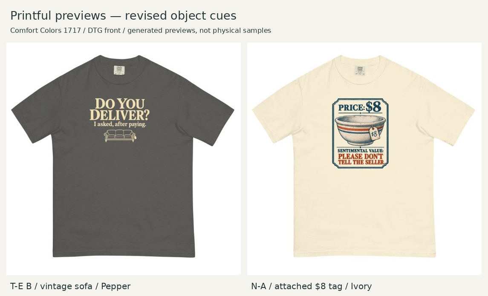

# Revised-upload provider check

October 21, 2026 (America/Chicago). Observed in Printful's public Comfort Colors 1717 Design Maker, DTG front. No checkout, account creation or storefront publication.

| Revision | Applied upload | File ID | Observed result |
|---|---|---|---|
| T-E B sofa / Pepper | TE-revised-12x16.png | 1091603730 | Good / 150 DPI; 12.00 × 16.00 units; generated Pepper front mockup inspected |
| N-A tagged bowl / Ivory | NA-tagged-review-12x16.png | 1091607281 | Good / 150 DPI; 12.00 × 16.00 units; generated Ivory front mockup inspected |

Full-context screenshots: [T-E](TE-provider-mockup.jpg), [N-A](NA-provider-mockup.jpg). Layer text: [T-E](TE-layer.txt), [N-A](NA-layer.txt). [Product controls](NA-product.txt) record DTG selected and Ivory pressed. T-E continued the existing Pepper/DTG/front canvas, verified before replacement. Same garment and established size-control evidence are reused; no claim of new size-specific calibration.

The full 12 × 16 upload dimensions include transparent margins. The visible art is 8.5 × 6.2358 inches for T-E and 8 × 9.9703 for N-A, as recorded in the layout specs. Generated views show the selected sofa and tag with the intended hierarchy, no obvious clipping, and no glow around the selected sofa. The bowl's tag is clearly visible at garment scale. Provider and local blank shapes differ; use these as separate visual checks, not a falsely exact calibration.

The first N-A upload (1091603728) failed and showed an error icon with no image metadata. Local validation found an incomplete PNG export. Re-running the measured build produced a valid file. The successful retry used a differently named exact-byte copy of the final `layouts/NA-revised-12x16.png`; see [upload hashes](upload-hashes.json). The failed provider record is not evidence of acceptance.

Provider quality labels describe the 1800 × 2400 export. N-A's native effective detail is only 126.4 ppi; resampling does not restore it. T-E native effective resolution is 165.2 ppi, with fine-line/opacity preparation still outstanding. Physical print quality, reference garment size, exact provider scaling across sizes and physical collar clearance remain unverified. No physical sample or market test was performed.

The paired image is a uniform crop/composite of the two retained screenshots (690,110)-(1240,660), without artwork edits. Current source page: https://www.printful.com/custom/brands/comfort-colors/unisex-garment-dyed-heavyweight-shirt-comfort-colors-1717?technique=T-SHIRT&color=Pepper&size=S#guidelines . The URL does not encode the guest design or the editor's subsequent Ivory selection.
