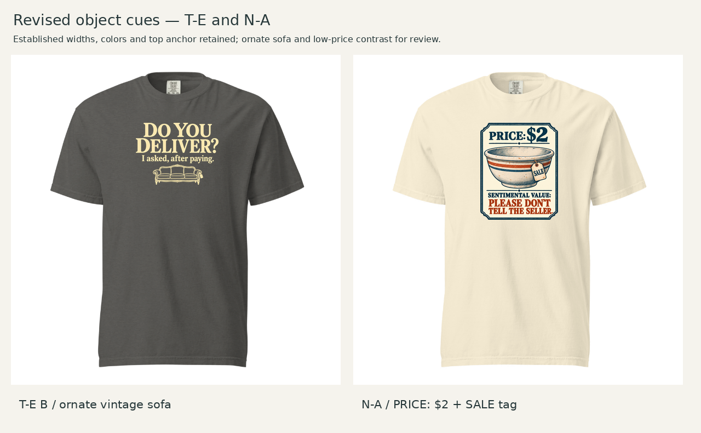

# T-E B ornate sofa and N-A $2 / SALE revisions

October 21, 2026 (America/Chicago) · Current proposed images in draft PR140; awaiting Founder review.

Founder preferred the first sofa's older ornamental style over the simplified third sofa. This revision brings back its carved crest, shaped back and curved wooden apron while retaining the typography-led arrangement. N-A changes the main price from $8 to $2 and the attached tag from $8 to SALE, following the request to avoid duplicate prices and strengthen the contrast with sentimental value.

**CD recommendation:** advance both. Read the [frozen pre-feedback assessment](assessment.md) after viewing the [before/after shirts](assets/before-after.png). The sofa's antique character and bulky scale are separate jobs; the new image carries both. For N-A, $2 is the chosen low-price expression, not a researched market valuation. The worn bowl and attached sale tag still do the contextual work of suggesting a secondhand purchase.

| Revision | Color | Visible dimensions | Left / top on 12 × 16 canvas | Native effective ppi |
|---|---|---|---|---:|
| T-E B ornate sofa v4 | Pepper | 8.5 × 6.3447 in | 1.75 / 1.5 in | 165.2 |
| N-A $2 / SALE v3 | Ivory | 8 × 9.9783 in | 2 / 1.5 in | 126.9 |

Both retain Comfort Colors 1717 / DTG front and their existing selected widths, colors and top anchors. Reuse [T-E's footprint/color comparisons](../TE-quiet-02/README.md) and [N-A's original comparisons](../README.md#garment-and-controlled-comparisons) under the scoped-revision rule. New shirt views assess the ornament and changed lettering; [new provider evidence](evidence/verification.md) checks these final uploads.

## Assets and reproducibility

- Transparent masters: [T-E ornate v4](assets/TE-ornate-v4.png), [N-A $2/SALE v3](assets/NA-sale2-v3.png).
- Grounded details: [T-E](assets/TE-artwork-detail.png), [N-A](assets/NA-artwork-detail.png).
- Final padded uploads: [T-E](layouts/TE-cue04-12x16.png), [N-A](layouts/NA-cue04-12x16.png).
- [Exact built-in image-generation prompts](generation-prompts.json), [layout specs and master hashes](layout-specs.json), [reproducible build script](build_review.py), [upload hashes](evidence/upload-hashes.json).
- Reference inputs: [prior plain sofa](../cue-revisions-03/assets/TE-sofa-v3-detail.png), [preferred first ornate sofa](../cue-revisions-03/assets/TE-sofa-first-detail.png), [prior $8-tag bowl](../cue-revisions-03/assets/NA-tagged-v2-detail.png).
- [Append-only Founder feedback](../founder-feedback.md). All previous frozen assessments remain unchanged.

Run `python build_review.py` with Pillow and DejaVu Sans in a complete checkout. Image generation performed all artwork/text edits. The script only measures, crops transparent padding, resamples proportionally and composites; upload canvases are written atomically to avoid partial files. It also composes the retained provider screenshots when available.

These remain review masters. T-E's fine ornament/opacity and N-A's native resolution/border need production preparation and sample inspection. The 150-DPI padded export does not upgrade N-A's native detail. Local 602px blank geometry, estimated 54px image-space collar clearance and photographed size remain provisional. Top 1.5 inches is from the print-canvas origin. Nominal S/L/2XL fixed-width ratios remain 46.6/38.6/32.7% for T-E and 43.8/36.4/30.8% for N-A; exact fulfillment scaling remains unresolved.

T-E A stays approved and locked; T-B stays retired. These revisions replace existing candidates without adding assortment slots. No production release, physical sample or customer-test result is claimed.
