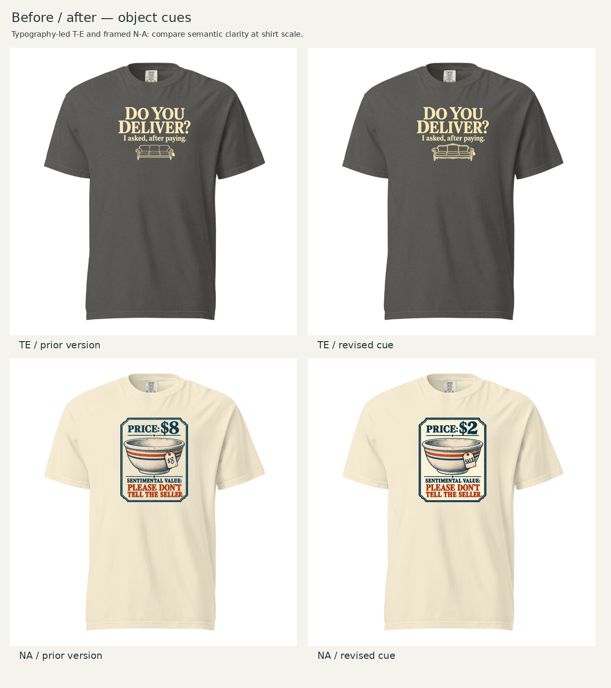

# Frozen CD assessment — antique form and low-price contrast

October 21, 2026 (America/Chicago). Recorded before Founder feedback on these new images. Previous assessments remain unchanged; append later feedback to the parent record.

**Recommendation:** advance the ornate sofa revision for T-E B and the $2/SALE revision for N-A. Both improve the intended reading without changing the visual-family choice or adding assortment slots. These images await Founder review; T-E A remains approved and locked.

## T-E B

The Founder prefers the first sofa's older ornamental style over the plainer third version. On reinspection I agree: the simplification solved neither a demonstrated legibility problem nor a production requirement, yet removed useful antique character. The new edit restores the shaped exposed frame, central shell-like crest, curved lower apron, scrolled arms and turned feet from the first sofa. I describe it as Victorian-inspired in visual character, not as a historically authenticated furniture design.

At artwork scale the crest, curved back and apron distinguish it from a contemporary upholstered sofa. At shirt scale the silhouette and scrolled arms carry the old-furniture impression; the smallest carved details are supporting texture and should not be essential. Three seats still imply a bulky purchase. The small blank tag supports the shop context without adding another reading task.

The question remains the dominant mass, the timing sentence is the second read, and the sofa is an illustrated footnote. Its width is slightly greater than the previous plain sofa, but its light open linework keeps it subordinate. Overall width stays 8.5 inches and the visible height changes only from 6.2358 to 6.3447 inches. There is still clear separation between payoff and sofa crest. The current relationship reads balanced to me in the adjacent shirt views; no further reduction is warranted simply to hit a percentage.

Pepper and warm ivory remain a coherent, quiet combination. The final alpha-composited artwork is clean on Pepper; the generated transparent-preview display is not itself reliable evidence of glow. Typography, palette, centered hierarchy and line breaks are visually retained. This is an image-generated edit, not a claim of pixel-identical typography preservation. It remains a typography-led boundary adaptation of DLF-002 rather than a new family.

## N-A

The new header reads **PRICE: $2** and the attached tag reads **SALE**. The Founder identifies the repeated $8 as redundant; my previous assessment defended the repetition as useful binding. That preference difference remains visible in the older frozen record. SALE still connects the bowl physically to a selling context, while leaving the monetary amount to the main headline. The tag's navy lettering and aged paper fit the card, avoiding the feel of a bright retail discount sticker.

I choose $2 from the Founder's $1/$2 suggestions. It is plainly a cheap acquisition and strengthens the contrast with the buyer's private sentimental value. $1 would express much the same mechanism and does not justify another design variant. Neither number is a market-price claim. A low price alone cannot prove that an object is used, and SALE alone can also describe new retail goods; the secondhand reading depends on their combination with the visibly worn bowl, old-fashioned card and seller-oriented punchline.

The valuation-artifact hierarchy stays intact: price first, bowl second, personal-value admission last. At shirt scale $2 is immediately legible and SALE is a small supporting cue. The serif lettering on the tag is more visually definite than the previous handwritten price, but remains small and within the existing dark/light palette. No new frame, texture or explanatory copy was needed. The bowl remains the illustration's hero and does not appear to contain food. This is a stronger expression of the proposed concept to my eye, not a tested recognition or sales result.

## Execution and limits

Reuse established 1717/DTG-front choices, colors, widths and top anchors under the scoped-revision rule. These are object-style and copy edits within existing compositions; the previous two-footprint/four-color comparisons remain applicable. New before/after shirt views and new provider checks cover the changed final images. No prior assessment, approved T-E A artwork or retired T-B candidate is modified.

T-E: Pepper, 8.5 × 6.3447 inches, left 1.75/top 1.5 on a 12 × 16 canvas, native effective 165.2 ppi. N-A: Ivory, 8 × 9.9783 inches, left 2/top 1.5, native effective 126.9 ppi. Layout scripts only perform measured crop/resampling and compositing; image generation performed the artwork edits.

The native N-A detail still needs production preparation despite a 150-DPI export. T-E's fine ornamental lines, both masters' edge opacity and N-A's border remain sample/production considerations. Reference garment size, physical collar gap and exact provider scaling across sizes remain unresolved. Nominal fixed-width S/L/2XL ratios and local image-space placement are inherited sensitivity evidence, not physical fulfillment verification. Provider results are recorded separately and do not establish printed quality or demand.

**Review focus:** does the ornate sofa now supply the desired antique character without taking over the typography, and does $2 plus SALE sharpen the monetary/emotional contrast without making the tag distracting?
