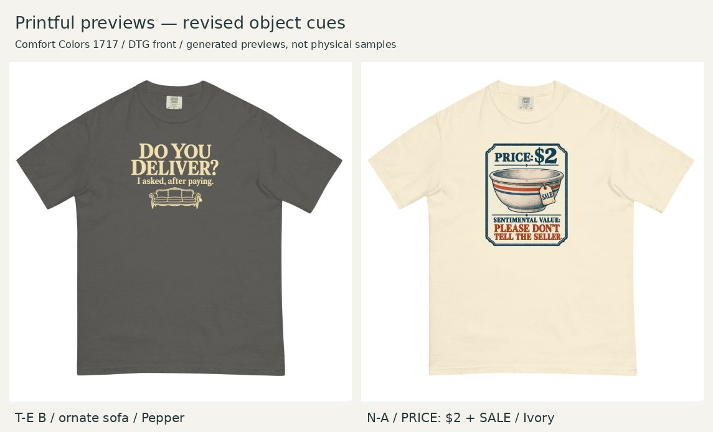

# Provider verification — ornate sofa and $2 / SALE

October 21, 2026 (America/Chicago). Printful public Design Maker, Comfort Colors 1717, DTG front. Both final revised uploads were applied and their generated front previews inspected. No checkout or storefront publication.

| Selected upload | File ID | Color | Layer result |
|---|---|---|---|
| TE-cue04-12x16.png | 1091618516 | Pepper | Good / 150 DPI; width 12.00, height 16.00 units |
| NA-cue04-12x16.png | 1091618522 | Ivory | Good / 150 DPI; width 12.00, height 16.00 units |

Full screenshots: [ornate sofa](TE-provider-mockup.jpg), [$2 / SALE bowl](NA-provider-mockup.jpg). Layer records: [T-E](TE-layer.txt), [N-A](NA-layer.txt). Product records: [Pepper and DTG](TE-product.txt), [Ivory and DTG](NA-product.txt). Exact canvas [SHA-256 hashes](upload-hashes.json) link these uploads to the retained files.

The 12 × 16 measurements include padding; visible bounds and top anchors are in the [layout specs](../layout-specs.json). T-E is 8.5 × 6.3447 inches, left 1.75/top 1.5. N-A is 8 × 9.9783, left 2/top 1.5. No provider-side repositioning or enlargement was introduced. The ornate sofa, PRICE: $2 and SALE are visible in the respective final previews, with the intended hierarchy and no obvious clipping. No actual glow is visible around the selected sofa. Product/size scaling evidence is reused from the established workflow; this check does not establish a new physical calibration.

Both files passed PNG integrity checks before upload. An incomplete local N-A export was caught before upload and rebuilt; the build script now serializes each upload PNG completely before atomically replacing the file. Both listed provider uploads succeeded. Native detail remains separate from the 150-DPI export badge: T-E 165.2 ppi, N-A 126.9 ppi. Fine ornament, edge opacity, border behavior and physical print fidelity remain production/sample work.

The paired view uniformly crops the main shirt region (690,110)-(1240,660) from each retained screenshot, then adds labels. It does not repaint or retouch the designs. The full screenshots preserve surrounding Printful context.

Reference garment size, physical collar clearance and exact size-dependent fulfillment transforms remain unresolved. No sample, customer recognition test or sales result is claimed. Observed source page: https://www.printful.com/custom/brands/comfort-colors/unisex-garment-dyed-heavyweight-shirt-comfort-colors-1717?technique=T-SHIRT&color=Pepper&size=S#guidelines . Guest design state and subsequent editor color choices are not encoded in this URL.
