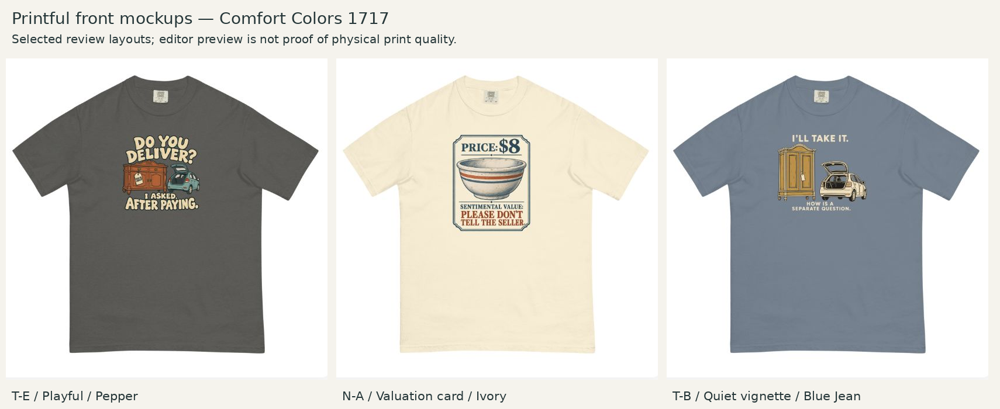

# Provider verification — NEXT-03

Observed October 21–22, 2026 UTC, after the frozen creative assessment. Actual guest Printful Design Maker previews, not generated garment images.

| Concept | Upload / file ID | Selected garment | Observed layer |
|---|---|---|---|
| T-E | TE-compact-12x16.png / 1091524056 | Comfort Colors 1717, Pepper, DTG front | 12 × 16 inches; Good / 150 DPI |
| N-A | NA-medium-12x16.png / 1091524049 | Comfort Colors 1717, Ivory, DTG front | 12 × 16 inches; Good / 150 DPI |
| T-B | TB-medium-12x16.png / 1091524042 | Comfort Colors 1717, Blue Jean, DTG front | 12 × 16 inches; Good / 150 DPI |

Each transparent canvas is 1800 × 2400 pixels with a 150-DPI export setting. No provider fit-to-area or aesthetic resizing was applied. The 12 × 16 measurement includes padding; actual ink dimensions are specified in ../layout-specs.json.

The actual generated front mockups were inspected individually. All preserve wording, selected palette and comfortable apparent collar clearance, with no evident clipping. T-E retains the compact cluster; N-A's tall card stays on the chest; T-B's quiet lower caption is visibly smaller and remains a closer-view read. No observed discrepancy requires changing the frozen creative selection. The local simulations and actual provider images are similar in overall placement; this does not establish a physical calibration.

Full-context evidence: [T-E controls](TE-provider-controls.jpg), [T-E mockup](TE-provider-mockup.jpg), [N-A controls](NA-provider-controls.jpg), [N-A mockup](NA-provider-mockup.jpg), [T-B controls](TB-provider-controls.jpg), [T-B mockup](TB-provider-mockup.jpg). The board is a uniform crop/composite of those screenshots for easier comparison, not a newly generated garment rendering.

## Limits and remaining work

The product UI exposed S through 4XL for the selected garment. These observations are not an inventory or fulfillment audit. Photographed size and size-dependent art scaling remain unverified; S/L/2XL comparisons in the main record are nominal calculations only. Existing generic provider scaling guidance remains unresolved at exact-transform level. No repeated uninformative calibration test was run.

The quality badge describes the exported canvas. Native effective detail remains approximately T-E 152.2, N-A 125.9 and T-B 122.8 ppi. N-A/T-B require higher-native-detail production derivatives while preserving the accepted composition. All three need edge/opacity inspection; N-A's fine engraving, small type and border need physical sample checks. Preview acceptance is not production approval or evidence of customer demand.

The public guest upload panel initially failed to show upload controls; one reload restored them. All three files were then uploaded and used in individual previews. No store listing, purchase, sample order or market test was created.
