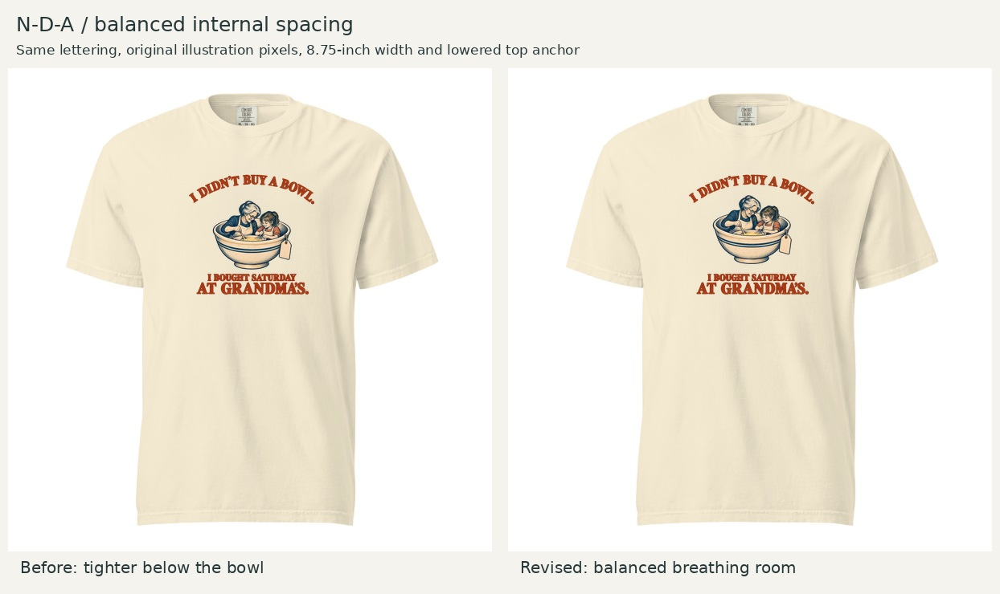
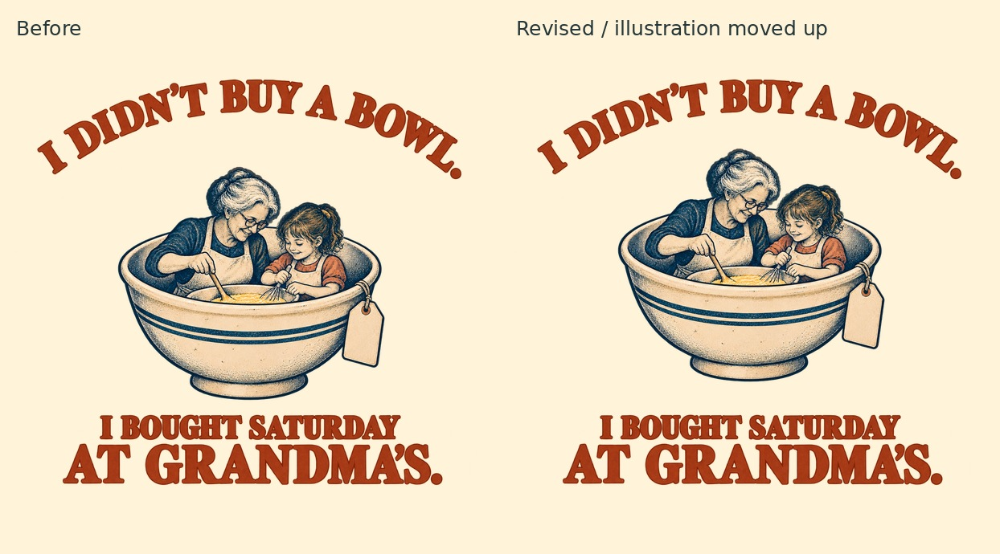

# N-D-A internal spacing correction

October 23, 2026. Founder approved the five lowered placements, then identified unequal space above/below the N-D-A illustration. The prior assessment missed this imbalance; it remains preserved, not retrospectively rewritten.

The selected revision shifts the original central scene upward 50 native pixels (about 0.38 inch at the approved footprint). The upper arch and lower two-line copy remain fixed. Overall width 8.75 inches, height 8.3794 inches and print-origin top 2 inches remain unchanged. Comfort Colors 1717 / Ivory / front DTG retained.

**Pre-feedback assessment:** the prior upper central gap was visibly larger than the bowl-to-payoff gap. The revision brings the scene into better optical balance between the arch and payoff without changing illustration scale or crowding either text block. The small shift remains visible at shirt scale. Curved lettering makes a universal bounding-box gap inappropriate; the central clearances and optical relationship guide this correction. Tradeoff: the scene sits closer to the arch, while the payoff gains breathing room. Recommend this version.

Three built-in imagegen spacing trials were rejected because they overshot or altered the scene. The selected file instead uses measured compositing of the original artwork, with no redrawing. `build.sh` isolates the scene in its transparent rectangular region and moves it up 50px. `build_review.py` exports the measured print canvas, checks the visible scene pixels within one 8-bit rounding level after compositing, verifies the fixed upper/lower bands, and creates comparisons. Dependencies: ImageMagick, Pillow, NumPy. Run shell script then Python script. Artwork and shirt-scale comparisons inspected.

**Current N-D-A upload candidate:** [NDA-balanced-12x16.png](NDA-balanced-12x16.png), superseding the parent folder's lowered-only N-D-A canvas. [Master](NDA-balanced-master.png) · [geometry](specs.json). Other four designs unchanged. Native-resolution limitations and Printful preview/sample verification remain open. No merge or order performed.
