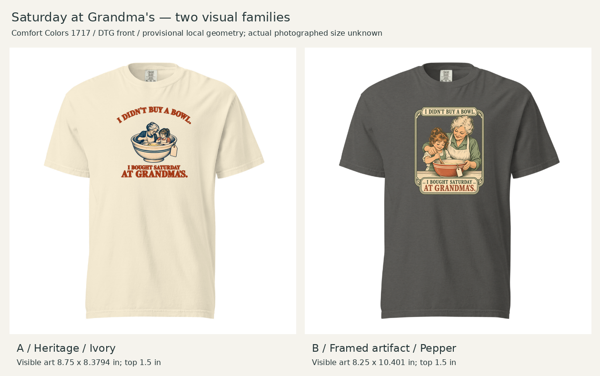
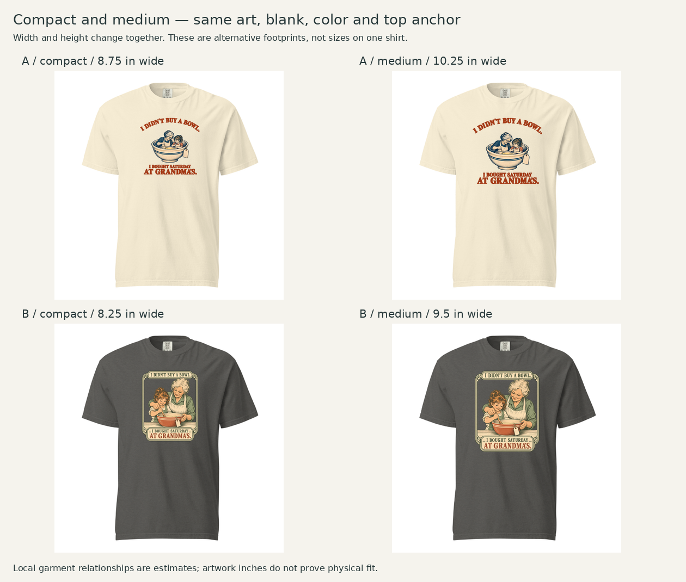
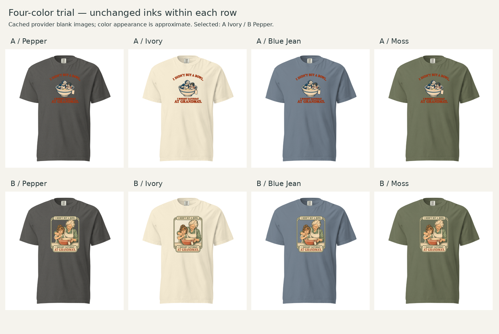
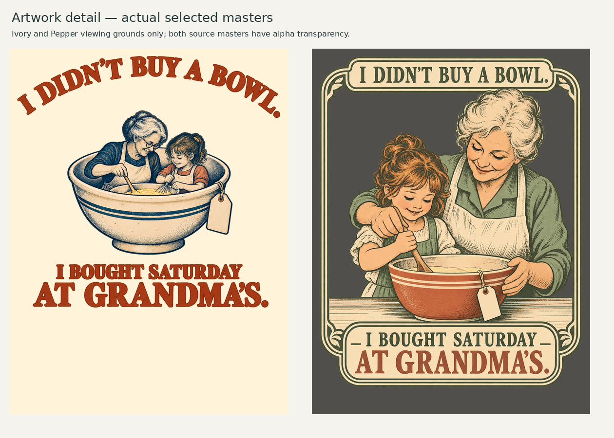

# Saturday at Grandma's — N-D in two visual families

Creative Director · October 21, 2026 (America/Chicago) · Founder accepts both visual directions, prefers B and authorizes documentation merge. [Feedback and disposition](founder-feedback.md). Production drafts: final provider mockup verification incomplete because the browser connection stalled.

## Assignment and concept choice

Continue after [CAR: WRONG closeout](../CAR-WRONG-05/closeout.md). User authorized one highly rated nostalgia concept in two suitable visual families, following current methodology and preserving the Creative Director's assessment before new feedback.

Selected **N-D**:

> I DIDN'T BUY A BOWL.\
> I BOUGHT SATURDAY\
> AT GRANDMA'S.

[Original card](../../../R012-Process-Comparison-Review-2026-10-19.md#n-d) · [Founder feedback](../../../R012-Process-Comparison-Founder-Nostalgia-Ratings-2026-10-19.md) · [Original process key](../../../R012-Process-Comparison-Key-2026-10-19.md#nostalgia).

N-D and N-A tied at Founder-reported 4.5/5. N-D was explicitly praised as emotionally powerful and solid despite not being funny. Choose it to test sincere storytelling after the transport joke; this does not retrospectively promote its score to humor, artwork approval or purchase intent. N-A remains available, not rejected.

## Handoff, material and meaning

Assignment integrity is **clear with nonblocking recognition/aesthetic uncertainty**. Preserve [approved positioning and working line](../../../../brands/R012-Antiques-Treasure-Hunters-Brand-Hypothesis-Brief.md#current-decision--october-3-2026): apparel for people who spot overlooked character and carry the story forward, beginning with antique and vintage treasure hunters; “For people who find things. And reasons to keep them.” No customer-facing brand name is added to these designs.

Material **R012-E005** is [ordinary replacement objects evoking family memories](../../../../Researches/R012-audience-evidence/Material-Bank.md#r012-e005--an-ordinary-replacement-can-carry-a-family-memory), priority 2 in the accepted [recognizability ranking](../../../R012-Material-Recognizability-Ranking-2026-10-19.md). It needs familiarity with memory-bearing household objects, not specialist appraisal knowledge. Multiple voices on one page do not measure prevalence or establish independent recurrence.

Material analysis: ownership can be new while familiarity is old; a stranger's bowl can recall one's own family; the transaction buys an object while its emotional value is an occasion. N-D came from explicit analysis plus **TRM-063**, shifting the category of the purchase from object to remembered time. Saturday, scene, tag and plain striped bowl are invented creative staging. This is not a claim that the bowl actually belonged to Grandma. Preserve original concept wording; no new concept-generation sweep or recipe rescan is necessary.

Copy supplies the acquisition/memory turn. The illustration must make the bowl, secondhand cue and shared baking experience legible. A sale tag helps keep the shirt connected to finding/keeping used objects; neither a tag nor a familiar kitchen scene proves that all viewers identify it as vintage hunting.

## Why these two families

| Alternative | Semantic and aesthetic job | Main tradeoff |
|---|---|---|
| A — [DLF-003 Heritage illustrated emblem](../../discovery-01/families/DLF-003.md) | Cherished bowl as dominant object; open serif framing, blue/cream illustration and rust lettering | People inside the bowl express memory metaphorically but may look too literal; smaller faces at shirt scale |
| B — [DLF-006 Framed illustrated artifact](../../discovery-01/families/DLF-006.md) | Family baking as a keepsake storybook/recipe-card scene; integrated frame and copy | Clearer human action, but taller, more decorative and potentially more baking-related than treasure-hunting-related |

Family cards, full reference images and details were inspected. DLF-003 anchors include DLS-HISTOREE-011 and DLS-ETSY-022; DLF-006 includes DLS-ETSY-016 and DLS-ZZ-029. Adapt relationships, not their distinctive artwork/words. Avoid branded kitchenware patterns and licensed subjects. These remain provisional family interpretations.

## Garment, footprint, colors and size checks

1717 remains the R012 design-stage default: relaxed, washed character supports a cherished-object context. Neither treatment creates a meaningful reason to switch to 64000. DTG front is the provisional production method. No cost, fulfillment or sample approval is implied.

| Selected version | Compact visible dimensions | Medium comparison | Position |
|---|---|---|---|
| A Heritage v3 / Ivory | 8.75 × 8.3794 inches | 10.25 × 9.8159 | Compact left 1.625 / top 1.5 inches |
| B Artifact v1 / Pepper | 8.25 × 10.401 inches | 9.50 × 11.9769 | Compact left 1.875 / top 1.5 inches |

Positions use the **12 × 16-inch print-canvas origin**, not the neckline. Compare each family on the same color/artwork/top anchor; preserve aspect ratio. Compact is selected for both after inspecting the alternatives: A's larger version adds coverage without solving the memory metaphor; B's larger version improves title size but becomes a large torso panel. The two families need different aspect ratios and application-specific widths; this is not a requirement to make every print equal in area.

A selects Ivory for rust/blue contrast and warmth. B selects Pepper for cream/sage contrast and the collected-artifact mood. The other approved colors were compared locally without recoloring the masters; no second colorway earned advancement. Cached Ivory/Blue Jean blanks contain translucent shading and require the recorded provider-color underlay; the build script preserves it. These are screen approximations, not measured fabric/ink matches.

The reusable round04 transform is **provisional**: 17.8 image pixels/inch, print-area origin y=97, center x=303 on a 602px preview; actual photographed size unknown. Local collar-rib low point is approximately y=70, highest ink approximately y=124: around 54 image pixels of visible cloth, not physical collar inches. Both selected bottom edges sit above the lower torso in these simulations; B is visibly taller. No verified worn view or physical placement calibration exists.

Nominal flat-width calculations retain the same artwork dimensions across S/L/2XL only as a sensitivity scenario:

| Design | S 18.25-inch width | L 22-inch width | 2XL 26-inch width |
|---|---:|---:|---:|
| A, 8.75-inch print | 47.9% | 39.8% | 33.7% |
| B, 8.25-inch print | 45.2% | 37.5% | 31.7% |

Widths reuse the prior size-chart record. These are print-width / nominal garment-width calculations, not size-specific mockups or verified fulfillment scale. Current Printful guidelines state that graphics scale according to product size; the exact per-size transform remains unresolved. Do not assume equal editor canvas controls establish fixed physical scaling.

## Artwork and preserved judgment

- [Frozen Creative Director assessment](assessment.md) — qualitative preference and specific concerns, recorded before Founder feedback.
- Masters: [A v3](assets/A-heritage-v3.png), [B v1](assets/B-artifact-v1.png). Both have alpha transparency. [A v1](assets/A-heritage-v1.png) and [v2](assets/A-heritage-v2.png) preserve the caught spacing issues.
- [Measured layout specification](layout-specs.json), [A upload canvas](layouts/A-compact-12x16.png), [B upload canvas](layouts/B-compact-12x16.png).
- [Exact built-in image-generation prompts](generation-prompts.json) and [reproducible placement script](build_review.py). Run with Pillow from a complete checkout; it reuses round04 blank assets and does not repaint the artwork.
- [Provider evidence and outstanding verification](evidence/verification.md).

The original assessment favors B's clearer emotional storytelling while preserving A as the more object-led option. Warmth, humor and willingness to wear are judged separately. No numerical composite or automatic family validation is introduced.

## Original review questions and next task

Review the actual shirt and enlarged artwork before reading the assessment if you want a less anchored first impression. Record feedback separately: which treatment would you want to wear, does the memory come through immediately, and does it feel connected to a secondhand find? In A, specifically note whether the people-in-bowl visual helps or distracts.

Founder feedback is now recorded [separately](founder-feedback.md): preserve both selected directions; B is preferred, A has no Founder-confirmed defect. Finish the provider preview check and native-detail/transparency production work before store release. Native effective detail is only about 132.2 ppi for A and 113.0 for B at selected widths; resampling a 150-DPI export does not improve that detail. Exact phrase/originality screening remains downstream before production as specified in the concept record. Documentation merge is authorized; no sample, order, store publication or market test is included.
