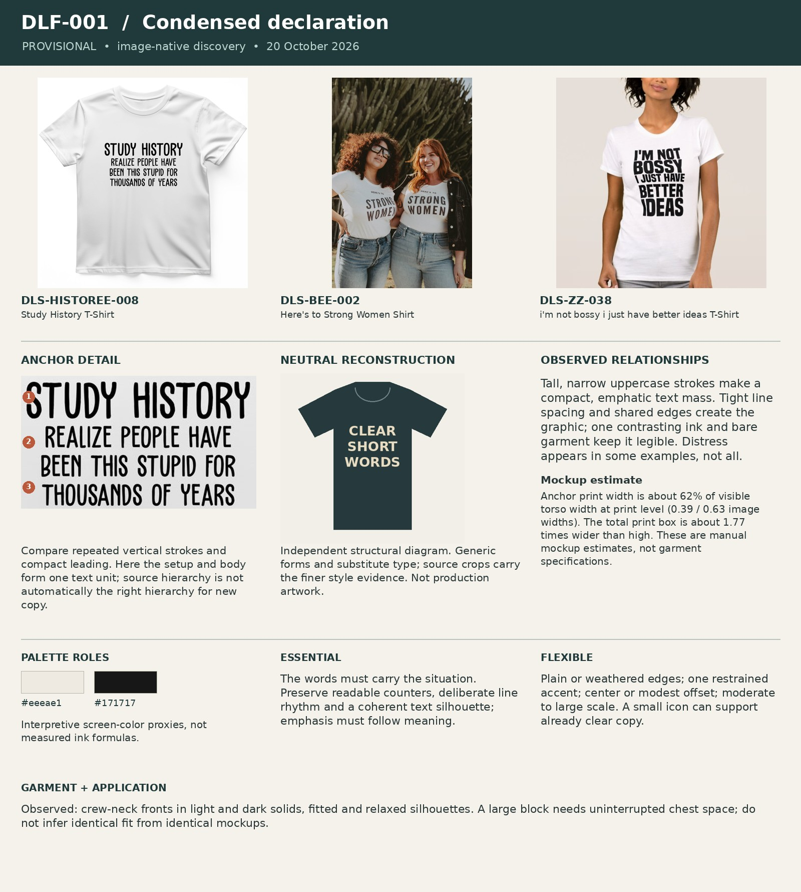

# DLF-001 — Condensed declaration

Provisional visual family · 2026-10-20 · Analyst interpretation, not purchase validation.

## References and evidence

- [DLS-HISTOREE-008](../../sourcing/expanded-scan/records/DLS-HISTOREE-008.md) — [retained full image](../../sourcing/expanded-scan/images/DLS-HISTOREE-008.jpg); [source product](https://historeetees.com/products/study-history-white-t-shirt).
- [DLS-BEE-002](../../sourcing/expanded-scan/records/DLS-BEE-002.md) — [retained full image](../../sourcing/initial-eight/assets/DLS-BEE-002-0.jpg); [source product](https://www.thebeeandthefox.com/products/heres-to-strong-women).
- [DLS-ZZ-038](../../sourcing/expanded-scan/records/DLS-ZZ-038.md) — [retained full image](../../sourcing/expanded-scan/images/DLS-ZZ-038.jpg); [source product](https://www.zazzle.com/im_not_bossy_i_just_have_better_ideas_t_shirt-235197774222632415).

Core examples: DLS-BEE-001, DLS-BEE-002, DLS-ETSY-023, DLS-ETSY-035, DLS-HISTOREE-005, DLS-HISTOREE-008, DLS-RB-036, DLS-ZZ-005, DLS-ZZ-024, DLS-ZZ-038.

Boundary examples: DLS-RB-007, DLS-RB-018, DLS-RB-022, DLS-ZZ-009, DLS-ZZ-035, DLS-ZZ-036, DLS-ZZ-043, DLS-SNORG-005, DLS-SNORG-020. These share some relationships but differ in lettering, image treatment, framing, scale or garment; membership is not all-or-nothing. Full record links and original observations are in the [220-image review log](../Review-Log.md). Source-order and commercial-signal limitations remain attached to each source record.

## Observed combination

Tall, narrow uppercase strokes make a compact, emphatic text mass. Tight line spacing and shared edges create the graphic; one contrasting ink and bare garment keep it legible. Distress appears in some examples, not all.

## Essential relationships — working hypothesis

The words must carry the situation. Preserve readable counters, deliberate line rhythm and a coherent text silhouette; emphasis must follow meaning.

## Flexible relationships and subtypes

Plain or weathered edges; one restrained accent; center or modest offset; moderate to large scale. A small icon can support already clear copy.

## Garment relationship

Observed: crew-neck fronts in light and dark solids, fitted and relaxed silhouettes. A large block needs uninterrupted chest space; do not infer identical fit from identical mockups.

## Audience and semantic fit — transfer hypothesis

A plausible fit for audiences who enjoy direct statements or verbal humor. Fails when the audience or situation exists only in an invisible illustration. CAR: WRONG needs more image evidence than a pure type version supplies.

## Failure conditions

Too many independently enlarged words; illegible condensed counters; a tiny illustration asked to explain the whole premise.

## Measured relationships

Anchor print width is about 62% of visible torso width at print level (0.39 / 0.63 image widths). The total print box is about 1.77 times wider than high. These are manual mockup estimates, not garment specifications.

## Application guidance — proposed choice

Try at most one payoff accent. Select line breaks after assigning semantic roles, not by filling a rectangle.

Measurement source: DLS-HISTOREE-008; normalized artwork box `[0.31, 0.3, 0.7, 0.52]` (x1, y1, x2, y2 as fractions of the full retained image). Pixel crop `[310, 300, 700, 520]`. manual visual bounds; denominator is horizontal visible torso width at artwork level, not shoulder/sleeve width; approximately ±5 percentage points for flat mockups, ±10 or more for styled/folded photos. Perspective, folds, occlusion and reproduction may distort ratios. Ranges describe these images, not universal recipe limits. Palette hex values are interpretive visual proxies, not sampled production inks. Crop callouts 1–3 mark upper/middle/lower observation zones; the adjacent note explains their relationship.

The independent [neutral reconstruction](../assets/DLF-001-neutral.png) substitutes generic words and shapes. It preserves an interpretation of composition and palette relationships; it does not reproduce the source font, distinctive artwork, exact texture or creator intent. Use the full references and detail crop alongside it.

## Application evidence

Not applied in this round. Source recurrence alone does not establish transfer to a new audience or concept.
