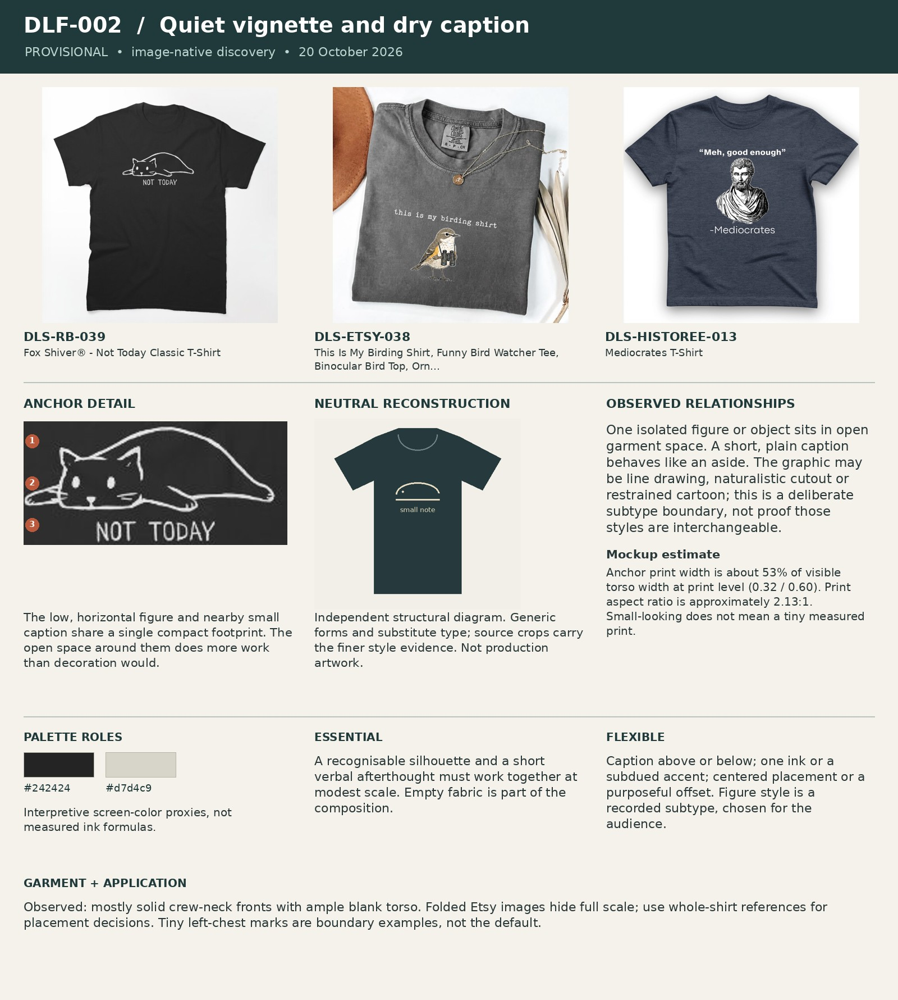

# DLF-002 — Quiet vignette and dry caption

Provisional visual family · 2026-10-20 · Analyst interpretation, not purchase validation.

## References and evidence

- [DLS-RB-039](../../sourcing/expanded-scan/records/DLS-RB-039.md) — [retained full image](../../sourcing/expanded-scan/images/DLS-RB-039.jpg); [source product](https://www.redbubble.com/i/t-shirt/Fox-Shiver-Not-Today-by-FoxShiver/85381169/lrcw.XYZ).
- [DLS-ETSY-038](../../sourcing/expanded-scan/records/DLS-ETSY-038.md) — [retained full image](../../sourcing/expanded-scan/images/DLS-ETSY-038.jpg); [source product](https://www.etsy.com/listing/4520338918/this-is-my-birding-shirt-funny-bird).
- [DLS-HISTOREE-013](../../sourcing/expanded-scan/records/DLS-HISTOREE-013.md) — [retained full image](../../sourcing/expanded-scan/images/DLS-HISTOREE-013.jpg); [source product](https://historeetees.com/products/mediocrates-meh-t-shirt).

Core examples: DLS-ETSY-010, DLS-ETSY-012, DLS-ETSY-015, DLS-ETSY-024, DLS-ETSY-026, DLS-ETSY-038, DLS-ETSY-039, DLS-HISTOREE-006, DLS-HISTOREE-007, DLS-HISTOREE-010, DLS-HISTOREE-013, DLS-HISTOREE-018, DLS-HISTOREE-020, DLS-RB-005, DLS-RB-010, DLS-RB-039, DLS-ZZ-041.

Boundary examples: DLS-ETSY-006, DLS-ETSY-013, DLS-ETSY-017, DLS-ETSY-030, DLS-ETSY-033, DLS-ETSY-037, DLS-HISTOREE-012, DLS-HISTOREE-017, DLS-LIG-008, DLS-LIG-019, DLS-RB-003, DLS-RB-011, DLS-RB-021, DLS-RB-024, DLS-RB-025, DLS-RB-038, DLS-SNORG-015, DLS-ZZ-007, DLS-ZZ-019, DLS-ZZ-027, DLS-ZZ-042. These share some relationships but differ in lettering, image treatment, framing, scale or garment; membership is not all-or-nothing. Full record links and original observations are in the [220-image review log](../Review-Log.md). Source-order and commercial-signal limitations remain attached to each source record.

## Observed combination

One isolated figure or object sits in open garment space. A short, plain caption behaves like an aside. The graphic may be line drawing, naturalistic cutout or restrained cartoon; this is a deliberate subtype boundary, not proof those styles are interchangeable.

## Essential relationships — working hypothesis

A recognisable silhouette and a short verbal afterthought must work together at modest scale. Empty fabric is part of the composition.

## Flexible relationships and subtypes

Caption above or below; one ink or a subdued accent; centered placement or a purposeful offset. Figure style is a recorded subtype, chosen for the audience.

## Garment relationship

Observed: mostly solid crew-neck fronts with ample blank torso. Folded Etsy images hide full scale; use whole-shirt references for placement decisions. Tiny left-chest marks are boundary examples, not the default.

## Audience and semantic fit — transfer hypothesis

Useful for quiet, observant humor when a single object supplies the missing context. Less suitable for a sequence, multiple relationships or subtle antique details that disappear when reduced.

## Failure conditions

Confusing restraint with undersizing; a fine drawing that turns into an indistinct spot; a caption so small that the payoff vanishes.

## Measured relationships

Anchor print width is about 53% of visible torso width at print level (0.32 / 0.60). Print aspect ratio is approximately 2.13:1. Small-looking does not mean a tiny measured print.

## Application guidance — proposed choice

For a complex material, first simplify the visual relation; do not simply reduce the entire illustration.

Measurement source: DLS-RB-039; normalized artwork box `[0.34, 0.27, 0.66, 0.42]` (x1, y1, x2, y2 as fractions of the full retained image). Pixel crop `[204, 162, 396, 252]`. manual visual bounds; denominator is horizontal visible torso width at artwork level, not shoulder/sleeve width; approximately ±5 percentage points for flat mockups, ±10 or more for styled/folded photos. Perspective, folds, occlusion and reproduction may distort ratios. Ranges describe these images, not universal recipe limits. Palette hex values are interpretive visual proxies, not sampled production inks. Crop callouts 1–3 mark upper/middle/lower observation zones; the adjacent note explains their relationship.

The independent [neutral reconstruction](../assets/DLF-002-neutral.png) substitutes generic words and shapes. It preserves an interpretation of composition and palette relationships; it does not reproduce the source font, distinctive artwork, exact texture or creator intent. Use the full references and detail crop alongside it.

## Application evidence

Not applied in this round. Source recurrence alone does not establish transfer to a new audience or concept.
