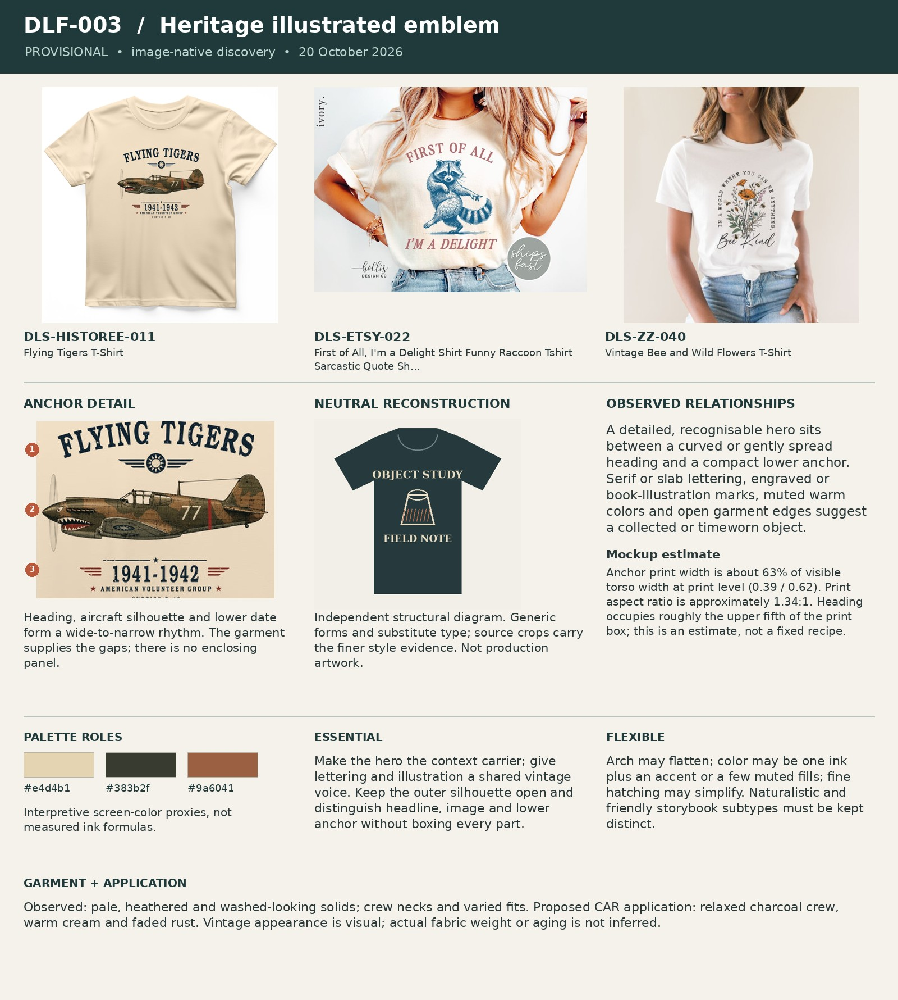

# DLF-003 — Heritage illustrated emblem

Provisional visual family · 2026-10-20 · Analyst interpretation, not purchase validation.

## References and evidence

- [DLS-HISTOREE-011](../../sourcing/expanded-scan/records/DLS-HISTOREE-011.md) — [retained full image](../../sourcing/expanded-scan/images/DLS-HISTOREE-011.jpg); [source product](https://historeetees.com/products/flying-tigers-t-shirt).
- [DLS-ETSY-022](../../sourcing/expanded-scan/records/DLS-ETSY-022.md) — [retained full image](../../sourcing/expanded-scan/images/DLS-ETSY-022.jpg); [source product](https://www.etsy.com/listing/4347191679/first-of-all-im-a-delight-shirt-funny).
- [DLS-ZZ-040](../../sourcing/expanded-scan/records/DLS-ZZ-040.md) — [retained full image](../../sourcing/expanded-scan/images/DLS-ZZ-040.jpg); [source product](https://www.zazzle.com/vintage_bee_and_wild_flowers_t_shirt-256385862165696722).

Core examples: DLS-ETSY-011, DLS-ETSY-014, DLS-ETSY-022, DLS-HISTOREE-004, DLS-HISTOREE-011, DLS-HISTOREE-019, DLS-ZZ-014, DLS-ZZ-040, DLS-SLOTH-005, DLS-SLOTH-010.

Boundary examples: DLS-HISTOREE-021, DLS-SLOTH-001, DLS-SLOTH-006, DLS-SLOTH-009, DLS-SLOTH-013, DLS-LIG-015, DLS-SNORG-008, DLS-SNORG-013, DLS-RB-002, DLS-RB-009, DLS-RB-016. These share some relationships but differ in lettering, image treatment, framing, scale or garment; membership is not all-or-nothing. Full record links and original observations are in the [220-image review log](../Review-Log.md). Source-order and commercial-signal limitations remain attached to each source record.

## Observed combination

A detailed, recognisable hero sits between a curved or gently spread heading and a compact lower anchor. Serif or slab lettering, engraved or book-illustration marks, muted warm colors and open garment edges suggest a collected or timeworn object.

## Essential relationships — working hypothesis

Make the hero the context carrier; give lettering and illustration a shared vintage voice. Keep the outer silhouette open and distinguish headline, image and lower anchor without boxing every part.

## Flexible relationships and subtypes

Arch may flatten; color may be one ink plus an accent or a few muted fills; fine hatching may simplify. Naturalistic and friendly storybook subtypes must be kept distinct.

## Garment relationship

Observed: pale, heathered and washed-looking solids; crew necks and varied fits. Proposed CAR application: relaxed charcoal crew, warm cream and faded rust. Vintage appearance is visual; actual fabric weight or aging is not inferred.

## Audience and semantic fit — transfer hypothesis

Promising for some antique/vintage hunters because familiar object illustration and aged print can reinforce the subject. Transfer to food lovers needs evidence of their aesthetic fit; the same frame alone is insufficient.

## Failure conditions

A generic badge with no material-specific action; tiny engraved details carrying the joke; ornamental stars and dates added without meaning.

## Measured relationships

Anchor print width is about 63% of visible torso width at print level (0.39 / 0.62). Print aspect ratio is approximately 1.34:1. Heading occupies roughly the upper fifth of the print box; this is an estimate, not a fixed recipe.

## Application guidance — proposed choice

For CAR: WRONG, replace the solitary hero with a clearly related antique cabinet and small open-boot car. Keep the setup at one weight and give the verdict a strong lower anchor.

Measurement source: DLS-HISTOREE-011; normalized artwork box `[0.31, 0.26, 0.7, 0.55]` (x1, y1, x2, y2 as fractions of the full retained image). Pixel crop `[310, 260, 700, 550]`. manual visual bounds; denominator is horizontal visible torso width at artwork level, not shoulder/sleeve width; approximately ±5 percentage points for flat mockups, ±10 or more for styled/folded photos. Perspective, folds, occlusion and reproduction may distort ratios. Ranges describe these images, not universal recipe limits. Palette hex values are interpretive visual proxies, not sampled production inks. Crop callouts 1–3 mark upper/middle/lower observation zones; the adjacent note explains their relationship.

The independent [neutral reconstruction](../assets/DLF-003-neutral.png) substitutes generic words and shapes. It preserves an interpretation of composition and palette relationships; it does not reproduce the source font, distinctive artwork, exact texture or creator intent. Use the full references and detail crop alongside it.

## Application evidence

[CAR: WRONG round 02](../../applications/CAR-WRONG-02/README.md) tests this family. Read its frozen assessment and limitations before claiming transfer.

### CAR: WRONG calibration — October 21

In [round04](../../applications/CAR-WRONG-04/README.md), Founder preferred the arched setup over straight stacks because it better expressed the heritage emblem. Founder had also rejected an overly fat payoff and requested a one-color cabinet/car illustration. Preserve the combined lesson: frame the object group, retain a classic typographic voice, and judge the whole relationship rather than fixing one dimension in isolation. The resulting blue illustration/rose type on Ivory remains a review draft, with fine-line cleanup outstanding. This application supports the arched subtype; it does not remove flatter headings from the family or validate customer demand.

### Internal-spacing calibration — October 21

Founder selected round04's one-color-object Heritage direction, then found its copy-to-graphic gaps cramped. The cabinet crown/upper copy and object bases/payoff need optical separation that survives shirt scale for this composed emblem treatment. Preserve the arch and classic type while opening the gaps without weakening the hero or elongating the print. This refines one application, not every heritage subtype.

See the [paired visual record](../../reviews/2026-10-21-CAR-WRONG-Spacing.md) and [round05 revision](../../applications/CAR-WRONG-05/README.md). Founder preference is calibration, not customer purchase evidence.
