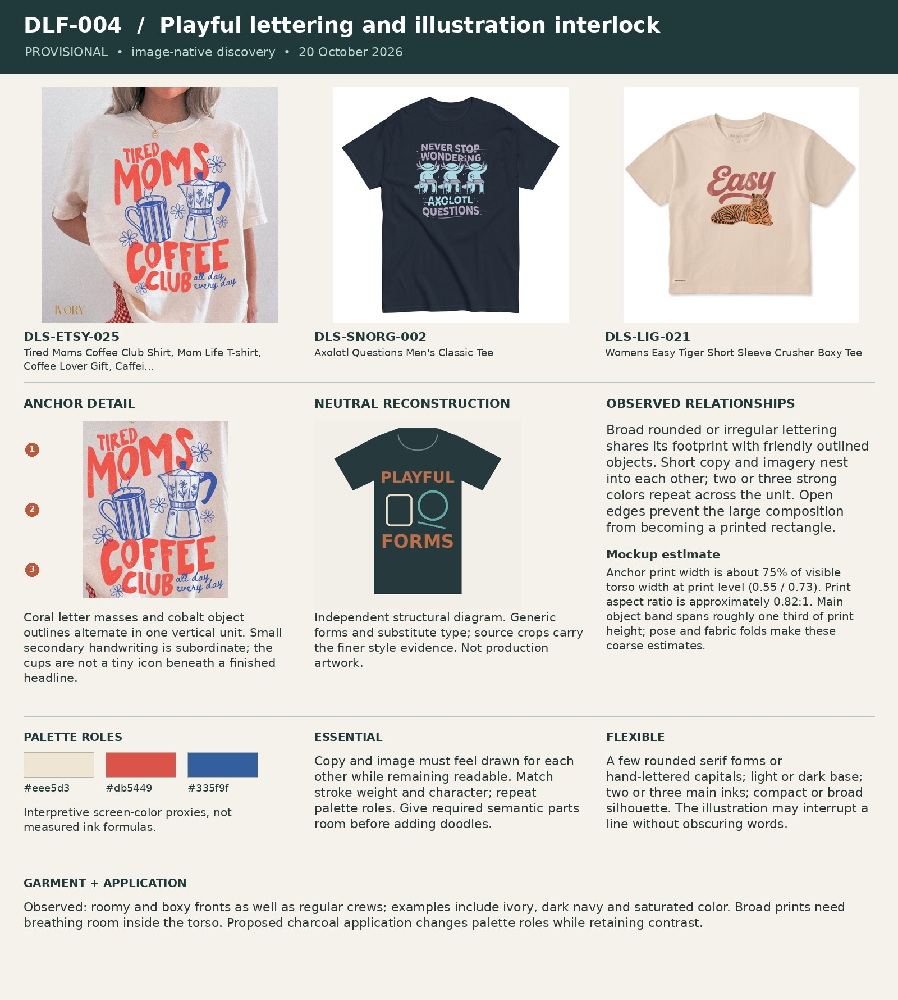

# DLF-004 — Playful lettering and illustration interlock

Provisional visual family · 2026-10-20 · Analyst interpretation, not purchase validation.

## References and evidence

- [DLS-ETSY-025](../../sourcing/expanded-scan/records/DLS-ETSY-025.md) — [retained full image](../../sourcing/expanded-scan/images/DLS-ETSY-025.jpg); [source product](https://www.etsy.com/listing/4486104985/tired-moms-coffee-club-shirt-mom-life-t).
- [DLS-SNORG-002](../../sourcing/expanded-scan/records/DLS-SNORG-002.md) — [retained full image](../../sourcing/discovery-28/assets/DLS-SNORG-002-0.jpg); [source product](https://www.snorgtees.com/products/axolotl-questions-mens-classic-tee).
- [DLS-LIG-021](../../sourcing/expanded-scan/records/DLS-LIG-021.md) — [retained full image](../../sourcing/expanded-scan/images/DLS-LIG-021.jpg); [source product](https://lifeisgood.com/products/womens-easy-tiger-short-sleeve-crusher-boxy-tee).

Core examples: DLS-ETSY-025, DLS-ETSY-046, DLS-ETSY-048, DLS-LIG-021, DLS-SLOTH-012, DLS-SLOTH-017, DLS-SNORG-002, DLS-SNORG-003, DLS-SNORG-016, DLS-ZZ-001, DLS-ZZ-025.

Boundary examples: DLS-ETSY-008, DLS-ETSY-009, DLS-ETSY-018, DLS-ETSY-027, DLS-ETSY-047, DLS-SNORG-007, DLS-SNORG-011, DLS-SNORG-021, DLS-LIG-017, DLS-ZZ-009, DLS-ZZ-016, DLS-ZZ-017, DLS-ZZ-023, DLS-ZZ-030, DLS-ZZ-033, DLS-SLOTH-013. These share some relationships but differ in lettering, image treatment, framing, scale or garment; membership is not all-or-nothing. Full record links and original observations are in the [220-image review log](../Review-Log.md). Source-order and commercial-signal limitations remain attached to each source record.

## Observed combination

Broad rounded or irregular lettering shares its footprint with friendly outlined objects. Short copy and imagery nest into each other; two or three strong colors repeat across the unit. Open edges prevent the large composition from becoming a printed rectangle.

## Essential relationships — working hypothesis

Copy and image must feel drawn for each other while remaining readable. Match stroke weight and character; repeat palette roles. Give required semantic parts room before adding doodles.

## Flexible relationships and subtypes

A few rounded serif forms or hand-lettered capitals; light or dark base; two or three main inks; compact or broad silhouette. The illustration may interrupt a line without obscuring words.

## Garment relationship

Observed: roomy and boxy fronts as well as regular crews; examples include ivory, dark navy and saturated color. Broad prints need breathing room inside the torso. Proposed charcoal application changes palette roles while retaining contrast.

## Audience and semantic fit — transfer hypothesis

Promising for audiences who welcome approachable, cheerful humor and visible illustrations. Cute or bubbly treatment may weaken a solemn, austere or understated concept. Gendered store routes do not establish who will like it.

## Failure conditions

Decorative clutter, many competing letter styles, equal emphasis everywhere, or cuteness that hides the actual transport problem.

## Measured relationships

Anchor print width is about 75% of visible torso width at print level (0.55 / 0.73). Print aspect ratio is approximately 0.82:1. Main object band spans roughly one third of print height; pose and fabric folds make these coarse estimates.

## Application guidance — proposed choice

For CAR: WRONG, fit two equally treated setup ideas into one line, then let the cabinet/car relationship occupy the middle and the punchline anchor the bottom. Omit unrelated flowers or stars.

Measurement source: DLS-ETSY-025; normalized artwork box `[0.29, 0.21, 0.84, 0.88]` (x1, y1, x2, y2 as fractions of the full retained image). Pixel crop `[230, 167, 667, 699]`. manual visual bounds; denominator is horizontal visible torso width at artwork level, not shoulder/sleeve width; approximately ±5 percentage points for flat mockups, ±10 or more for styled/folded photos. Perspective, folds, occlusion and reproduction may distort ratios. Ranges describe these images, not universal recipe limits. Palette hex values are interpretive visual proxies, not sampled production inks. Crop callouts 1–3 mark upper/middle/lower observation zones; the adjacent note explains their relationship.

The independent [neutral reconstruction](../assets/DLF-004-neutral.png) substitutes generic words and shapes. It preserves an interpretation of composition and palette relationships; it does not reproduce the source font, distinctive artwork, exact texture or creator intent. Use the full references and detail crop alongside it.

## Application evidence

[CAR: WRONG round 02](../../applications/CAR-WRONG-02/README.md) tests this family. Read its frozen assessment and limitations before claiming transfer.

### Internal-spacing calibration — October 21

Founder retained round04 Playful as a different aesthetic worth selling/testing and accepted its dense copy/graphic grouping because it suits the playful character. Closely nested rounded letters and cartoon objects can read as one cohesive unit. Density is not permission for unreadable text, accidental collisions or lost semantic cues; it is not mandatory for every playful application.

See the [paired visual record](../../reviews/2026-10-21-CAR-WRONG-Spacing.md) and [round05 revision](../../applications/CAR-WRONG-05/README.md). Founder preference is calibration, not customer purchase evidence.
