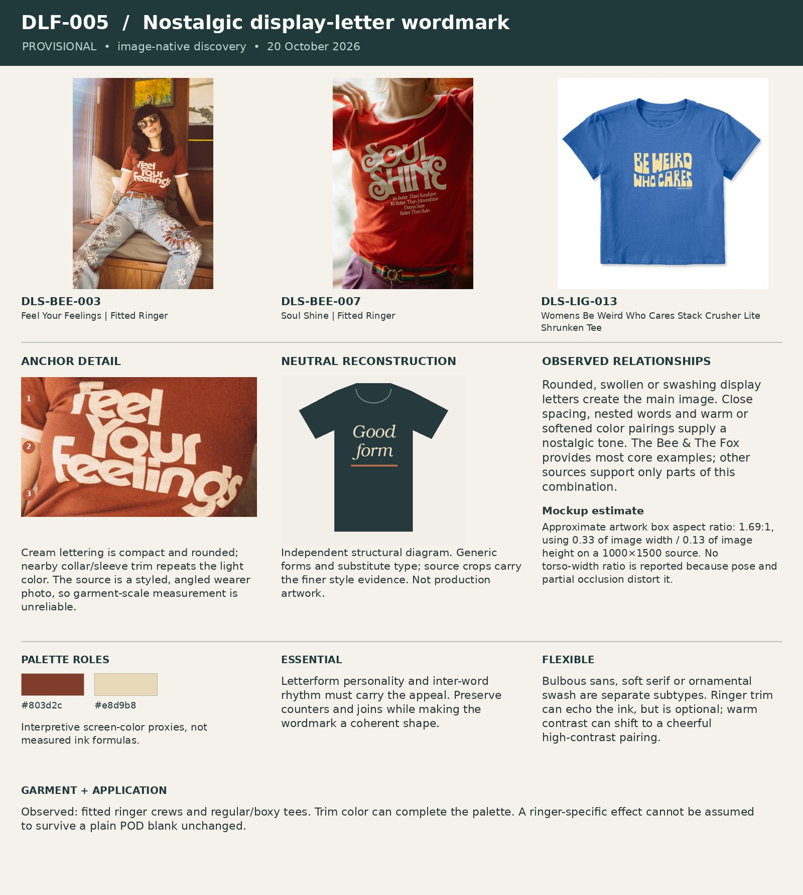

# DLF-005 — Nostalgic display-letter wordmark

Provisional visual family · 2026-10-20 · Analyst interpretation, not purchase validation.

## References and evidence

- [DLS-BEE-003](../../sourcing/expanded-scan/records/DLS-BEE-003.md) — [retained full image](../../sourcing/initial-eight/assets/DLS-BEE-003-0.jpg); [source product](https://www.thebeeandthefox.com/products/feel-your-feelings).
- [DLS-BEE-007](../../sourcing/expanded-scan/records/DLS-BEE-007.md) — [retained full image](../../sourcing/expanded-scan/images/DLS-BEE-007.jpg); [source product](https://www.thebeeandthefox.com/products/soul-shine-fitted-ringer).
- [DLS-LIG-013](../../sourcing/expanded-scan/records/DLS-LIG-013.md) — [retained full image](../../sourcing/expanded-scan/images/DLS-LIG-013.jpg); [source product](https://lifeisgood.com/products/womens-be-weird-who-cares-stack-crusher-lite-shrunken-tee).

Core examples: DLS-BEE-003, DLS-BEE-006, DLS-BEE-007, DLS-BEE-008, DLS-LIG-013, DLS-ZZ-003.

Boundary examples: DLS-ZZ-021, DLS-ZZ-028, DLS-SNORG-012, DLS-SNORG-020. These share some relationships but differ in lettering, image treatment, framing, scale or garment; membership is not all-or-nothing. Full record links and original observations are in the [220-image review log](../Review-Log.md). Source-order and commercial-signal limitations remain attached to each source record.

## Observed combination

Rounded, swollen or swashing display letters create the main image. Close spacing, nested words and warm or softened color pairings supply a nostalgic tone. The Bee & The Fox provides most core examples; other sources support only parts of this combination.

## Essential relationships — working hypothesis

Letterform personality and inter-word rhythm must carry the appeal. Preserve counters and joins while making the wordmark a coherent shape.

## Flexible relationships and subtypes

Bulbous sans, soft serif or ornamental swash are separate subtypes. Ringer trim can echo the ink, but is optional; warm contrast can shift to a cheerful high-contrast pairing.

## Garment relationship

Observed: fitted ringer crews and regular/boxy tees. Trim color can complete the palette. A ringer-specific effect cannot be assumed to survive a plain POD blank unchanged.

## Audience and semantic fit — transfer hypothesis

Useful when the wording itself is the desired identity signal and the audience welcomes nostalgic lettering. Evidence is concentrated in one brand; do not equate that brand audience with all women or antique hunters.

## Failure conditions

Using an arbitrary retro font as the entire recipe; pinched letter counters; decorative swashes that interfere with the reading order.

## Measured relationships

Approximate artwork box aspect ratio: 1.69:1, using 0.33 of image width / 0.13 of image height on a 1000×1500 source. No torso-width ratio is reported because pose and partial occlusion distort it.

## Application guidance — proposed choice

Test on short, self-contained copy first. A transport joke requiring a large picture is not the strongest initial transfer test.

Measurement source: DLS-BEE-003; normalized artwork box `[0.39, 0.39, 0.72, 0.52]` (x1, y1, x2, y2 as fractions of the full retained image). Pixel crop `[390, 585, 720, 780]`. manual visual bounds; denominator is horizontal visible torso width at artwork level, not shoulder/sleeve width; approximately ±5 percentage points for flat mockups, ±10 or more for styled/folded photos. Perspective, folds, occlusion and reproduction may distort ratios. Ranges describe these images, not universal recipe limits. Palette hex values are interpretive visual proxies, not sampled production inks. Crop callouts 1–3 mark upper/middle/lower observation zones; the adjacent note explains their relationship.

The independent [neutral reconstruction](../assets/DLF-005-neutral.png) substitutes generic words and shapes. It preserves an interpretation of composition and palette relationships; it does not reproduce the source font, distinctive artwork, exact texture or creator intent. Use the full references and detail crop alongside it.

## Application evidence

Not applied in this round. Source recurrence alone does not establish transfer to a new audience or concept.
