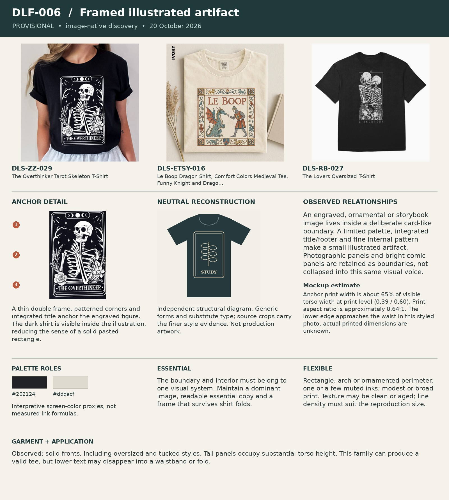

# DLF-006 — Framed illustrated artifact

Provisional visual family · 2026-10-20 · Analyst interpretation, not purchase validation.

## References and evidence

- [DLS-ZZ-029](../../sourcing/expanded-scan/records/DLS-ZZ-029.md) — [retained full image](../../sourcing/expanded-scan/images/DLS-ZZ-029.jpg); [source product](https://www.zazzle.com/the_overthinker_tarot_skeleton_t_shirt-256445344356044235).
- [DLS-ETSY-016](../../sourcing/expanded-scan/records/DLS-ETSY-016.md) — [retained full image](../../sourcing/expanded-scan/images/DLS-ETSY-016.jpg); [source product](https://www.etsy.com/listing/4545932867/le-boop-dragon-shirt-comfort-colors).
- [DLS-RB-027](../../sourcing/expanded-scan/records/DLS-RB-027.md) — [retained full image](../../sourcing/expanded-scan/images/DLS-RB-027.jpg); [source product](https://www.redbubble.com/i/t-shirt/The-Lovers-by-deniart/27240325/rh5j.XYZ).

Core examples: DLS-ETSY-016, DLS-ETSY-028, DLS-ETSY-029, DLS-ETSY-032, DLS-RB-027, DLS-RB-032, DLS-SNORG-014, DLS-ZZ-029.

Boundary examples: DLS-ETSY-020, DLS-ETSY-031, DLS-ETSY-042, DLS-ETSY-043, DLS-ETSY-044, DLS-LIG-009, DLS-RB-001, DLS-RB-017, DLS-RB-026, DLS-RB-030, DLS-SNORG-009, DLS-SNORG-019, DLS-ZZ-008. These share some relationships but differ in lettering, image treatment, framing, scale or garment; membership is not all-or-nothing. Full record links and original observations are in the [220-image review log](../Review-Log.md). Source-order and commercial-signal limitations remain attached to each source record.

## Observed combination

An engraved, ornamental or storybook image lives inside a deliberate card-like boundary. A limited palette, integrated title/footer and fine internal pattern make a small illustrated artifact. Photographic panels and bright comic panels are retained as boundaries, not collapsed into this same visual voice.

## Essential relationships — working hypothesis

The boundary and interior must belong to one visual system. Maintain a dominant image, readable essential copy and a frame that survives shirt folds.

## Flexible relationships and subtypes

Rectangle, arch or ornamented perimeter; one or a few muted inks; modest or broad print. Texture may be clean or aged; line density must suit the reproduction size.

## Garment relationship

Observed: solid fronts, including oversized and tucked styles. Tall panels occupy substantial torso height. This family can produce a valid tee, but lower text may disappear into a waistband or fold.

## Audience and semantic fit — transfer hypothesis

Possible for audiences who enjoy collectible, gothic, bookish or decorative imagery. It is not automatically suitable for a quick visual joke or someone seeking a quiet everyday shirt.

## Failure conditions

Defaulting to a poster page with many explanatory blocks; making essential narrative depend on tiny details; mistaking the existence of a border for style similarity.

## Measured relationships

Anchor print width is about 65% of visible torso width at print level (0.39 / 0.60). Print aspect ratio is approximately 0.64:1. The lower edge approaches the waist in this styled photo; actual printed dimensions are unknown.

## Application guidance — proposed choice

Use only when the artifact-like presentation contributes to the identity or emotion. A border is not a cure for weak composition.

Measurement source: DLS-ZZ-029; normalized artwork box `[0.32, 0.27, 0.71, 0.88]` (x1, y1, x2, y2 as fractions of the full retained image). Pixel crop `[158, 133, 351, 435]`. manual visual bounds; denominator is horizontal visible torso width at artwork level, not shoulder/sleeve width; approximately ±5 percentage points for flat mockups, ±10 or more for styled/folded photos. Perspective, folds, occlusion and reproduction may distort ratios. Ranges describe these images, not universal recipe limits. Palette hex values are interpretive visual proxies, not sampled production inks. Crop callouts 1–3 mark upper/middle/lower observation zones; the adjacent note explains their relationship.

The independent [neutral reconstruction](../assets/DLF-006-neutral.png) substitutes generic words and shapes. It preserves an interpretation of composition and palette relationships; it does not reproduce the source font, distinctive artwork, exact texture or creator intent. Use the full references and detail crop alongside it.

## Application evidence

Not applied in this round. Source recurrence alone does not establish transfer to a new audience or concept.
