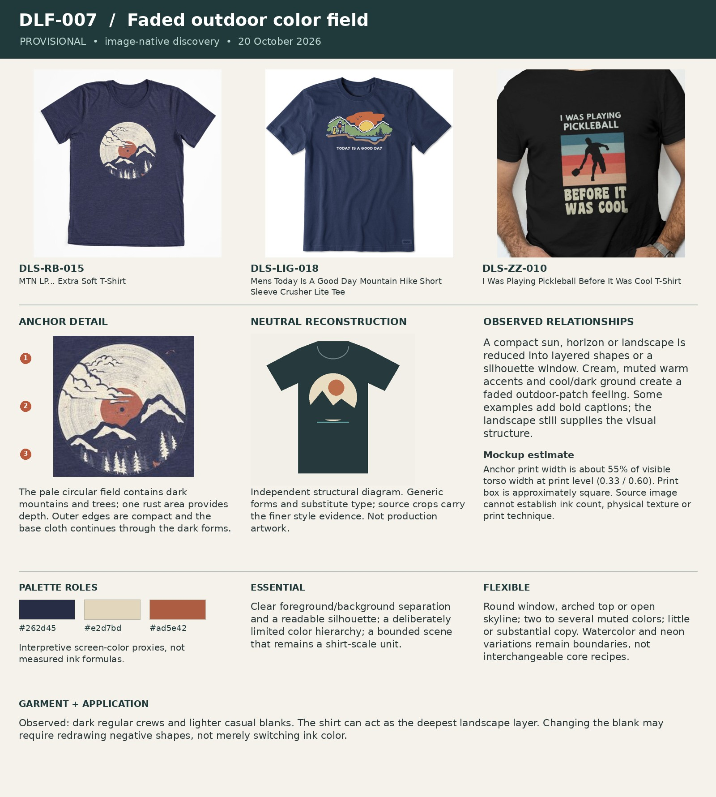

# DLF-007 — Faded outdoor color field

Provisional visual family · 2026-10-20 · Analyst interpretation, not purchase validation.

## References and evidence

- [DLS-RB-015](../../sourcing/expanded-scan/records/DLS-RB-015.md) — [retained full image](../../sourcing/expanded-scan/images/DLS-RB-015.jpg); [source product](https://www.redbubble.com/i/t-shirt/MTN-LP-by-ndtank/21013490/4d7w).
- [DLS-LIG-018](../../sourcing/expanded-scan/records/DLS-LIG-018.md) — [retained full image](../../sourcing/expanded-scan/images/DLS-LIG-018.jpg); [source product](https://lifeisgood.com/products/mens-today-is-a-good-day-mountain-hike-short-sleeve-crusher-lite-tee).
- [DLS-ZZ-010](../../sourcing/expanded-scan/records/DLS-ZZ-010.md) — [retained full image](../../sourcing/expanded-scan/images/DLS-ZZ-010.jpg); [source product](https://www.zazzle.com/i_was_playing_pickleball_before_it_was_cool_t_shirt-256598705485276007).

Core examples: DLS-HISTOREE-003, DLS-LIG-010, DLS-LIG-018, DLS-RB-015, DLS-RB-019, DLS-SLOTH-014, DLS-ZZ-004, DLS-ZZ-010, DLS-ZZ-011, DLS-ZZ-013, DLS-ZZ-018.

Boundary examples: DLS-LIG-016, DLS-RB-008, DLS-RB-012, DLS-RB-029, DLS-RB-035, DLS-SLOTH-001, DLS-SLOTH-003, DLS-SLOTH-008, DLS-SLOTH-011, DLS-SLOTH-019, DLS-SLOTH-020, DLS-SLOTH-021, DLS-SNORG-018. These share some relationships but differ in lettering, image treatment, framing, scale or garment; membership is not all-or-nothing. Full record links and original observations are in the [220-image review log](../Review-Log.md). Source-order and commercial-signal limitations remain attached to each source record.

## Observed combination

A compact sun, horizon or landscape is reduced into layered shapes or a silhouette window. Cream, muted warm accents and cool/dark ground create a faded outdoor-patch feeling. Some examples add bold captions; the landscape still supplies the visual structure.

## Essential relationships — working hypothesis

Clear foreground/background separation and a readable silhouette; a deliberately limited color hierarchy; a bounded scene that remains a shirt-scale unit.

## Flexible relationships and subtypes

Round window, arched top or open skyline; two to several muted colors; little or substantial copy. Watercolor and neon variations remain boundaries, not interchangeable core recipes.

## Garment relationship

Observed: dark regular crews and lighter casual blanks. The shirt can act as the deepest landscape layer. Changing the blank may require redrawing negative shapes, not merely switching ink color.

## Audience and semantic fit — transfer hypothesis

Strong source context in outdoor interests, with transfers to nostalgia and sport. For unrelated audiences the sun/mountains may be irrelevant decoration; borrow shape relationships only if the new concept needs them.

## Failure conditions

Adding a sunset to every subject; low contrast between successive layers; a background that competes with the required action.

## Measured relationships

Anchor print width is about 55% of visible torso width at print level (0.33 / 0.60). Print box is approximately square. Source image cannot establish ink count, physical texture or print technique.

## Application guidance — proposed choice

For CAR: WRONG, a sunset does no essential semantic work. Keep this family available for a more suitable material instead of forcing it into the current test.

Measurement source: DLS-RB-015; normalized artwork box `[0.34, 0.26, 0.67, 0.59]` (x1, y1, x2, y2 as fractions of the full retained image). Pixel crop `[204, 156, 402, 354]`. manual visual bounds; denominator is horizontal visible torso width at artwork level, not shoulder/sleeve width; approximately ±5 percentage points for flat mockups, ±10 or more for styled/folded photos. Perspective, folds, occlusion and reproduction may distort ratios. Ranges describe these images, not universal recipe limits. Palette hex values are interpretive visual proxies, not sampled production inks. Crop callouts 1–3 mark upper/middle/lower observation zones; the adjacent note explains their relationship.

The independent [neutral reconstruction](../assets/DLF-007-neutral.png) substitutes generic words and shapes. It preserves an interpretation of composition and palette relationships; it does not reproduce the source font, distinctive artwork, exact texture or creator intent. Use the full references and detail crop alongside it.

## Application evidence

Not applied in this round. Source recurrence alone does not establish transfer to a new audience or concept.
