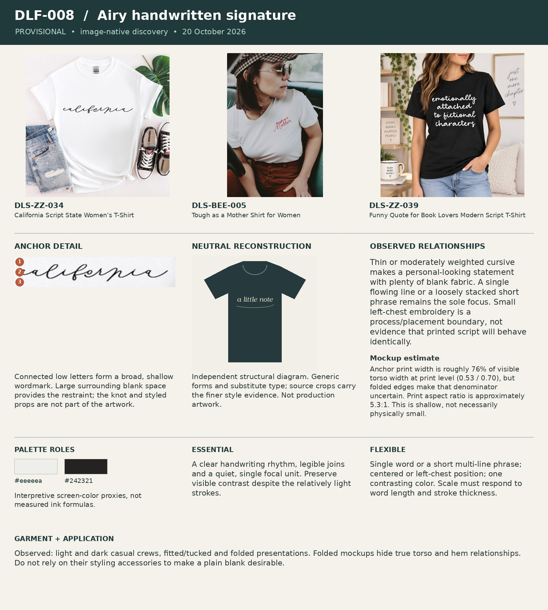

# DLF-008 — Airy handwritten signature

Provisional visual family · 2026-10-20 · Analyst interpretation, not purchase validation.

## References and evidence

- [DLS-ZZ-034](../../sourcing/expanded-scan/records/DLS-ZZ-034.md) — [retained full image](../../sourcing/expanded-scan/images/DLS-ZZ-034.jpg); [source product](https://www.zazzle.com/california_script_state_women_s_t_shirt-235105372182805567).
- [DLS-BEE-005](../../sourcing/expanded-scan/records/DLS-BEE-005.md) — [retained full image](../../sourcing/expanded-scan/images/DLS-BEE-005.jpg); [source product](https://www.thebeeandthefox.com/products/tough-as-a-mother).
- [DLS-ZZ-039](../../sourcing/expanded-scan/records/DLS-ZZ-039.md) — [retained full image](../../sourcing/expanded-scan/images/DLS-ZZ-039.jpg); [source product](https://www.zazzle.com/funny_quote_for_book_lovers_modern_script_t_shirt-235434137338518147).

Core examples: DLS-BEE-005, DLS-ZZ-015, DLS-ZZ-022, DLS-ZZ-034, DLS-ZZ-037, DLS-ZZ-039, DLS-ZZ-044.

Boundary examples: DLS-ETSY-041, DLS-SLOTH-018, DLS-LIG-022, DLS-ZZ-036. These share some relationships but differ in lettering, image treatment, framing, scale or garment; membership is not all-or-nothing. Full record links and original observations are in the [220-image review log](../Review-Log.md). Source-order and commercial-signal limitations remain attached to each source record.

## Observed combination

Thin or moderately weighted cursive makes a personal-looking statement with plenty of blank fabric. A single flowing line or a loosely stacked short phrase remains the sole focus. Small left-chest embroidery is a process/placement boundary, not evidence that printed script will behave identically.

## Essential relationships — working hypothesis

A clear handwriting rhythm, legible joins and a quiet, single focal unit. Preserve visible contrast despite the relatively light strokes.

## Flexible relationships and subtypes

Single word or a short multi-line phrase; centered or left-chest position; one contrasting color. Scale must respond to word length and stroke thickness.

## Garment relationship

Observed: light and dark casual crews, fitted/tucked and folded presentations. Folded mockups hide true torso and hem relationships. Do not rely on their styling accessories to make a plain blank desirable.

## Audience and semantic fit — transfer hypothesis

Useful when a personal affiliation or emotionally direct phrase is self-explanatory. Weak initial choice for a situation requiring two objects, spatial comparison or a three-beat reveal.

## Failure conditions

Hairline strokes disappearing in print; illegible joins; personal script mistaken for universal feminine taste; quietness used to justify an unclear concept.

## Measured relationships

Anchor print width is roughly 76% of visible torso width at print level (0.53 / 0.70), but folded edges make that denominator uncertain. Print aspect ratio is approximately 5.3:1. This is shallow, not necessarily physically small.

## Application guidance — proposed choice

Test on a concise identity or emotional concept; do not force a cabinet/car drawing into the wordmark just to use the family.

Measurement source: DLS-ZZ-034; normalized artwork box `[0.24, 0.34, 0.77, 0.44]` (x1, y1, x2, y2 as fractions of the full retained image). Pixel crop `[119, 168, 380, 217]`. manual visual bounds; denominator is horizontal visible torso width at artwork level, not shoulder/sleeve width; approximately ±5 percentage points for flat mockups, ±10 or more for styled/folded photos. Perspective, folds, occlusion and reproduction may distort ratios. Ranges describe these images, not universal recipe limits. Palette hex values are interpretive visual proxies, not sampled production inks. Crop callouts 1–3 mark upper/middle/lower observation zones; the adjacent note explains their relationship.

The independent [neutral reconstruction](../assets/DLF-008-neutral.png) substitutes generic words and shapes. It preserves an interpretation of composition and palette relationships; it does not reproduce the source font, distinctive artwork, exact texture or creator intent. Use the full references and detail crop alongside it.

## Application evidence

Not applied in this round. Source recurrence alone does not establish transfer to a new audience or concept.
