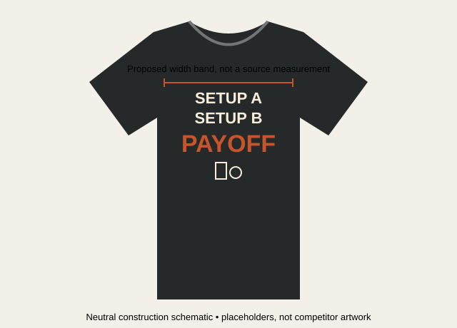
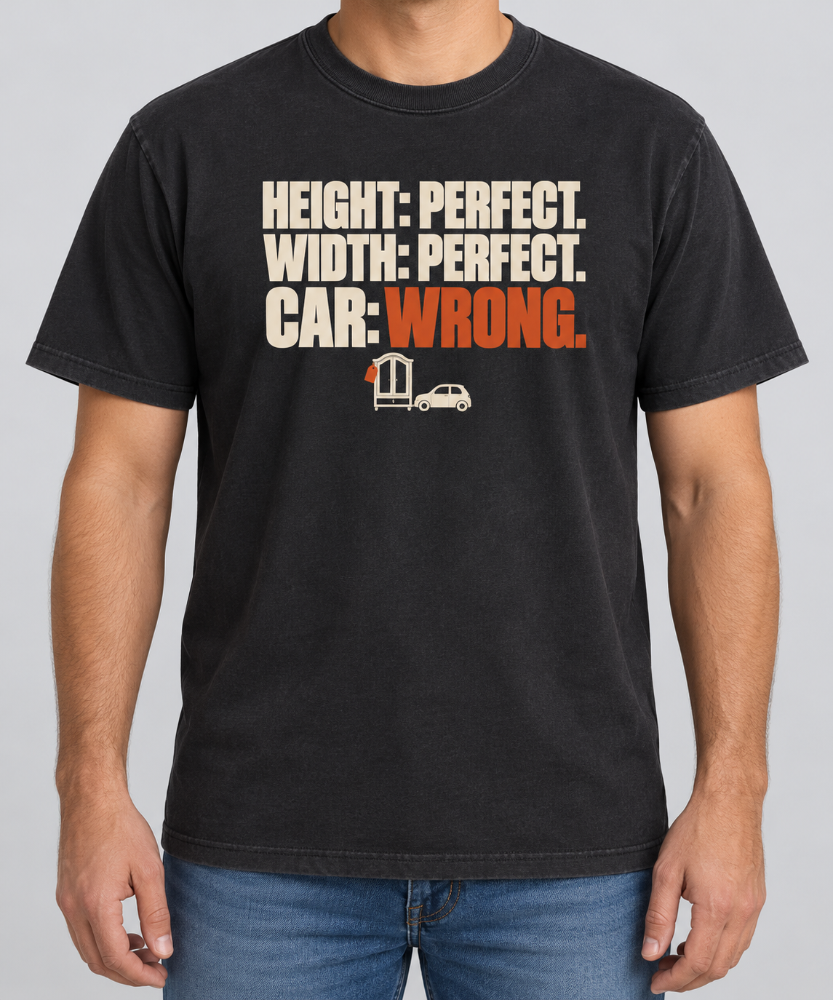
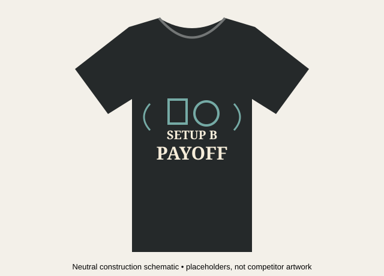
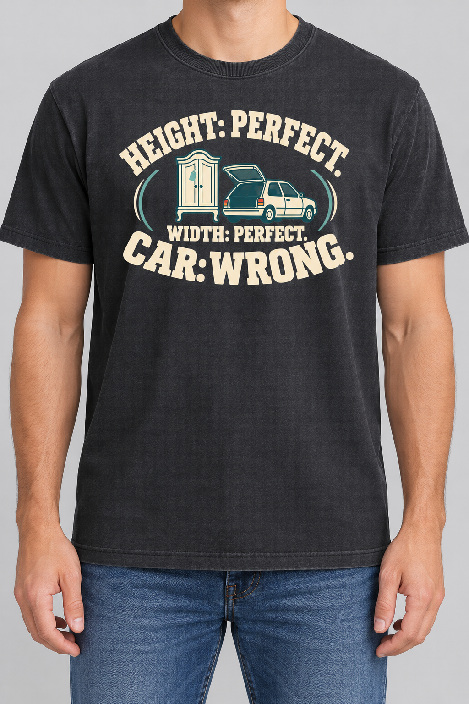

# Design-language pilot 01 — CAR: WRONG

2026-10-19 · DLR-001 / DLR-002 · Provisional, application-tested candidates · Original snapshot; Founder feedback and v2 review linked below

## Current status

The original visual package is now included in this repository update, with all original image bytes preserved from local commit `61df149`. The original recipes, prompts and scores below describe v1. See [Founder feedback](../reviews/2026-10-19-CAR-WRONG.md), [v2 hierarchy revision](revision-02.md), and [side-by-side visual comparison](revision-review.html). V2 is a review draft, not locked or production-ready.

## Review package

- [Visual recipe cards and comparison](visual-review.html): full sources, CSS detail viewports, annotations, neutral construction diagrams, palettes, original flat art and on-body previews. Download the folder and open the HTML; GitHub may show its source rather than render it.
- [Source manifest](source-manifest.json): original URLs, captured-image hashes, source frame and generated asset identifiers.
- [Pre-feedback Creative Director assessment](assessment.md): recorded before Founder review of this round; open after making an initial judgment if avoiding anchoring.
- [Generation prompts](prompts.json): exact flat-art and mockup instructions.
- [Prior concept comparison](../../R012-Process-Comparison-Results-2026-10-19.md) and [Creative Director methodology](../../../company/Creative-Director-Methodology.md).

**Goal 1:** turn a material and creative concept into usable original apparel executions through visual recipes. **Goal 2:** improve design judgment by preserving source-based interpretation, application failures, pre-feedback assessment and Founder feedback.

Fixed concept: **HEIGHT: PERFECT. WIDTH: PERFECT. CAR: WRONG.** Material: R012-E007 transport constraints. The source involved a thrift-shop hat rack and a truck; cabinet, car, tag, wording and artwork are invented staging. TRM-002 remains the concept's mechanism; DLR IDs describe its visual execution. Both applications omit the earlier optional MEASUREMENTS heading and keep all three substantive clauses.

## Evidence scope

Reused six already captured HISTOREE-002 images, all from HistoreeTees. No new Etsy scan, 120-shirt clustering exercise or cross-seller validation is claimed. Three examples support the condensed-stack candidate; two support the open-emblem candidate; one is a boundary example. Original source pixels are unmodified and their hashes match the earlier evidence manifest. HTML detail views are magnified viewports, not new evidence or higher-resolution captures.

Seller-controlled “Best selling” collection placement is contextual commercial evidence. Unit sales, persistence, variant sales, creator intent and causal effects of design are unknown. Source garments are mockups, not physical samples. Listed material specifications were not retrieved for this pilot. Cut, fabric composition, fabric weight, feel, actual print dimensions and print method are unknown unless explicitly labeled as visible appearance or our proposal. No on-body source images were available in these retained captures.

Sources are retained for internal analysis, not production reuse. Do not reproduce historical captions, source illustrations, exact typefaces, distinctive layout combinations or seal identities. Neutral diagrams replace all source content with generic shapes and placeholders. No competitor artwork was passed to image generation; prompts describe the extracted relationships and our independent transport concept.

## DLR-001 — Condensed emphasis stack

**Visual signature:** an assertive compact mass of condensed capital lettering, an economical contrast hierarchy and extensive unprinted garment area. A small contextual icon is optional; type carries most of the personality.

| Source | Specific support | Limit |
|---|---|---|
| [H2-031](assets/H2-031.jpg) | Large condensed topic words alternate with small connectors; distressed ivory-like lettering on olive crewneck | Exact font, ink and fit unknown |
| [H2-022](assets/H2-022.jpg) | Clean condensed text; one yellow emphasis; simple white icon; supporting small lines | Graphic-only image; cannot infer garment placement |
| [H2-043](assets/H2-043.jpg) | Narrow type-led mass with selective italic emphasis and distress | Left-aligned variant, not the same arrangement as H2-031 |

**Essential relationships:** short text units form a coherent mass; hierarchy differentiates content; background/garment remains visible around and between marks. A selective accent must have a job. Do not preserve an exact source layout.

**Adjustable:** alignment, optional distress, exact typeface, accent hue and presence of a small contextual icon. Distress is observed in two sources but absent in another. An icon is not mandatory for every use; here it helps identify a secondhand-object transport problem.

**Compatible concepts:** short statements, comparisons, checklists, declarations and contrast-based punchlines. Weak fit for long narratives, intricate symbolic scenes or a delicate emotional tone requiring a different lettering voice. These are application hypotheses, not proven universal rules.

**Application procedure:** assign two equal-sized rows to the repeated setup; make the final verdict larger; reserve one accent for the changed judgment; integrate only the minimum object cue; test the whole mark on the chosen garment before increasing detail. The precise setup/payoff arrangement is our adaptation, not a template extracted verbatim.

**Garment:** black/olive crewneck appearances in sources. Proposed regular/relaxed charcoal shirt with smooth matte cotton-like surface lets light letters and counters remain clear. Actual fiber/weight/fit not verified. H2-031/043 print width visually estimated at roughly 60–70% of torso width below the armholes; denominator excludes sleeves. Our proposed 50–55% width target is intentionally smaller and is not a source measurement or physical print specification.

**Palette:** source color relationships are near-monochrome with optional selective accent. Application proposes charcoal #25292A, ivory #F7EDDA and burnt orange #C7542A. These are analyst-selected design targets, not sampled inks or exact generated colors.

**Failure conditions:** generic slogan appearance; overcompressed letters; all words equally emphasized; tiny icon losing the audience connection; increased print width erasing garment breathing room. A print can follow the recipe and still be unattractive.

[Separate flat artwork](assets/DLR-001-art.png). The source characteristics translate visibly into this original application, but commercial usability is unvalidated. This is a raster draft, not editable vector typography or production-ready separated inks.

## DLR-002 — Open collegiate emblem

**Visual signature:** arched display lettering, an integrated central symbol and a lower anchor line form one compact rounded mark. Garment shows through; no rectangular scene background is required. Chunky slab serifs supply collegiate character in the strongest source.

| Source | Specific support | Limit |
|---|---|---|
| [H2-009](assets/H2-009.jpg) | Arched slab-serif lettering, small central ship, lower straight team line and date capsule on black shirt | Primary typography/garment example, not proof of fit or fabric |
| [H2-017](assets/H2-017.jpg) | Arcs, symbols and banner unify an event emblem | Supporting construction grammar only; typography differs; graphic-only capture |
| [H2-069](assets/H2-069.jpg) | Closed circular seal on navy heather-looking shirt | Boundary example, not counted as a member of the open-emblem recipe |

**Essential relationships:** curved upper text helps establish an overall silhouette; central illustration participates in the mark; a lower line anchors the shape; the parts are visually connected without a full scenery panel. Collegiate lettering is a provisional narrower treatment supported chiefly by H2-009; H2-017 does not independently establish the same font character.

**Adjustable:** arch depth, lower baseline, illustration, accent color and limited flank marks. Do not automatically import a date, team name, stars, closed rings or source banner. H2-069 shows why not every circular identity mark belongs in the same recipe.

**Compatible concepts:** short identity statements, mock affiliations, hobby declarations and compact visual jokes where text and object must work together. For this checklist concept, the arrangement must retain setup-to-payoff reading order; forcing a fake club identity would weaken the original concept.

**Application procedure:** set the first setup on the upper arc; create an independently drawn cabinet/car pictogram; place the second setup below the symbol; use the largest lower lettering for the verdict; check the full silhouette and remove ornamental information. Different lettering, object, layout details and palette prevent a noun-swapped copy of any source.

**Garment:** H2-009 black crewneck mockup; H2-017 garment unknown; heather appearance appears only in boundary H2-069. Proposed charcoal regular/relaxed crewneck and cream marks. Source print width estimate for H2-009 is roughly 60–70% of torso below armholes. Target 50–55% in this trial; generated on-body result is visibly wider, so scale is a comparison confound. No exact inch dimension or textile compatibility result is claimed. Heavy heather may compete with fine detail; this is an untested design hypothesis.

**Palette:** source white-on-black with a multicolor supporting variant. Application proposes charcoal #25292A, cream #F7EDDA and muted teal #75AAA5. Teal is an adaptation, not an essential recurring source trait. Output added orange taillights and some shading; it is not a strict two-ink separation.

**Failure conditions:** long curved copy; gratuitous ornaments; tiny lower lines; generic sports-club reading; illustration that grows into a standalone scene; a visually attractive mark whose audience remains unclear.

[Separate flat artwork](assets/DLR-002-art.png). Larger icon makes the object relationship clearer but increases density. Recipe remains provisional pending review.

## Comparison, limits and next review

Both candidates were constructed from source images, then applied to the same concept. Sources and reconstructions remain distinct from new application hypotheses. Neutral constructions are precise SVG schematics; artwork and on-body applications were generated separately with imagegen. No Kittl use.

The mockups approximate the same garment/color direction but differ in model, framing and actual print scale. Flat-art generation introduced edge/shading artifacts, and mockup generation does not guarantee pixel-exact transfer. Readable preview text does not establish physical print quality. Actual garment selection, provider requirements, artwork cleanup and a physical sample remain downstream.

The wearer and antique cue are not fully resolved: DLR-001's icon may be too small; DLR-002's cabinet may still read as generic furniture. Removing the previous market landscape improves visual economy but can reduce contextual clarity. That trade-off is part of the review, not something hidden by the recipe description.

Review: (1) Can each recipe explain and guide its application? (2) Which execution has stronger visual appeal? (3) Is the identity/material apparent? (4) Would you wear it? Preserve these separately from the already reviewed humor premise. Founder responses pending; no recipe promoted to a validated winner and no methodology changes in this pilot.
