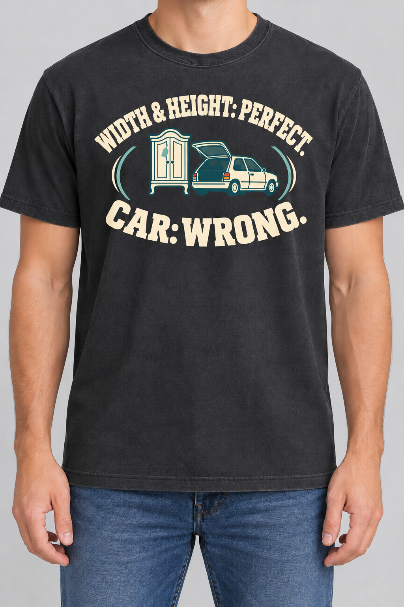

# DLR-002 revision 02 — combined setup

October 19, 2026 (America/Chicago) · Founder review pending · Original images preserved

## Requested correction

Founder identified unequal visual weight between parallel HEIGHT and WIDTH statements. Use the explicitly suggested alternative of combining them: **WIDTH & HEIGHT: PERFECT.** Keep **CAR: WRONG.** as the payoff.

[View before/after](revision-review.html). [Original recipe/source card](README.md#dlr-002--open-collegiate-emblem).

| Original | Revision 02 |
|---|---|
|  |  |

## Execution

Edited the original on-body preview with the built-in image-generation tool. The prompt requests one upper arc with equal cap height/weight, removal of the smaller middle WIDTH line, and preservation of the cabinet/car illustration, palette, lower verdict, footprint, garment, model and setting. Exact prompt and asset hash are in [revision-manifest.json](revision-manifest.json).

This is a mockup revision only. Original flat artwork remains v1; no corresponding v2 production artwork or exact ink separation is claimed. The original flat art and both original shirt previews remain unchanged.

## CD assessment before Founder feedback

The intended hierarchy correction is visible: WIDTH and HEIGHT share one typographic treatment, and the removed middle line creates separation between the explanatory graphic and verdict. The top arc is longer and more condensed than before; this is the trade-off to inspect at realistic shirt size. CAR: WRONG remains dominant, and the cabinet/car cue remains prominent.

The model/background are closely retained, but the generator redrew some edges and details; this is not a pixel-exact isolated typography experiment. The result does not resolve all questions: the object still needs to signal antique/vintage hunting sufficiently, the illustration does not depict physical fit directly, and actual print legibility/fabric performance remain untested. No claim of improved purchase appeal or final approval.

Review question: does the combined setup fix the hierarchy while retaining a desirable collegiate shirt? Founder feedback pending. No further iteration performed in this update.
