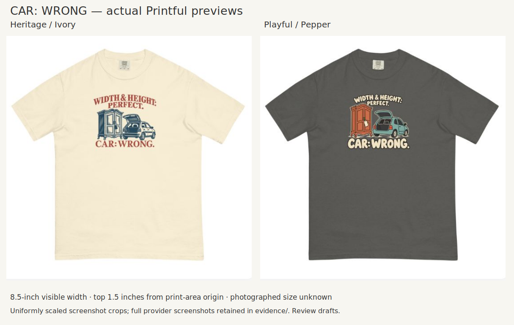

# CAR: WRONG — internal spacing and taste calibration

Creative Director · October 21, 2026 (America/Chicago) · Founder-approved review principles; revised artwork awaits separate review.

## Evidence pair and feedback

The image is the preserved round04 provider board. It is not a round05 provider check. Open the [Heritage master](../applications/CAR-WRONG-04/assets/A-heritage-draft.png) and [Playful master](../applications/CAR-WRONG-04/assets/B-playful-draft.png) for detail.

Founder selected Heritage's one-color cabinet/car illustration over the earlier colored version because it better delivered the heritage language. The lettering remains a separate muted rose color; “monotone” here describes the objects, not a single-ink complete design. Founder also retained Playful as a different aesthetic worth testing and wants eventual sales/click evidence to guide preference. This does not establish that either design is ready for production or that the two styles will sell equally well.

Founder then requested more breathing room between Heritage's copy and graphic. Playful was also described as cramped, but its playful character made that density acceptable.

| Execution | Visible relationship | Interpretation and response |
|---|---|---|
| A Heritage, round04 | Cabinet crown sits close to PERFECT; feet/wheels nearly meet CAR: WRONG | The narrow gaps weaken the composed emblem feeling. Open both gaps while retaining arch, classic type, object meaning and compact garment footprint. |
| B Playful, round04 | Rounded lettering and cartoon objects form a dense cluster | Founder accepts the coherent playful grouping. Retain it; do not impose Heritage's solution automatically. |

These are specific internal judgments, not evidence that all heritage needs air or all playful needs density. The two versions also differ in type, linework, palette and garment; their comparison does not isolate a causal effect of spacing.

## Creative Director diagnosis before revision

The previous review did not adequately judge the interaction between recipe intent and internal spacing. Individually suitable lettering and illustration did not produce a fully resolved whole. Close-up inspection reveals near-touches; shirt scale shows how the gaps visually disappear. Collar clearance and internal composition spacing are separate issues.

Proposed correction: increase the two copy-to-illustration gaps, potentially by modestly reducing/repositioning the object group within the existing composition. Keep the 8.5-inch visible width, the 1.5-inch print-canvas top anchor, Ivory, the arched setup, classic serif payoff and one-color blue objects. Avoid solving crowding by making the composition tall, disconnecting its parts or making essential objects too small. Playful stays unchanged.

## Approved reusable guidance

Founder agreed with the four-part critique: intended recipe character; relationships among elements; close-up and shirt views; and comparison with relevant strong visual references. Record a specific diagnosis and tradeoff before new Founder feedback. Preserve paired images and explanations so later work can retrieve both a useful treatment and its failure condition.

Canonical principle: [Playbook §9.1 and pre-review critique](../../../company/Creative-Director-Tshirt-Design-Playbook.md#91-judge-relationships-against-the-intended-visual-language). Routine integration: [workflow §4](../Garment-and-Placement-Workflow.md#4-check-comprehension-hierarchy-wearability-and-proportions-across-sl2xl). No new approval layer, research quota, universal gap threshold or promise of error-free judgment.

## Revision and next evidence

See [round05](../applications/CAR-WRONG-05/README.md) for the new artwork, controlled comparison, dimensions and frozen Creative Director assessment. Preserve further Founder feedback separately. Production cleanup, verified physical geometry and eventual customer response remain separate from this aesthetic judgment.
