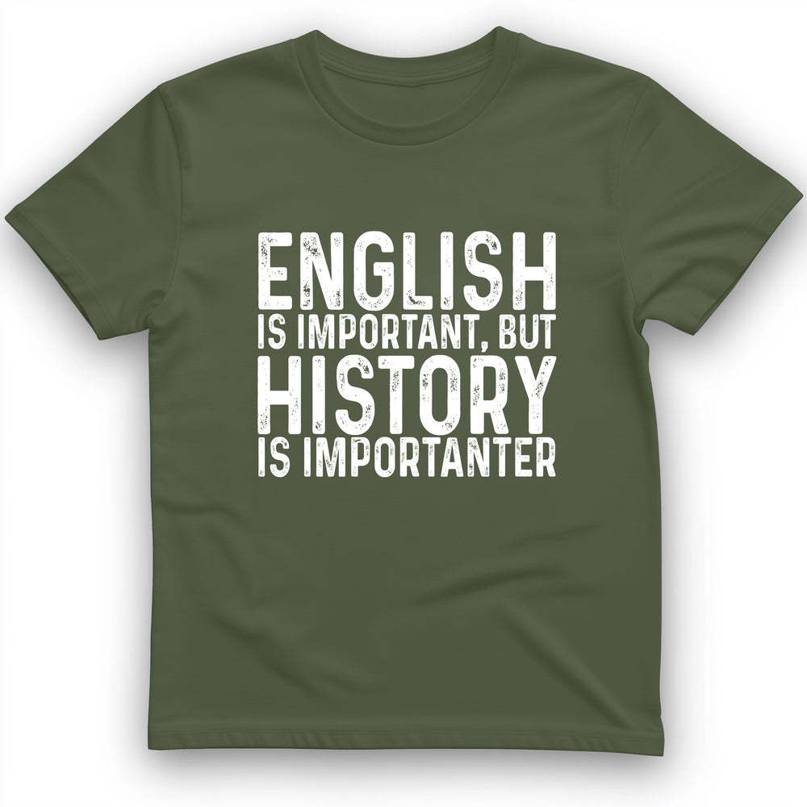
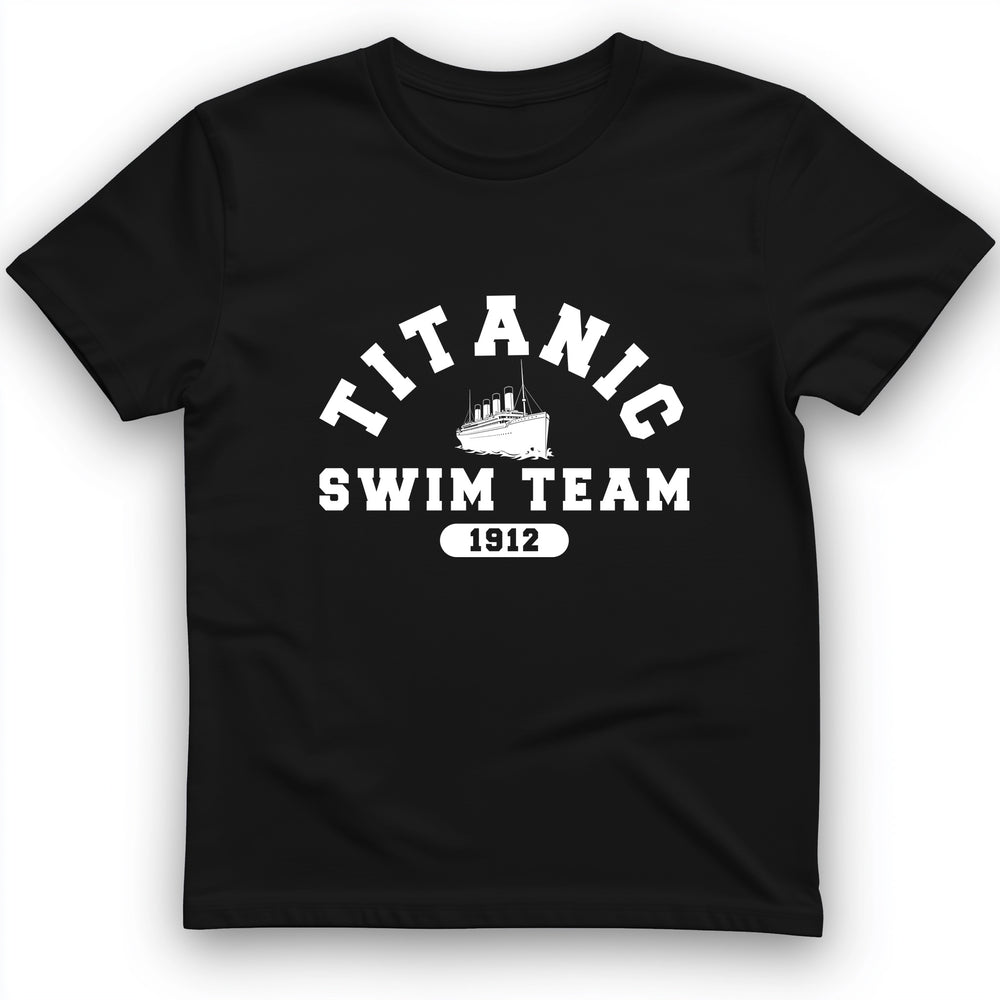
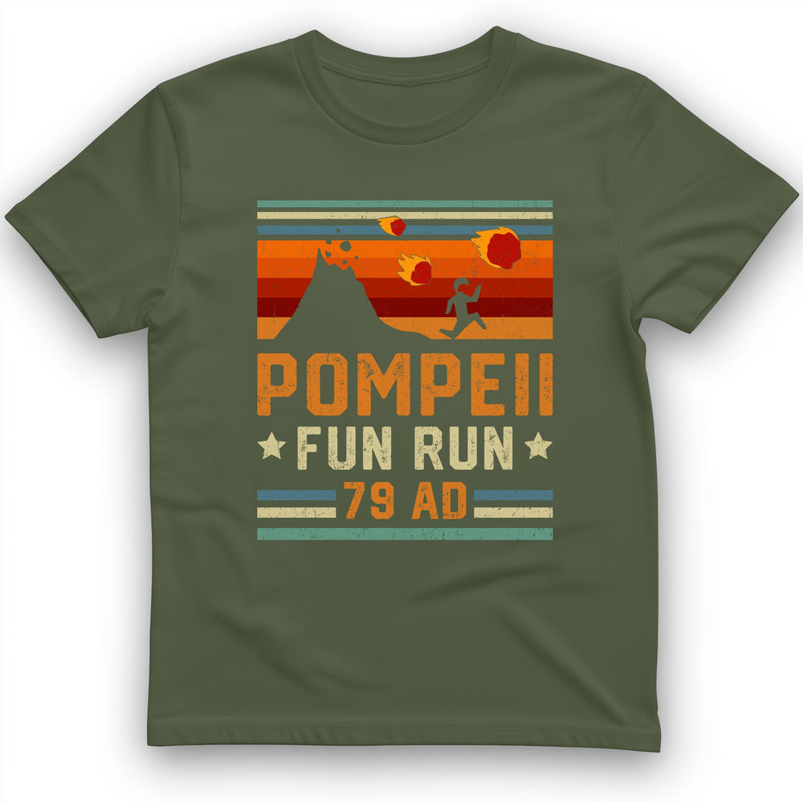
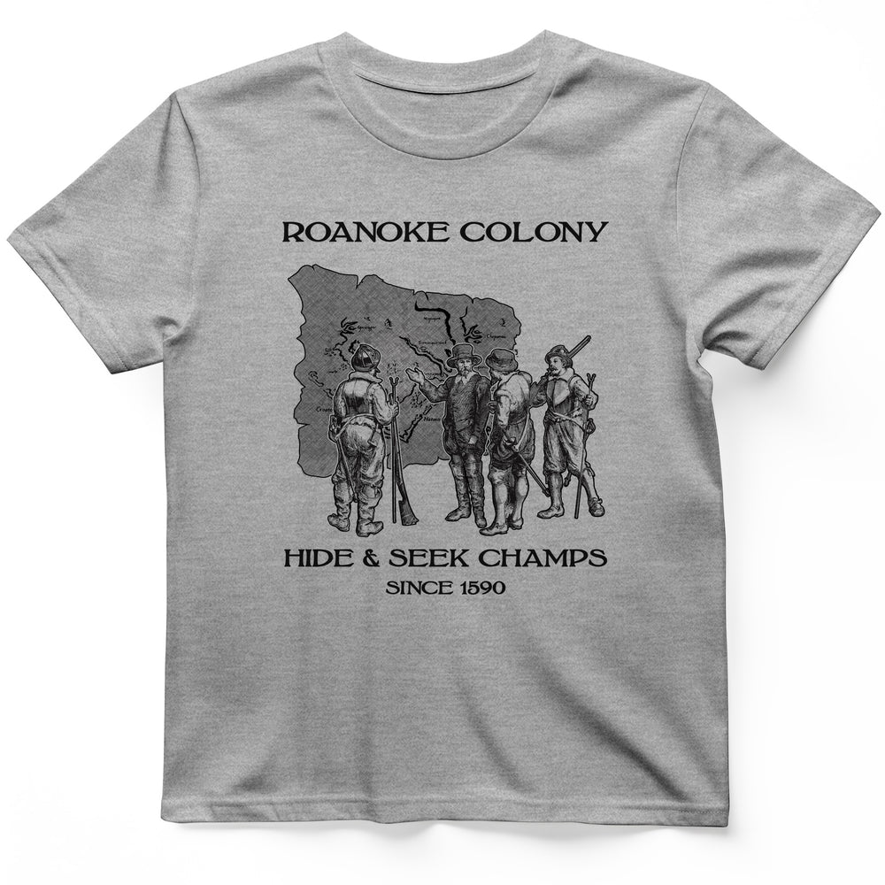

# HistoreeTees — four initial front-print sources

[Batch index](README.md) · [Machine-readable evidence](source-manifest.json)

Stage 1 discovery only. Visual descriptions are analyst observations; fabric specifications are seller claims. Placement/scale words are qualitative estimates from the shown images. No physical dimensions, demographic conclusions, sales causality or validated recipe is implied.

## DLS-HISTOREE-001 — History Is Importanter T-Shirt

[Product](https://historeetees.com/products/history-is-importanter-t-shirt) · [Collection](https://historeetees.com/collections/recent-best-sellers)

**Relationship to compare:** Condensed emphasis stack.

**Visible design:** Distressed white condensed capitals create a tight text mass; two larger subject words alternate with narrower linking lines. No illustration.

**On the garment:** Broad center-front block on olive crewneck; garment supplies all inter-line negative space.

**Listed garment / unknowns:** Seller-listed Gildan 64000 Softstyle unisex, preshrunk: solid colors cotton; Sport Grey 90/10 cotton/poly; Heather Navy 35/65 cotton/poly. Physical print and fabric unverified.

**Source context:** History-versus-English joke; prior pilot anchor H2-031, freshly captured for this batch.

**Transfer hypothesis:** Compare with DLR-001: strongest when copy supplies identity and context itself. Add an original visual cue if first-time comprehension requires it.

**Limits:** This is continuity evidence, not a new independent validation of DLR-001.

**Commercial evidence:** seller-designated bestseller collection membership; no audited sales rank. Collection feed position 23, feed page 1; not HTML page or sales rank.

## DLS-HISTOREE-002 — Titanic Swim Team T-Shirt

[Product](https://historeetees.com/products/titanic-swim-team-t-shirt) · [Collection](https://historeetees.com/collections/recent-best-sellers)

**Relationship to compare:** Open collegiate team emblem.

**Visible design:** Arched white slab capitals, small ship silhouette, straight lower line and date capsule create a sports-team emblem with open gaps.

**On the garment:** Medium-large central front print on black crewneck; no outer seal enclosing the entire design.

**Listed garment / unknowns:** Seller-listed Gildan 64000 Softstyle unisex, preshrunk: solid colors cotton; Sport Grey 90/10 cotton/poly; Heather Navy 35/65 cotton/poly. Physical print and fabric unverified.

**Source context:** Historical dark humor; prior pilot anchor H2-009, freshly captured.

**Transfer hypothesis:** Compare with DLR-002: central object can resolve identity while arc/lower anchor organize short copy.

**Limits:** Historical knowledge carries the joke; successful adaptation requires a new resolving object, not automatic text substitution.

**Commercial evidence:** seller-designated bestseller collection membership; no audited sales rank. Collection feed position 20, feed page 1; not HTML page or sales rank.

## DLS-HISTOREE-003 — Pompeii "Fun" Run T-Shirt

[Product](https://historeetees.com/products/pompeii-fun-run-t-shirt) · [Collection](https://historeetees.com/collections/recent-best-sellers)

**Relationship to compare:** Retro event panel.

**Visible design:** Warm orange/yellow and teal stripes, volcano and runner silhouettes, block lettering and small event details combine into a distressed rectangular mass.

**On the garment:** Large center-front panel on olive crewneck; cloth colors also act as internal dark shapes.

**Listed garment / unknowns:** Seller-listed Gildan 64000 Softstyle unisex, preshrunk: solid colors cotton; Sport Grey 90/10 cotton/poly; Heather Navy 35/65 cotton/poly. Physical print and fabric unverified.

**Source context:** Historical catastrophe reframed as an event.

**Transfer hypothesis:** Test event graphics when the concept has a recognizable activity and one dominant scene. Keep hierarchy readable on the torso.

**Limits:** Dense rectangular treatment is a boundary case for our poster concern; seller demand does not exempt it from wearability review.

**Commercial evidence:** seller-designated bestseller collection membership; no audited sales rank. Collection feed position 17, feed page 1; not HTML page or sales rank.

## DLS-HISTOREE-004 — Roanoke T-Shirt

[Product](https://historeetees.com/products/roanoke-t-shirt) · [Collection](https://historeetees.com/collections/recent-best-sellers)

**Relationship to compare:** Historical engraving with restrained type.

**Visible design:** Dark fine-line historical scene sits between a thin serif title and a small lower caption; irregular edges soften the picture boundary.

**On the garment:** Centered medium front image on heather-gray crewneck; lower contrast and fine marks create a quieter, more archival impression.

**Listed garment / unknowns:** Seller-listed Gildan 64000 Softstyle unisex, preshrunk: solid colors cotton; Sport Grey 90/10 cotton/poly; Heather Navy 35/65 cotton/poly. Physical print and fabric unverified.

**Source context:** History knowledge and an archival illustration aesthetic.

**Transfer hypothesis:** Test an original object/scene engraving for a nostalgic subgroup, preserving contrast and a readable silhouette.

**Limits:** Heather texture can obscure fine strokes; source subject knowledge may drive interest more than the drawing style.

**Commercial evidence:** seller-designated bestseller collection membership; no audited sales rank. Collection feed position 15, feed page 1; not HTML page or sales rank.
