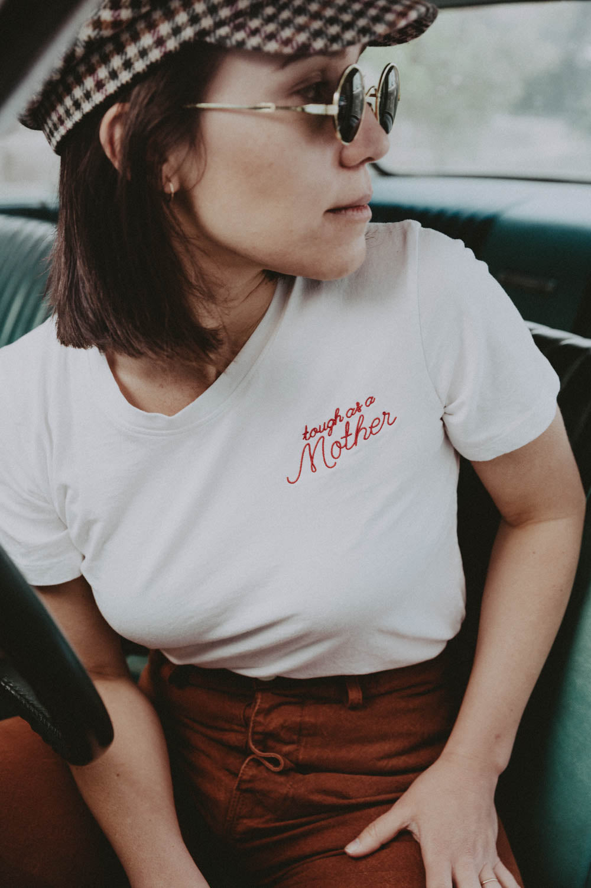

# DLS-BEE-005 — Tough as a Mother Shirt for Women

Status: collected front-design reference; back placement unverified. No recipe classification.

- Product: https://www.thebeeandthefox.com/products/tough-as-a-mother
- Seller: The Bee & The Fox; individual designer unknown.
- Route: https://www.thebeeandthefox.com/collections/best-sellers — default displayed order, observed 2026-10-20, position 3, page 1. Displayed collection has 13 products; unrelated recommendations are outside the route.
- Signal: seller-designated Best Sellers collection membership, not audited sales rank.
- Source image: https://cdn.shopify.com/s/files/1/1373/5123/products/ToughasaMother_crewneck_TheBee_TheFox_-12.jpg?v=1622506410
- SHA-256: `c48a63e53cf4d9ff529f7515aa8a871324bc183320dd7e8eeb9cf68161a6acd6`. Seller CDN rendition requested at width 1000 and format=jpg.
- Eligibility: adult tee, complete predefined design; no identifiable licensed fictional character or celebrity depicted. Cultural/song references, if any, remain appeal confounds, not permission to reuse wording.
- Placement: front visible; no affirmative blank-back evidence established. Known back graphic at collection position 5 was excluded separately. Do not certify front-only merchandise from missing views.
- Garment: Seller: fitted women’s crewneck, white, 100% cotton; red embroidered thread. Embroidery relief is part of the source treatment and is not directly reproduced by ordinary front DTG printing. Actual print dimensions unverified; styling, tucking and knots do not establish garment length/cut.
- Deduplication: new expanded record; recolors excluded from artwork count; global reconciliation pending.

## Visual observation

Small red cursive words occupy the wearer's left chest on a white fitted tee. A larger looping final word sits beneath a smaller tilted phrase, with most of the garment bare. Seller describes actual embroidery, so thin raised thread and stitch texture are source-specific. Restrained placement and scale are distinct from center-chest statement styling; photo is tucked and seated, not a full flat garment view.

## Limits

Qualitative estimates from lifestyle photography. Pose, fabric folds, hair and warm lighting affect visibility. No demographic or sales-causality inference; no family synthesis.
