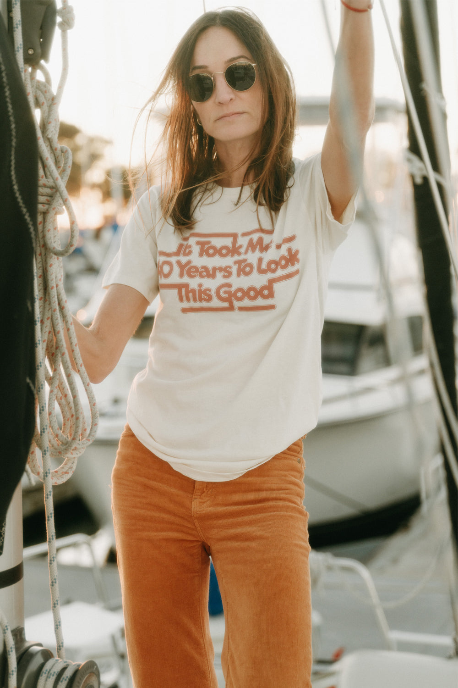

# DLS-BEE-006 — It Took Me 40 Years to Look This Good | Unisex

Status: collected front-design reference; back placement unverified. No recipe classification.

- Product: https://www.thebeeandthefox.com/products/it-took-me-40-years-to-look-this-good-unisex
- Seller: The Bee & The Fox; individual designer unknown.
- Route: https://www.thebeeandthefox.com/collections/best-sellers — default displayed order, observed 2026-10-20, position 4, page 1. Displayed collection has 13 products; unrelated recommendations are outside the route.
- Signal: seller-designated Best Sellers collection membership, not audited sales rank.
- Source image: https://cdn.shopify.com/s/files/1/1373/5123/files/TheBee_TheFox-TookMe40Years-8-2copy.jpg?v=1732048432
- SHA-256: `2540a6630c555e05d5fb361267ef9f8c496ef57effa3cdb25d697fa19d3517af`. Seller CDN rendition requested at width 1000 and format=jpg.
- Eligibility: adult tee, complete predefined design; no identifiable licensed fictional character or celebrity depicted. Cultural/song references, if any, remain appeal confounds, not permission to reuse wording.
- Placement: front visible; no affirmative blank-back evidence established. Known back graphic at collection position 5 was excluded separately. Do not certify front-only merchandise from missing views.
- Garment: Seller: unisex 100% cotton, enzyme washed; screen print. Photo appears cream with warm tan/orange lettering; lighting limits color precision. Actual print dimensions unverified; styling, tucking and knots do not establish garment length/cut.
- Deduplication: new expanded record; recolors excluded from artwork count; global reconciliation pending.

## Visual observation

Warm tan/orange rounded retro lettering forms three close-fitting horizontal lines on a pale unisex tee. Thin parallel outlines and long horizontal extensions connect words into a compact chest mass. Broad medium-height front print with no illustration; garment remains visible inside counters and outlines. Lifestyle lighting is warm and hair overlaps the upper edge; visual weight comes from continuous lettering rather than large solid panels.

## Limits

Qualitative estimates from lifestyle photography. Pose, fabric folds, hair and warm lighting affect visibility. No demographic or sales-causality inference; no family synthesis.
