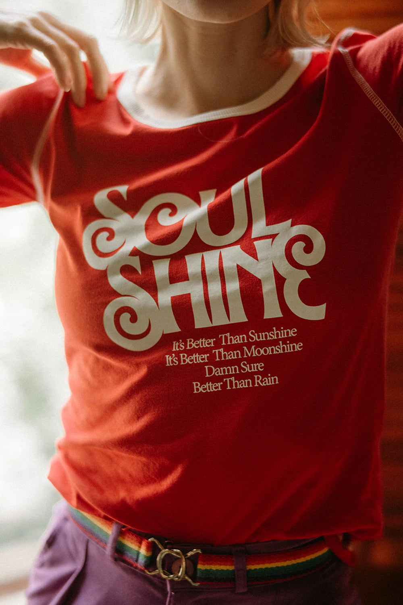

# DLS-BEE-007 — Soul Shine | Fitted Ringer

Status: collected front-design reference; back placement unverified. No recipe classification.

- Product: https://www.thebeeandthefox.com/products/soul-shine-fitted-ringer
- Seller: The Bee & The Fox; individual designer unknown.
- Route: https://www.thebeeandthefox.com/collections/best-sellers — default displayed order, observed 2026-10-20, position 10, page 1. Displayed collection has 13 products; unrelated recommendations are outside the route.
- Signal: seller-designated Best Sellers collection membership, not audited sales rank.
- Source image: https://cdn.shopify.com/s/files/1/1373/5123/files/Untitled-13.jpg?v=1732409472
- SHA-256: `364f07f2f2fc7210672d4fccc46f93808adab007fb1fa416fbf0bf48b607cff7`. Seller CDN rendition requested at width 1000 and format=jpg.
- Eligibility: adult tee, complete predefined design; no identifiable licensed fictional character or celebrity depicted. Cultural/song references, if any, remain appeal confounds, not permission to reuse wording.
- Placement: front visible; no affirmative blank-back evidence established. Known back graphic at collection position 5 was excluded separately. Do not certify front-only merchandise from missing views.
- Garment: Seller: fitted ringer, 100% cotton, garment dyed/enzyme washed, screen printed. Light trim echoes the light graphic; actual color under neutral light unverified. Actual print dimensions unverified; styling, tucking and knots do not establish garment length/cut.
- Deduplication: new expanded record; recolors excluded from artwork count; global reconciliation pending.

## Visual observation

Large light decorative serif letters interlock across two lines, with curled terminals and broad high-contrast strokes. Four much smaller serif lines form a narrow lower block. Front graphic on warm red/rust fitted ringer; light collar trim echoes the lettering. Primary photo is a close torso crop, so full-garment proportions are not established. The seller identifies a classic-rock song connection; retain that confound without assuming wording transfer or celebrity depiction.

## Limits

Qualitative estimates from lifestyle photography. Pose, fabric folds, hair and warm lighting affect visibility. No demographic or sales-causality inference; no family synthesis.
