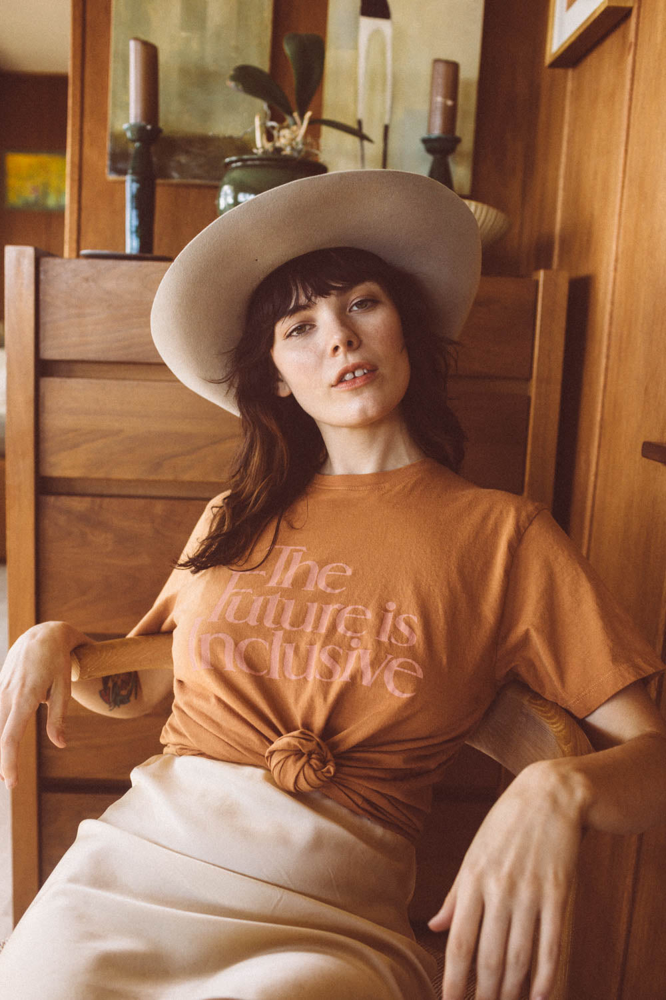

# DLS-BEE-008 — The Future is Inclusive Shirt in Unisex

Status: collected front-design reference; back placement unverified. No recipe classification.

- Product: https://www.thebeeandthefox.com/products/the-future-is-inclusive-shirt
- Seller: The Bee & The Fox; individual designer unknown.
- Route: https://www.thebeeandthefox.com/collections/best-sellers — default displayed order, observed 2026-10-20, position 11, page 1. Displayed collection has 13 products; unrelated recommendations are outside the route.
- Signal: seller-designated Best Sellers collection membership, not audited sales rank.
- Source image: https://cdn.shopify.com/s/files/1/1373/5123/products/TheFutureisInclusive_TheBee_TheFox_-32.jpg?v=1650830984
- SHA-256: `d5ef1f25571d82b24a01d9d89331f347620d81e04f85430e8241d8b6e7e4dd63`. Seller CDN rendition requested at width 1000 and format=jpg.
- Eligibility: adult tee, complete predefined design; no identifiable licensed fictional character or celebrity depicted. Cultural/song references, if any, remain appeal confounds, not permission to reuse wording.
- Placement: front visible; no affirmative blank-back evidence established. Known back graphic at collection position 5 was excluded separately. Do not certify front-only merchandise from missing views.
- Garment: Seller: unisex cotton tee, rust, screen printed. Photo has pink lettering; lighting limits exact color inference. Actual print dimensions unverified; styling, tucking and knots do not establish garment length/cut.
- Deduplication: new expanded record; recolors excluded from artwork count; global reconciliation pending.

## Visual observation

Three closely stacked pink serif lines form a soft rectangular chest block on a rust unisex tee. Thin/thick stroke contrast and rounded curves provide an editorial, understated character; no illustration or enclosing border. Low-to-moderate warm-color contrast. Photo shows a knotted, draped hem and seated model: neither is a built-in crop or fitted-cut specification. Copy alone carries identity meaning.

## Limits

Qualitative estimates from lifestyle photography. Pose, fabric folds, hair and warm lighting affect visibility. No demographic or sales-causality inference; no family synthesis.
