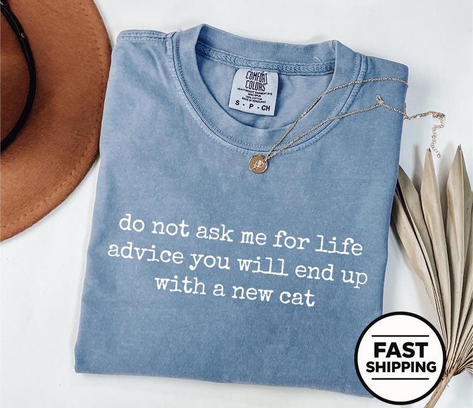

# DLS-ETSY-006 — Comfort Colors® Life Advice Tee, Cat Person Humor Shirt, Funny Cat Mom Quote Tee, Cat Owner Humor, Sarcastic Pet Humor Gift For Him Or Her

Status: collected front-design reference; back unverified. No family synthesis.

- Product: https://www.etsy.com/listing/4533017730/comfort-colors-life-advice-tee-cat
- Seller: SovelleApparel; Etsy. https://www.etsy.com/shop/SovelleApparel
- Discovery: https://www.etsy.com/market/bestselling_tshirts; page 1, card position 6 (includes ads in numbering), Relevancy order, 2026-10-20. Sponsored cards skipped. Listing-level **Bestseller** button observed in live product page; evidence excerpt retained in batch JSON.
- Commercial signal: Etsy listing-level Bestseller badge. Not an audited sales count, global ranking, or proof that design caused demand. Mixed garment listings may aggregate tee/sweatshirt variants.
- Source image: https://i.etsystatic.com/63213456/r/il/d5a399/8237239780/il_794xN.8237239780_3u7k.jpg
- SHA-256: `2ea5f517600732dda8acc455d92244e78a1ef957aeb61a6c018ae48b01570932`. Original displayed CDN image, no editing; promotional mockup, not physical sample. Apparel variant chosen visually; decorative props and seller overlays are not part of print.
- Eligibility: complete predefined adult tee front; no observed licensed character or celebrity. Back unverified. Garment color/cut below are observations; fabric, print method and physical dimensions unverified unless explicitly attributed.
- Deduplication: not a recolor of another accepted listing in this route; cross-source reconciliation pending. Prior discovery IDs001–004 preserved separately and not silently recounted.

## Visual observation

Dusty blue crew-neck folded flat. Small white lowercase typewriter-like copy in three centered lines, no image or enclosure. Compact low-density chest print, substantial plain blue surrounds it; garment texture is visible. Necklace, hat and FAST SHIPPING badge are staging/overlay, not printed design.

## Limits

Approximate mockup relationships only. No exact font identification, demographic assumption or recipe-family assignment. Listing keyword/title claims, stars, shop sales and Star Seller status do not substitute for the observed Bestseller badge.
