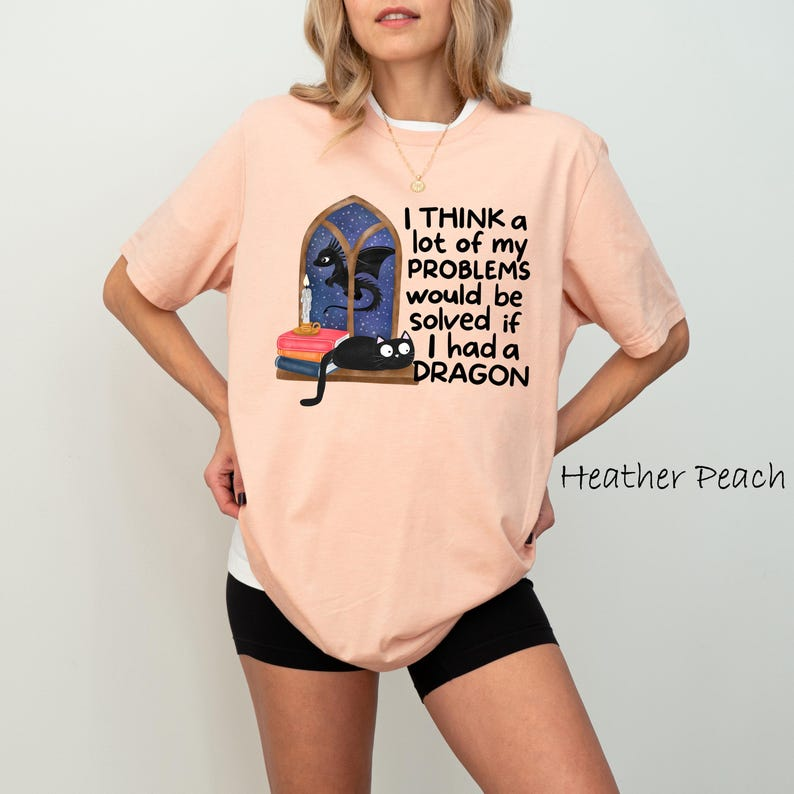

# DLS-ETSY-008 — Funny Dragon Shirt, I Think A Lot Of My Problems Would Be Solved If I Had A Dragon Fantasy Graphic Tee, Gift For Dragon Lovers, Dragon Shirt

Status: collected front-design reference; back unverified. No family synthesis.

- Product: https://www.etsy.com/listing/4431588809/funny-dragon-shirt-i-think-a-lot-of-my
- Seller: CustombyTexas; Etsy. https://www.etsy.com/shop/CustombyTexas
- Discovery: https://www.etsy.com/market/bestselling_tshirts; page 1, card position 9 (includes ads in numbering), Relevancy order, 2026-10-20. Sponsored cards skipped. Listing-level **Bestseller** button observed in live product page; evidence excerpt retained in batch JSON.
- Commercial signal: Etsy listing-level Bestseller badge. Not an audited sales count, global ranking, or proof that design caused demand. Mixed garment listings may aggregate tee/sweatshirt variants.
- Source image: https://i.etsystatic.com/50446336/r/il/e05054/7678986821/il_794xN.7678986821_csp1.jpg
- SHA-256: `842296ccabf5de9dce64605ed19c0b13da1269b8b4022582d924cfa786ebc5af`. Original displayed CDN image, no editing; promotional mockup, not physical sample. Apparel variant chosen visually; decorative props and seller overlays are not part of print.
- Eligibility: complete predefined adult tee front; no observed licensed character or celebrity. Back unverified. Garment color/cut below are observations; fabric, print method and physical dimensions unverified unless explicitly attributed.
- Deduplication: not a recolor of another accepted listing in this route; cross-source reconciliation pending. Prior discovery IDs001–004 preserved separately and not silently recounted.

## Visual observation

Peach adult crew-neck on model. Medium central illustration-and-copy block: colorful arched fantasy window and books at left, tall stacked black informal bold statement at right. Image and type share total height; no enclosing outside frame. Selected tee gallery image2, not initial sweatshirt. Color label at right is overlay.

## Limits

Approximate mockup relationships only. No exact font identification, demographic assumption or recipe-family assignment. Listing keyword/title claims, stars, shop sales and Star Seller status do not substitute for the observed Bestseller badge.
