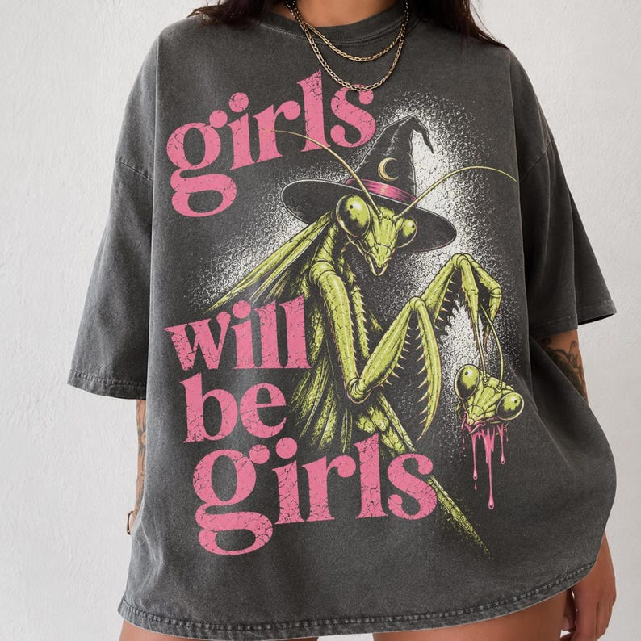

# DLS-ETSY-009 — Girls Will Be Girls Shirt, Witchy Feminist Tee, Goth Summer Graphic Tee, Praying Mantis Tee, Grunge Feminist Shirt, Vintage Summerween Shirt

Status: collected front-design reference; back unverified. No family synthesis.

- Product: https://www.etsy.com/listing/4524228568/girls-will-be-girls-shirt-witchy
- Seller: EverChangingJourney; Etsy. https://www.etsy.com/shop/EverChangingJourney
- Discovery: https://www.etsy.com/market/bestselling_tshirts; page 1, card position 10 (includes ads in numbering), Relevancy order, 2026-10-20. Sponsored cards skipped. Listing-level **Bestseller** button observed in live product page; evidence excerpt retained in batch JSON.
- Commercial signal: Etsy listing-level Bestseller badge. Not an audited sales count, global ranking, or proof that design caused demand. Mixed garment listings may aggregate tee/sweatshirt variants.
- Source image: https://i.etsystatic.com/9005412/r/il/24c1fb/8577977201/il_794xN.8577977201_6x00.jpg
- SHA-256: `fad1593e24c3a22cdb7d98e4d9b0f11126276800307e5c741fe589650a4fadc7`. Original displayed CDN image, no editing; promotional mockup, not physical sample. Apparel variant chosen visually; decorative props and seller overlays are not part of print.
- Eligibility: complete predefined adult tee front; no observed licensed character or celebrity. Back unverified. Garment color/cut below are observations; fabric, print method and physical dimensions unverified unless explicitly attributed.
- Deduplication: not a recolor of another accepted listing in this route; cross-source reconciliation pending. Prior discovery IDs001–004 preserved separately and not silently recounted.

## Visual observation

Oversized-looking washed charcoal crew-neck on model. Very large acid-green praying mantis wearing witch hat occupies right/center; distressed pink serif words wrap down left and across bottom. Speckled pale halo behind insect, minimal surrounding empty chest. Large asymmetrical image/type interaction extends toward lower torso; mantis is generic creature, not identified character.

## Limits

Approximate mockup relationships only. No exact font identification, demographic assumption or recipe-family assignment. Listing keyword/title claims, stars, shop sales and Star Seller status do not substitute for the observed Bestseller badge.
