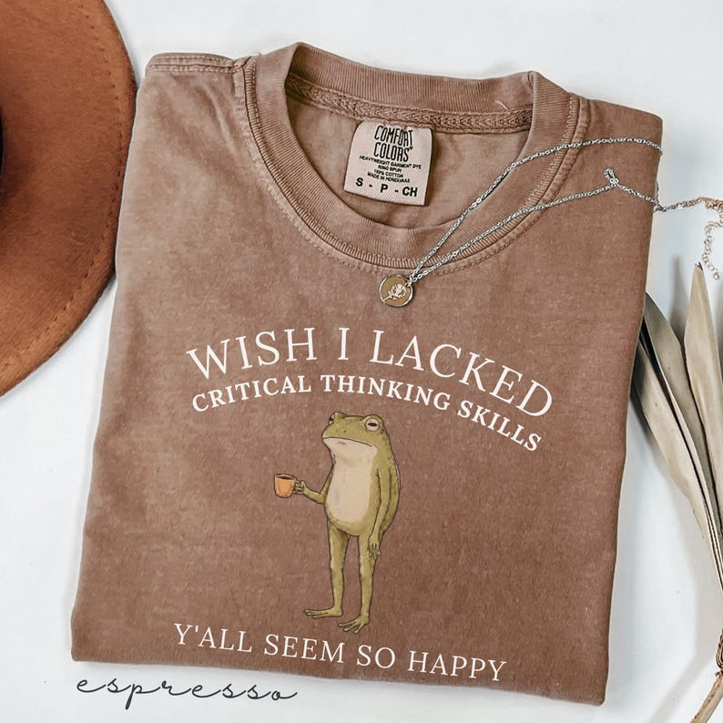

# DLS-ETSY-011 — Wish I Lacked Critical Thinking Skills Shirt, Comfort Colors® Funny Sarcastic Quote Tee, Overthinker Gift, Frog Meme Graphic T-Shirt

Status: collected front-design reference; back unverified. No family synthesis.

- Product: https://www.etsy.com/listing/4543877737/wish-i-lacked-critical-thinking-skills
- Seller: PhoenixSparkStudio; Etsy. https://www.etsy.com/shop/PhoenixSparkStudio
- Discovery: https://www.etsy.com/market/bestselling_tshirts; page 1, card position 13 (includes ads in numbering), Relevancy order, 2026-10-20. Sponsored cards skipped. Listing-level **Bestseller** button observed in live product page; evidence excerpt retained in batch JSON.
- Commercial signal: Etsy listing-level Bestseller badge. Not an audited sales count, global ranking, or proof that design caused demand. Mixed garment listings may aggregate tee/sweatshirt variants.
- Source image: https://i.etsystatic.com/57071292/r/il/6ab293/8299606512/il_794xN.8299606512_selm.jpg
- SHA-256: `a06047b62f26e85592dc99ce2ad818115af2a9c853ae05d2266ff37ce66dd780`. Original displayed CDN image, no editing; promotional mockup, not physical sample. Apparel variant chosen visually; decorative props and seller overlays are not part of print.
- Eligibility: complete predefined adult tee front; no observed licensed character or celebrity. Back unverified. Garment color/cut below are observations; fabric, print method and physical dimensions unverified unless explicitly attributed.
- Deduplication: not a recolor of another accepted listing in this route; cross-source reconciliation pending. Prior discovery IDs001–004 preserved separately and not silently recounted.

## Visual observation

Brown/espresso crew-neck folded flat. Cream serif text arcs in two lines above slim standing frog holding orange cup; final line straight below. Muted olive frog small relative to broad type arc. Open chest composition, no frame; necklace/hat/color-name overlay excluded from design description.

## Limits

Approximate mockup relationships only. No exact font identification, demographic assumption or recipe-family assignment. Listing keyword/title claims, stars, shop sales and Star Seller status do not substitute for the observed Bestseller badge.
