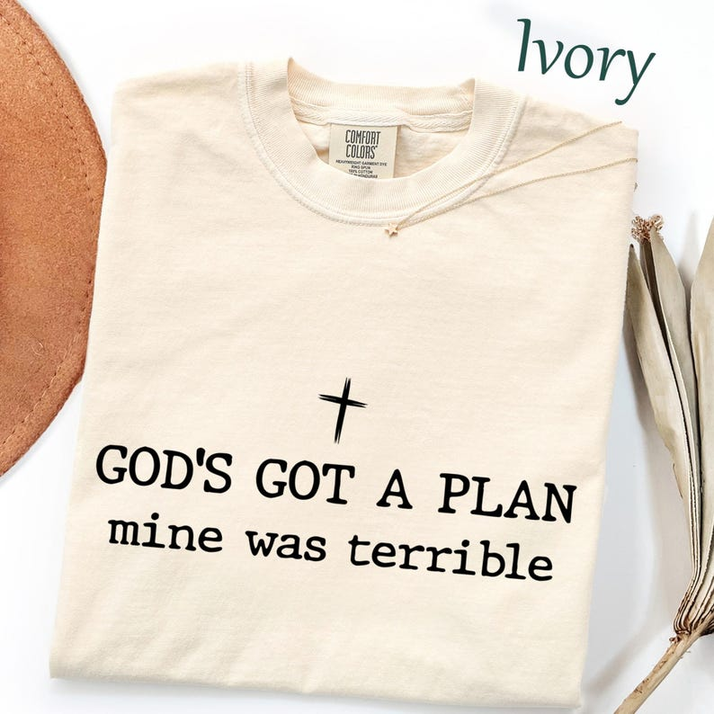

# DLS-ETSY-013 — Comfort Colors God's Got A Plan Mine Was Terrible Shirt, Funny Christian T-Shirt, Faith Humor Shirt, Religious Women Gift, Trendy Church Tee

Status: collected front-design reference; back unverified. No family synthesis.

- Product: https://www.etsy.com/listing/4554108792/comfort-colors-gods-got-a-plan-mine-was
- Seller: GardenGraceTX; Etsy. https://www.etsy.com/shop/GardenGraceTX
- Discovery: https://www.etsy.com/market/bestselling_tshirts; page 1, card position 15 (includes ads in numbering), Relevancy order, 2026-10-20. Sponsored cards skipped. Listing-level **Bestseller** button observed in live product page; evidence excerpt retained in batch JSON.
- Commercial signal: Etsy listing-level Bestseller badge. Not an audited sales count, global ranking, or proof that design caused demand. Mixed garment listings may aggregate tee/sweatshirt variants.
- Source image: https://i.etsystatic.com/65030945/r/il/bdec8f/8542878945/il_794xN.8542878945_8nek.jpg
- SHA-256: `37ae7d68c4184bf5146b7e2e2a6a3b683218ae5b25ff7103c5082322e3259db5`. Original displayed CDN image, no editing; promotional mockup, not physical sample. Apparel variant chosen visually; decorative props and seller overlays are not part of print.
- Eligibility: complete predefined adult tee front; no observed licensed character or celebrity. Back unverified. Garment color/cut below are observations; fabric, print method and physical dimensions unverified unless explicitly attributed.
- Deduplication: not a recolor of another accepted listing in this route; cross-source reconciliation pending. Prior discovery IDs001–004 preserved separately and not silently recounted.

## Visual observation

Ivory crew-neck folded flat. Small black cross above two-line typewriter-like statement; uppercase first line and lowercase second line at similar overall width. Medium-wide low-height chest composition, no frame or illustration beyond cross. Extensive plain cream fabric; necklace and color label are staging.

## Limits

Approximate mockup relationships only. No exact font identification, demographic assumption or recipe-family assignment. Listing keyword/title claims, stars, shop sales and Star Seller status do not substitute for the observed Bestseller badge.
