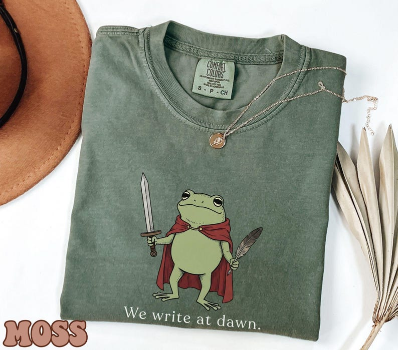

# DLS-ETSY-015 — Comfort Colors Frog Writer's Shirt, Funny Author Gift, Poet Shirt Gift for Writers Teacher Shirt, Creative Writing Shirt, Book Lover Tee

Status: collected front-design reference; back unverified. No family synthesis.

- Product: https://www.etsy.com/listing/4493164107/comfort-colors-frog-writers-shirt-funny
- Seller: CuteNovelTeez; Etsy. https://www.etsy.com/shop/CuteNovelTeez
- Discovery: https://www.etsy.com/market/bestselling_tshirts; page 1, card position 18 (includes ads in numbering), Relevancy order, 2026-10-20. Sponsored cards skipped. Listing-level **Bestseller** button observed in live product page; evidence excerpt retained in batch JSON.
- Commercial signal: Etsy listing-level Bestseller badge. Not an audited sales count, global ranking, or proof that design caused demand. Mixed garment listings may aggregate tee/sweatshirt variants.
- Source image: https://i.etsystatic.com/55061753/r/il/f0019c/7942065098/il_794xN.7942065098_8y3d.jpg
- SHA-256: `39d5a63882726e621abd383a862fb206d82c6845c2baf3929b4b9743e40d97a9`. Original displayed CDN image, no editing; promotional mockup, not physical sample. Apparel variant chosen visually; decorative props and seller overlays are not part of print.
- Eligibility: complete predefined adult tee front; no observed licensed character or celebrity. Back unverified. Garment color/cut below are observations; fabric, print method and physical dimensions unverified unless explicitly attributed.
- Deduplication: not a recolor of another accepted listing in this route; cross-source reconciliation pending. Prior discovery IDs001–004 preserved separately and not silently recounted.

## Visual observation

Moss-green folded crew-neck. Medium upright cartoon frog in red cape holding sword and feather/quill; small pale serif caption below. Muted olive body against green fabric, red cape supplies strongest accent. Single central figure without frame or dense text; jewelry, hat and MOSS label are external styling.

## Limits

Approximate mockup relationships only. No exact font identification, demographic assumption or recipe-family assignment. Listing keyword/title claims, stars, shop sales and Star Seller status do not substitute for the observed Bestseller badge.
