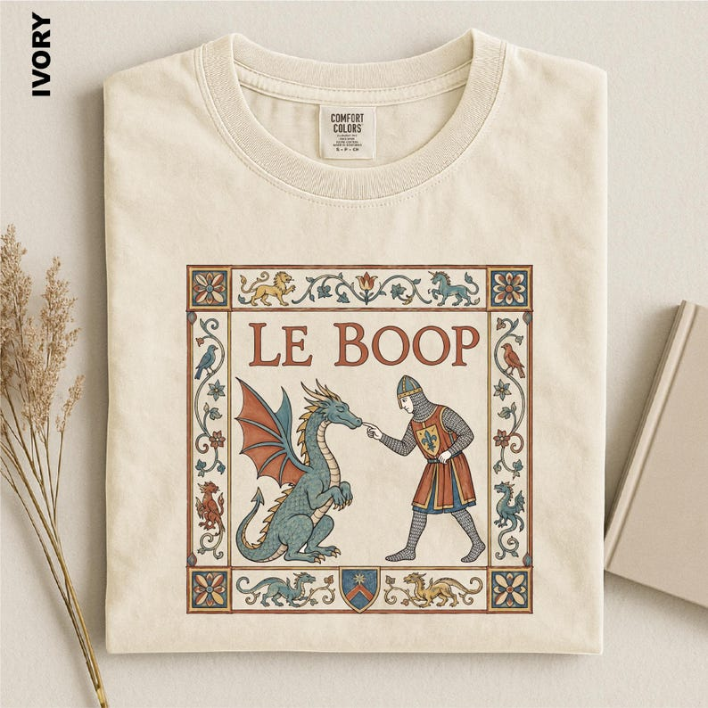

# DLS-ETSY-016 — Le Boop Dragon Shirt, Comfort Colors Medieval Tee, Funny Knight and Dragon Sweatshirt, Fantasy Meme Lover Gift, Renaissance Fair Apparel

Status: collected front-design reference; back unverified. No family synthesis.

- Product: https://www.etsy.com/listing/4545932867/le-boop-dragon-shirt-comfort-colors
- Seller: SunsetAndStitchCo; Etsy. https://www.etsy.com/shop/SunsetAndStitchCo
- Discovery: https://www.etsy.com/market/bestselling_tshirts; page 1, card position 19 (includes ads in numbering), Relevancy order, 2026-10-20. Sponsored cards skipped. Listing-level **Bestseller** button observed in live product page; evidence excerpt retained in batch JSON.
- Commercial signal: Etsy listing-level Bestseller badge. Not an audited sales count, global ranking, or proof that design caused demand. Mixed garment listings may aggregate tee/sweatshirt variants.
- Source image: https://i.etsystatic.com/57426174/r/il/1c7318/8358964025/il_794xN.8358964025_tda5.jpg
- SHA-256: `b634b7f1494903c47fcf455500747ce0b2b4ef1f7d512276be6ebf96baaddd1c`. Original displayed CDN image, no editing; promotional mockup, not physical sample. Apparel variant chosen visually; decorative props and seller overlays are not part of print.
- Eligibility: complete predefined adult tee front; no observed licensed character or celebrity. Back unverified. Garment color/cut below are observations; fabric, print method and physical dimensions unverified unless explicitly attributed.
- Deduplication: not a recolor of another accepted listing in this route; cross-source reconciliation pending. Prior discovery IDs001–004 preserved separately and not silently recounted.

## Visual observation

Ivory folded crew-neck with medium tall illuminated-manuscript-style rectangular panel. Muted rust, teal and ochre decorative floral border encloses knight reaching toward dragon nose; large serif LE BOOP above. Fine outlines, ornamental corner squares and warm garment ground create aged storybook treatment. Hard frame retained as observed, not filtered out.

## Limits

Approximate mockup relationships only. No exact font identification, demographic assumption or recipe-family assignment. Listing keyword/title claims, stars, shop sales and Star Seller status do not substitute for the observed Bestseller badge.
