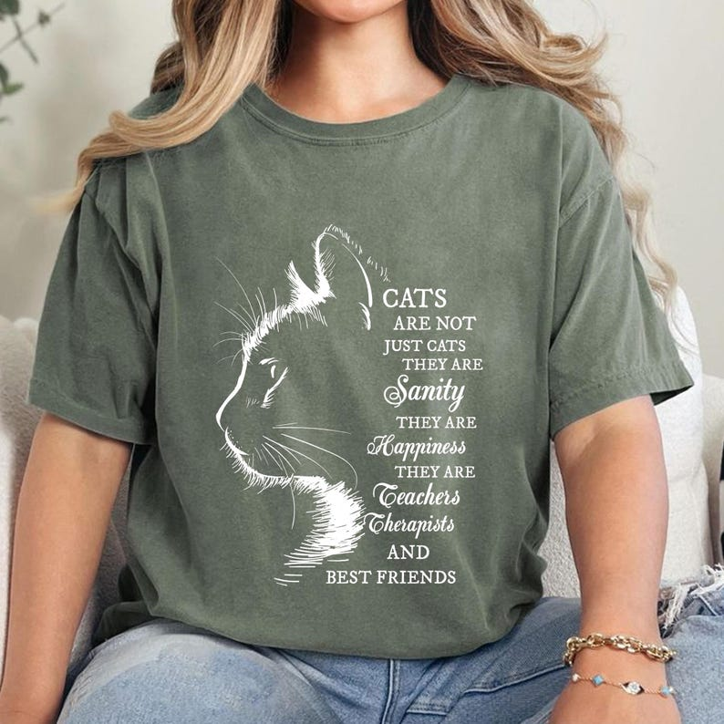

# DLS-ETSY-018 — Cat Lover Shirt: Feline Therapy Tee, Inspirational Cat Quote

Status: collected front-design reference; back unverified. No family synthesis.

- Product: https://www.etsy.com/listing/1871727014/cat-lover-shirt-feline-therapy-tee
- Seller: PrintFlairUS; Etsy. https://www.etsy.com/shop/PrintFlairUS
- Discovery: https://www.etsy.com/market/bestselling_tshirts; page 1, card position 31 (includes ads in numbering), Relevancy order, 2026-10-20. Sponsored cards skipped. Listing-level **Bestseller** button observed in live product page; evidence excerpt retained in batch JSON.
- Commercial signal: Etsy listing-level Bestseller badge. Not an audited sales count, global ranking, or proof that design caused demand. Mixed garment listings may aggregate tee/sweatshirt variants.
- Source image: https://i.etsystatic.com/54828039/r/il/57b606/6703788406/il_794xN.6703788406_oqcj.jpg
- SHA-256: `24c0b5a644bb210419665af73f719b4fedd0d45b8176dbd69d5cbc5084f609b9`. Original displayed CDN image, no editing; promotional mockup, not physical sample. Apparel variant chosen visually; decorative props and seller overlays are not part of print.
- Eligibility: complete predefined adult tee front; no observed licensed character or celebrity. Back unverified. Garment color/cut below are observations; fabric, print method and physical dimensions unverified unless explicitly attributed.
- Deduplication: not a recolor of another accepted listing in this route; cross-source reconciliation pending. Prior discovery IDs001–004 preserved separately and not silently recounted.

## Visual observation

Muted green roomy crew-neck on seated model. Large white cat profile at left formed with fine fur strokes and garment-color voids; multi-line mixed serif/script sentimental copy at right. Tall two-column unit, no outside frame. Image and message share height; small wording requires close reading. Same listing as sponsored27, accepted only once at organic31.

## Limits

Approximate mockup relationships only. No exact font identification, demographic assumption or recipe-family assignment. Listing keyword/title claims, stars, shop sales and Star Seller status do not substitute for the observed Bestseller badge.
