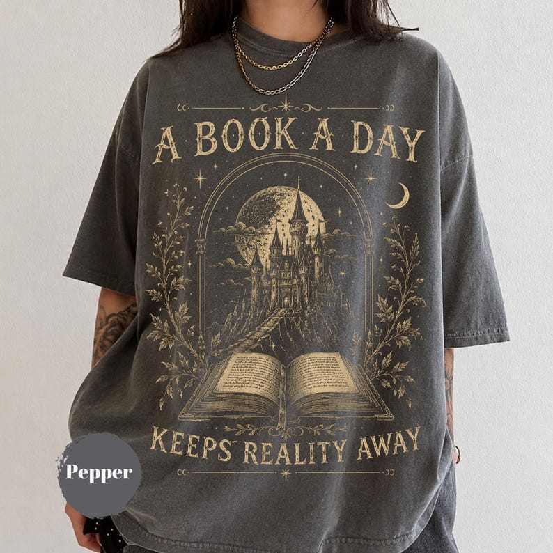

# DLS-ETSY-020 — A Book a Day Dragon Shirt, Fantasy Dragon Reader Graphic Tee, Book Club Apparel, Comfort Colors® Book Lover Gift, Cozy Bookworm Tshirt

Status: collected front-design reference; back unverified. No family synthesis.

- Product: https://www.etsy.com/listing/4537201603/a-book-a-day-dragon-shirt-fantasy-dragon
- Seller: OldRetroTees; Etsy. https://www.etsy.com/shop/OldRetroTees
- Discovery: https://www.etsy.com/market/bestselling_tshirts; page 1, card position 34 (includes ads in numbering), Relevancy order, 2026-10-20. Sponsored cards skipped. Listing-level **Bestseller** button observed in live product page; evidence excerpt retained in batch JSON.
- Commercial signal: Etsy listing-level Bestseller badge. Not an audited sales count, global ranking, or proof that design caused demand. Mixed garment listings may aggregate tee/sweatshirt variants.
- Source image: https://i.etsystatic.com/64063130/r/il/4e2146/8247287818/il_794xN.8247287818_g5al.jpg
- SHA-256: `e9b030cdc2d3788b402ceec87db63bf1a7d2023db09f8f94e00660e56e46bcc7`. Original displayed CDN image, no editing; promotional mockup, not physical sample. Apparel variant chosen visually; decorative props and seller overlays are not part of print.
- Eligibility: complete predefined adult tee front; no observed licensed character or celebrity. Back unverified. Garment color/cut below are observations; fabric, print method and physical dimensions unverified unless explicitly attributed.
- Deduplication: not a recolor of another accepted listing in this route; cross-source reconciliation pending. Prior discovery IDs001–004 preserved separately and not silently recounted.

## Visual observation

Washed charcoal roomy crew-neck on model. Large muted gold illustration of open book opening toward tall castle under arch, stars, crescent moon and foliage. Arched large serif setup across top and matching ending below; fine ornamental rules. Image spans much of torso, garment dark supplies interior shadows; single gold-like ink appearance unverified as actual ink.

## Limits

Approximate mockup relationships only. No exact font identification, demographic assumption or recipe-family assignment. Listing keyword/title claims, stars, shop sales and Star Seller status do not substitute for the observed Bestseller badge.
