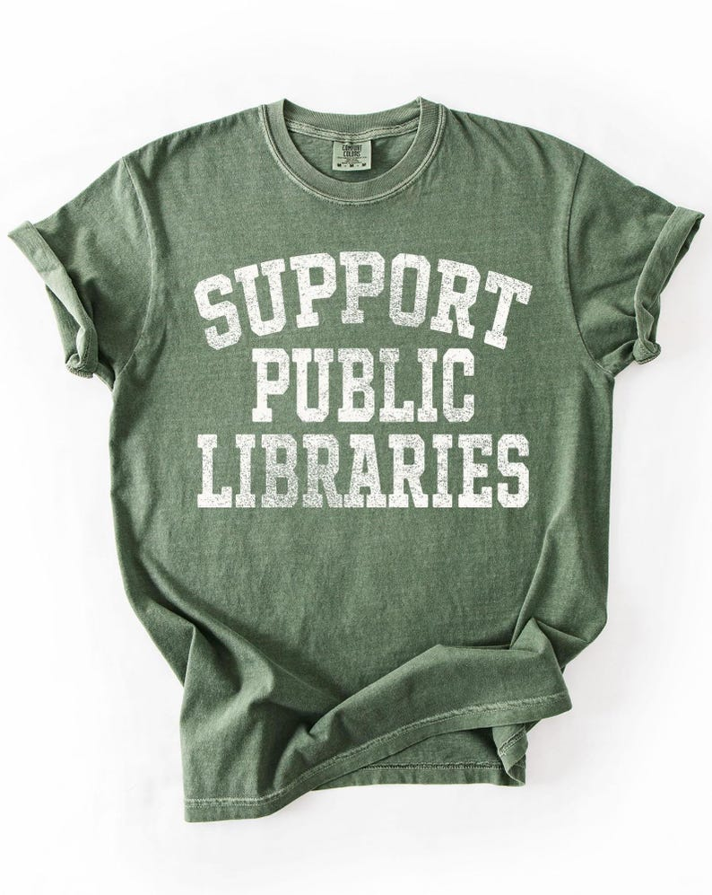

# DLS-ETSY-023 — Library Shirt, Support Public Libraries, Librarian TShirt, Gift for Reader, Reading T Shirt, Book Lover T-Shirt, Bookworm, Bibliophile Gifts

Status: collected front-design reference; back unverified. No family synthesis.

- Product: https://www.etsy.com/listing/4394005075/library-shirt-support-public-libraries
- Seller: ShopElleByers; Etsy. https://www.etsy.com/shop/ShopElleByers
- Discovery: https://www.etsy.com/market/bestselling_tshirts; page 1, card position 46 (includes ads in numbering), Relevancy order, 2026-10-20. Sponsored cards skipped. Listing-level **Bestseller** button observed in live product page; evidence excerpt retained in batch JSON.
- Commercial signal: Etsy listing-level Bestseller badge. Not an audited sales count, global ranking, or proof that design caused demand. Mixed garment listings may aggregate tee/sweatshirt variants.
- Source image: https://i.etsystatic.com/5268423/r/il/aabad9/7329008422/il_794xN.7329008422_8wgt.jpg
- SHA-256: `e2e0853e11834d3cc4df05b542e315f2cd0b02dd66ddc022a3c317ddd407702a`. Original displayed CDN image, no editing; promotional mockup, not physical sample. Apparel variant chosen visually; decorative props and seller overlays are not part of print.
- Eligibility: complete predefined adult tee front; no observed licensed character or celebrity. Back unverified. Garment color/cut below are observations; fabric, print method and physical dimensions unverified unless explicitly attributed.
- Deduplication: not a recolor of another accepted listing in this route; cross-source reconciliation pending. Prior discovery IDs001–004 preserved separately and not silently recounted.

## Visual observation

Muted green crew-neck flat laid with rolled cuffs/hem. Three large off-white varsity slab-capital lines, SUPPORT arched while PUBLIC and LIBRARIES straight. Strong distressed texture through thick strokes, no illustration or frame. Broad chest-sized typography with tight vertical rhythm; garment green visible through worn letter interiors.

## Limits

Approximate mockup relationships only. No exact font identification, demographic assumption or recipe-family assignment. Listing keyword/title claims, stars, shop sales and Star Seller status do not substitute for the observed Bestseller badge.
