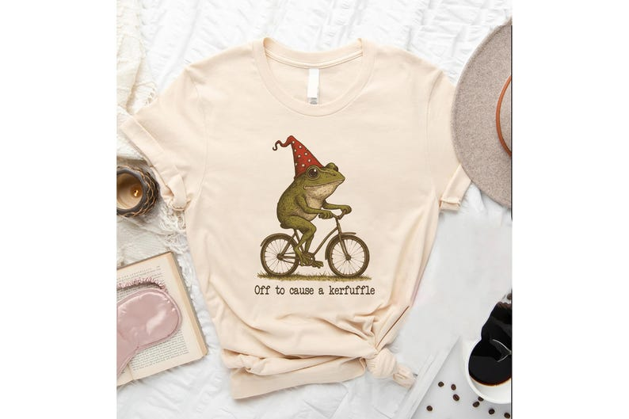

# DLS-ETSY-026 — Off to Cause a Kerfuffle Frog Tshirt, Sarcastic Shirts, Funny Sayings, Adult Humor Shirt, Frog Meme Shirt, Mental Health Shirt, Funny Shirts

Status: collected front-design reference; back unverified. No family synthesis.

- Product: https://www.etsy.com/listing/4334740351/off-to-cause-a-kerfuffle-frog-tshirt
- Seller: KavasClothing; Etsy. https://www.etsy.com/shop/KavasClothing
- Discovery: https://www.etsy.com/market/bestselling_tshirts; page 1, card position 57 (cumulative 57) (includes ads in numbering), Relevancy order, 2026-10-20. Sponsored cards skipped. Listing-level **Bestseller** button observed in live product page; evidence excerpt retained in batch JSON.
- Commercial signal: Etsy listing-level Bestseller badge. Not an audited sales count, global ranking, or proof that design caused demand. Mixed garment listings may aggregate tee/sweatshirt variants.
- Source image: https://i.etsystatic.com/54218318/r/il/ceeeaf/7064311905/il_794xN.7064311905_kty8.jpg
- SHA-256: `849e1d0f02f843a04ca9b1c6f7eb2f6c8a1951b58d463735d394881c49861a63`. Original displayed CDN image, no editing; promotional mockup, not physical sample. Apparel variant chosen visually; decorative props and seller overlays are not part of print.
- Eligibility: complete predefined adult tee front; no observed licensed character or celebrity. Back unverified. Garment color/cut below are observations; fabric, print method and physical dimensions unverified unless explicitly attributed.
- Deduplication: not a recolor of another accepted listing in this route; cross-source reconciliation pending. Prior discovery IDs001–004 preserved separately and not silently recounted.

## Visual observation

Cream crew-neck flat laid with knotted hem. Small-to-medium vintage naturalistic frog riding bicycle, wearing red pointed polka-dot hat; tiny dark caption beneath. Olive/brown palette with red accent; compact centered isolated scene and broad blank garment space. No border or oversized type.

## Limits

Approximate mockup relationships only. No exact font identification, demographic assumption or recipe-family assignment. Listing keyword/title claims, stars, shop sales and Star Seller status do not substitute for the observed Bestseller badge.
